# SAA-Nishiki（二式）

**English** | [日本語](docs/README.ja.md) | [简体中文](docs/README.zh-CN.md)

A fork of [Character Select SAA](https://github.com/mirabarukaso/character_select_stand_alone_app) — a stand-alone app with AI prompt, semi-auto tag complete and ComfyUI / Forge Neo (WebUI) API support.
Nishiki adds Japanese tag translation, a row-based prompt editor with tag chips, Parts, Diffusion (Anima) as a model type of its own with Cast and Prose, images that keep the recipe they were made with, a Library, a LoRA catalog with sample grids, an AI prompt refiner, a fast generation mode and a Runpod pod target.

Current release: **v4.1.0** — on upstream SAA 2.8.9. See [Releases](https://github.com/FUMIHITO-EGUCHI/saa-nishiki/releases) for downloads and release notes.

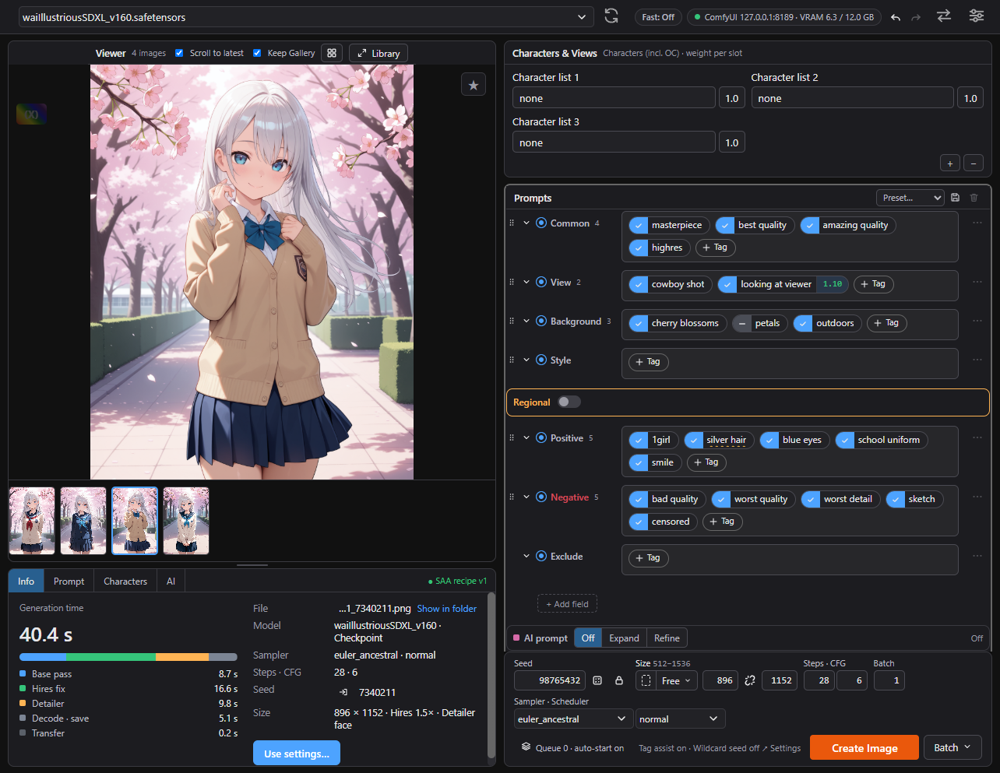

## Table of contents
- [What Nishiki adds](#what-nishiki-adds)
- [Install and run](#install-and-run)
- [Update](#update)
- [Highlights (inherited from upstream)](#highlights)
- [AI prompt](#ai-prompt)
- [Image API Interface](#image-api-interface)
- [FAQ](#faq)

------

# What Nishiki adds

## Japanese tag translation and localization
- Search and display tags in Japanese through a dictionary of about 100k entries covering the merged danbooru / e621 tag list (`data/danbooru_e621_merged_ja.csv`). Every group but the artists and e621 Character is reviewed down to heat 10 (ten posts).
- The tag search ranks the whole dictionary, prefix matches first and the popular tag first within a band, and loads the next 50 rows as you scroll; the last line counts the matches. A row shows the translation and the alias it matched by, and a space in the typed word matches the `_` of a tag (`white d` finds `white_dress`).
- Localized character and official-work names, plus tag category labels. The tag search and the character picker show the same names.
- Select `ja-JP` as the UI language in Settings. Tags, names and categories are shown in Japanese; UI strings that have no Japanese entry fall back to English.

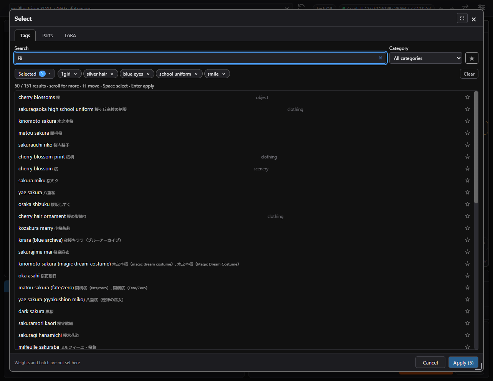

## Prompt editor
The Prompts card is one list of rows: Common, View, Background, Style, Positive, Negative, Exclude and the rows you add. Each row shows its tags as **chips**; the grip moves the row, the ● switch mutes it, a double-click on the name renames it, and the ⋯ menu holds the rest (Show as text / Show as chips, Insert part…, Weights per image…, Presets…, Make negative / Make positive, Rename, Delete field). `+ Add field` adds a row of your own. The final prompt is assembled from the rows in their order.

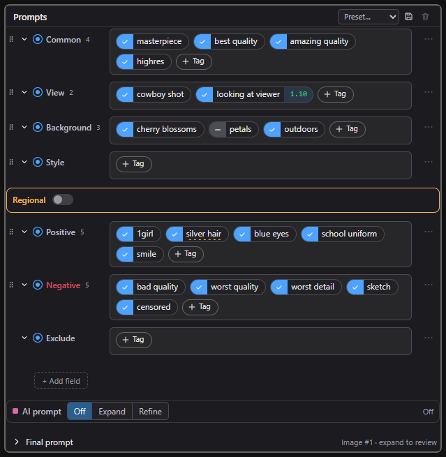

- **Chips.** A chip shows its state at the left (✓ on, − off, ★ favourite, × excluded) and its weight or weight plan at the right. A click on the ✓ switches the tag off without deleting it. `+ Tag` opens the tag picker with its Tags, Parts and LoRA tabs.
- **Weight popover.** A click on a chip opens its weight (`Ctrl + Up / Down` in text view), a weight plan for batches, the related tags (co-occurrence and the same word family, offline from `data/tag_related.txt`), its translation and ★ for the favourites. Grouped weights such as `(a, b:1.2)` are one chip.
- **Move tags between rows.** Drag a chip within its row or onto another row (hold `Ctrl` or `Alt` to copy), or use `Move to…` / `Copy to…` in the right-click menu. The weight and the off state travel with the tag; one drop is one undo step.
- **Select several tags.** `Ctrl + click` toggles a chip, `Shift + click` extends the selection, `Ctrl + A` selects every chip in the row, `Esc` clears. A selection drags, deletes and switches together, and the right-click menu acts on it (`Disable tag (3)`, `Move to (3)`, …).
- **The View row.** Angle, camera and composition are ordinary tags and parts in the View row, with the weights and the search of any other row.
- **Presets.** Each row has its own presets (⋯ → Presets…); the card's preset stores the whole layout (rows, names, order and content) and restores it exactly.
- **Dictionary marks.** A chip whose tag is not in the dictionary gets a wavy underline, because SDXL models mostly ignore such words: in tests `long staff` and `ancient staff` changed nothing, while the real tag `wooden staff` changed the staff every time. A chip that reads like a sentence (four or more words and not a known tag) is drawn dashed and italic and sent as written. LoRA tokens, wildcards and random groups are never marked.
- **Post counts.** A tag under 100 posts gets a yellow dotted mark and one under 1,000 a grey one; the popover shows the count. It is the Danbooru / e621 count, a hint only, and is not shown for Diffusion.

## Parts
A favourite bundle of tags can be saved as one `parts:<name>` chip. Its weight carries to the tags inside, and mute, the final prompt, AI Refine, Prose and the batch expansion all see the same tags. The Parts tab of the tag picker lists them by category with a sample grid; a part can be created from the current tags, edited, expanded back into tags or swapped for another, and can carry LoRAs of its own. A starter set of 295 parts (outfit, hair, body, background, camera, composition, tone, pose, expression, …) ships with the app. Parts are stored in `settings/parts.json`, their samples in `settings/parts/`.

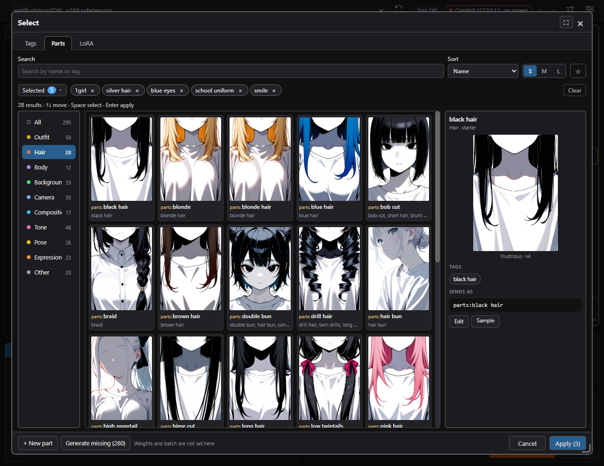

## Weight batches
Give a tag a **weight plan** (start, step, end) in its popover, or use ⋯ → Weights per image… on a row, and run a batch: SAA walks the plan one image at a time, keeping the seed fixed so only the weight changes. The `÷ batch count` option derives the step from the batch size. A warning appears when you start a batch with a non-random seed.

## Characters, favorites and list manager
- The Characters card holds as many character slots as you need (`+` / `−`), each with its weight. While Regional is on, each slot carries its side.
- Characters and original characters are chosen in a searchable picker with translations and a **favorites** group. Search finds a character by name in English, Chinese or Japanese and by the work it belongs to (`艦これ`, `kantai collection`, `FGO`).
- **List manager** (Settings → Lists): add, override or hide entries of the character / OC / angle / camera lists. Upstream data stays read-only; your edits are saved as a diff in `settings/user_lists.json` and can be exported and imported. List entries can carry multi-tag prompts, and the tag picker is available inside the entry editor.

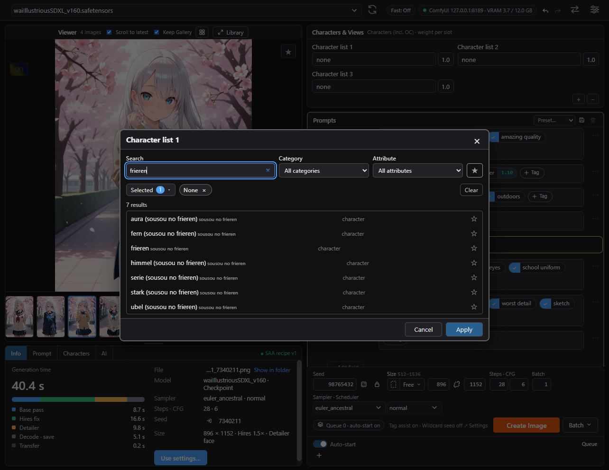

## Diffusion (Anima)
Diffusion is a model type of its own beside Checkpoint, with its own sampler, scheduler, steps, CFG, size, Hires, Regional and prompts, so switching types never carries one type's settings into the other.
- **Cast.** Every character slot gets an alias and a prompt row of its own, and the Action row says who does what with `@alias`.
- **Prose.** Anima reads English, not Danbooru tags, so before the image request goes out the assembled tags are rewritten as one English paragraph, written from the same resolved tags the image uses (the same wildcards and the same weights). The paragraph can be edited, reverted or asked for again. The writer is the LLM of the AI card (Ollama, local or on the pod) or the **Student**, a Qwen3.5-2B LoRA distilled from a 35B model, which SAA runs on its own llama-server (Settings → AI names the executable, the GGUF and the port; neither ships with the app). About a second a paragraph on a 12 GB card next to ComfyUI.
- **Artist.** A dictionary of what 17,716 Danbooru artists draw, searchable by name or subject (`cat ears` finds the artists who draw them), with up to three artists per image.
- **Regional and Panels** work for Diffusion too (see [Regional Condition / Couple](#regional-condition--couple)).

## Images keep their recipe
- Every image SAA makes carries what made it (the editor as Generate found it, the seed, the character a Random slot picked, the prompts sent, the AI answer, the Prose paragraph, what Fast mode sent) and how long each step took, as the `saa_recipe` and `saa_time` text chunks of the PNG. The time is written for a ComfyUI on the same machine.
- **Viewer.** The Info tab shows the image on show: the time as a bar and a legend, the file, model, sampler, steps, CFG, the seed (with a button that puts it in the Seed field), the size and passes, and the LoRAs that ran. Images made elsewhere are read from their PNG chunks. The Prompt tab holds the run's text; the star keeps an image, and the arrows step through them.
- **Use settings…** opens an image's recipe beside the editor, one checkbox per section (tags per row, Prose, LoRA, model and sampler, size and passes, Regional, seed). The rows that differ start checked; checking them all makes the picture again. An image with only A1111 parameters loads too. Loading is one undo step.
- **Library.** The Library button opens every image in ComfyUI's output folder and the pod's save folder, by folder and day, with views for this session, the starred images and those with a recipe, a search over prompt, characters, LoRA, model, seed and file name, and filters. The side panel offers Use settings…, the star, Show in folder and Move to trash. The index and thumbnails are kept in `settings/library/` and can be rebuilt from the images.

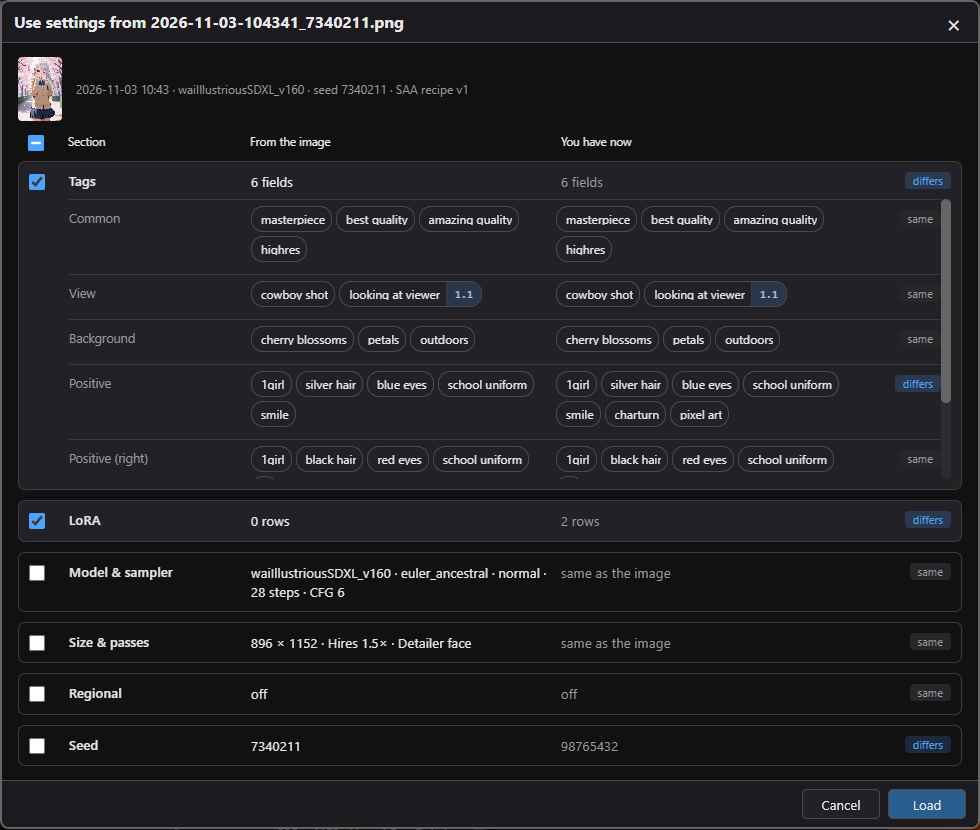 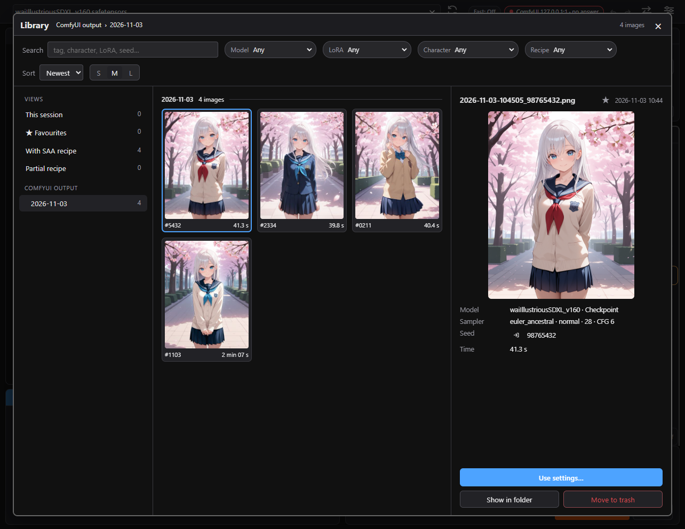

## LoRA catalog and LoRA card
- **LoRA tab.** The tag picker's LoRA tab shows every LoRA as its sample grid: the LoRA off, then five weights over its range, on the current model with one seed, so the effect shows without a description. A side panel sets the default weight, the range of the samples (Take samples / Retake, with a sample prompt per LoRA or a default for all), the trigger words, the tags it is suggested for and a name of your own. The guesses come from the `.safetensors` header only; Civitai is asked only from its button, by the file's sha256. The catalog lives in `settings/loras.json`, the samples in `settings/loras/`.
- **LoRA card.** Each LoRA is one row: an on/off switch, the name, its trigger words (a click takes one out of the prompt or puts it in), a slider with ticks at the sample weights and the number (the wheel steps 0.05, 0.25 with Shift). The fold holds the stage (All, Base, Hires), CLIP, the range and the trigger words. Switching a row off also takes its trigger words out of the prompt. `+ LoRA` opens the LoRA tab alone.
- **Tags and parts meet the LoRAs.** A chip that a LoRA is suggested for carries a `LoRA N` badge whose popover adds the LoRA; nothing is added without that click.

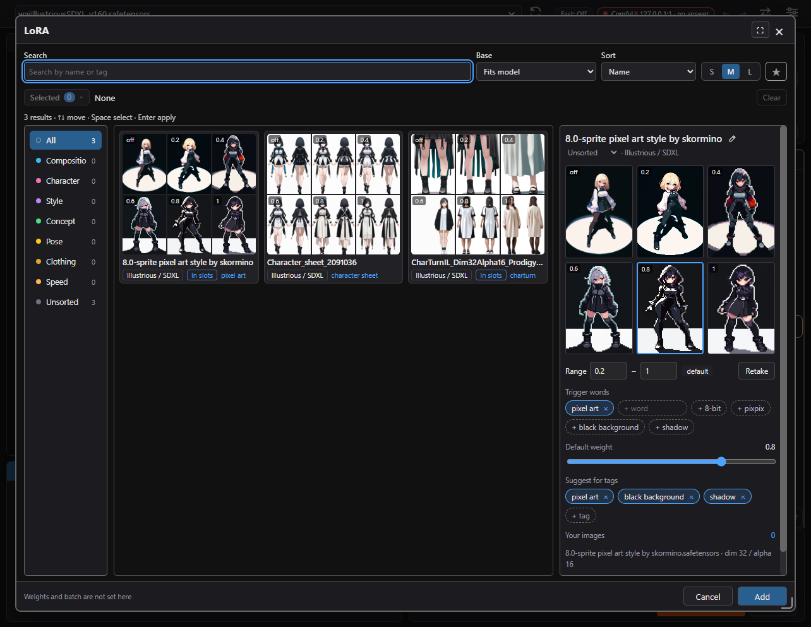 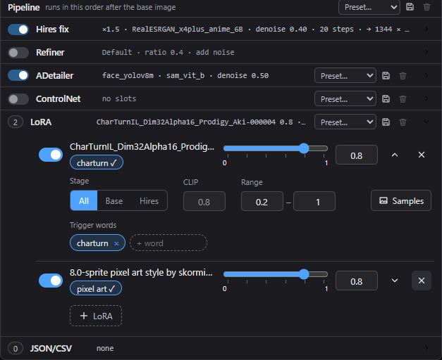

## Size and aspect ratio
The run bar's Size is `[turn | ratio ▾] [W] [chain] [H]`. The left half of the chip swaps width and height; the right half opens tiles for 1:1, 4:5, 3:4, A4 (1:√2), 2:3, Golden (1:φ), 9:16 and Free, each with the size it would give. A ratio keeps the pixel count on the 8 px grid; with the chain linked, typing one box moves the other along the ratio. The size boxes follow the model type's range (Checkpoint 512–1536, Diffusion 512–2048, the upper bound adjustable in Settings).

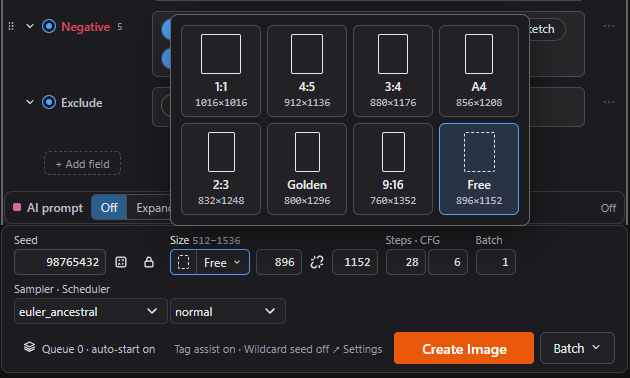

## Undo / redo
Every prompt edit, preset application and AI refine result is an atomic step in a global edit history. Use `Ctrl + Z` / `Ctrl + Shift + Z` (or `Ctrl + Y`) or the toolbar buttons.

## AI prompt refiner
In addition to upstream's remote / local `llama.cpp` AI prompt, Nishiki adds a **Refine** mode backed by [Ollama](https://ollama.com/). Refine rewrites the whole prompt with one structured request per batch before the first image, and applies the result row by row to the editor. Refine edits are recorded in the edit history and can be undone. A plain English action sentence among the tags (see *Who does what to whom* under Regional Condition) is kept as a sentence, not broken into tags.
While `Regional` is on, Refine rewrites both sides, the per-side negatives included. Everything generation adds - characters, JSON slots, Wildcards, slot LoRA - is left where it was and put back around the rewritten rows.
The AI result is shown in the **AI tab of the Info panel** instead of a pop-up after every generation.

## Fast generation mode
Settings → Backend → **Fast generation** applies a step-distillation LoRA (DMD2 / Hyper-SD / Lightning / LCM) and overrides steps, CFG, sampler and scheduler for the base, Hires fix and ADetailer passes. Works on the local ComfyUI and on the pod.
Measured on a RTX 4070 SUPER (600×1024, Hires 1.5x, ADetailer): 30 steps ≈ 29 s → DMD2 8 steps ≈ 16 s.

The Diffusion (Anima) model type has its own set: the Anima Turbo LoRA v0.2 at 0.8, 8 steps, CFG 1.5, euler / simple, plus the ComfyUI flags `--use-sage-attention --fast`. Those flags are process-wide, so before a run that needs other flags SAA restarts the local ComfyUI through Settings → Backend → ComfyUI process → launch command (which has to pass extra arguments on to `main.py`). SAA only takes away flags it launched ComfyUI with itself. Measured on a RTX 4070 (832×1216, waiANIMA): 25 steps ≈ 17–19 s → Turbo 8 steps with both flags ≈ 4.8 s. `--fast` shifts colours and small details a little. The LoRA works on the pod too; the flags only on the local ComfyUI.

The prompt's LoRAs reach the Hires and ADetailer passes as well, and the workflows keep one LoRA'd model through an image, so ComfyUI does not read the model file again within a run.

## The local ComfyUI, from inside SAA
Settings → Backend can start, restart and stop the local ComfyUI, and can bring it up together with SAA. Stop ends only the ComfyUI SAA talks to; anything else holding the port is named with its pid and program and ended only if you say so. A launch command runs only after you allow it once in a native dialog.

## Runpod pod target
Register a Runpod pod (SSH target and key) in Settings and switch image generation between **GPU: Local** and **GPU: Pod** with the status pill in the toolbar. Generated images stream back over SSH and are saved locally only; nothing is written to the pod's disks. The pod can also serve the LLM features (AI prompt / refine / Prose). `https` / `wss` backends with authentication are supported for pod endpoints.
The AI prompt / Refine requests go to an Ollama on the pod through the same SSH relay. Setup, the restore script for pod restarts and troubleshooting: [README_POD.md](docs/README_POD.md).

## UI shell
- New viewport layout, status pills, run progress indicators and dark / light themes.
- The colours of both themes come from one token file, `design/tokens.json`, which `scripts/buildThemeTokens.mjs` writes into the theme files; the icons come from one set, `scripts/shared/iconSet.js`.
- Every dialog has the same footer order: Cancel / No on the left, the primary button on the right. Esc takes the way out of the front dialog first.
- Context menus are specific to what you right-click: a chip, a prompt row, a gallery image, the AI field.

## Settings store
Settings are split into sections with a schema version:
- `settings/app.json` — application settings (backend, paths, AI, fast mode, pod)
- `settings/state.json` — prompt / generation / LoRA / ADetailer / ControlNet working state, kept per model type
- `settings/presets/<section>/<name>.json` — presets
- `settings/user_lists.json` — list manager diff
- `settings/parts.json`, `settings/parts/` — parts and their samples
- `settings/loras.json`, `settings/loras/` — the LoRA catalog and its samples
- `settings/library.json`, `settings/library/` — stars, ComfyUI's output folder, the Library index and thumbnails
- `settings/legacy/` — pre-split `settings/*.json` files, moved here on first start and never read again

Everything is autosaved with atomic writes. `settings/` is ignored by git except the bundled MiraITU workflow files.

## Versioning
Nishiki has its own semantic version since 3.0.0: minor for new features, patch for fixes. The upstream base is recorded as `upstreamBase` in `package.json` (2.8.9) and in the release notes; merging a newer upstream raises the minor version. Each release is a `v<version>` tag with a GitHub Release whose notes are the change log (`docs/CHANGELOGS.md` is upstream's).

------

> [!NOTE]
> If you find a character that isn't shown on the list but can be generated correctly, please raise an issue.
>
> The default thumbList is based on `waiIllustriousSDXL_v160`. Two alternative thumbLists, `waiANIMA_v10Base10` and `waiNSFWIllustrious_v120`, are downloaded automatically from `HuggingFace` once selected.
> Create your own thumbList with [SAA Thumb Generator](scripts/python/thumb-generator/README.md).

| Verified | [ComfyUI](https://github.com/comfyanonymous/ComfyUI)  | [Forge Neo](https://github.com/Haoming02/sd-webui-forge-classic/tree/neo) |
| --- | --- | --- |
| Release | 0.40.0 | 2.27 |
| Refiner (SDXL) | Yes | Yes |
| Image Color Transfer (ALL) | Yes | No |
| Regional Condition / Couple (SDXL/Anima) | Yes | Yes |
| ControlNet/IPA (SDXL) | Yes | Yes |
| ADetailer (ALL) | Yes | Yes |
| API authentication| No | Yes |
| MiraITU | Yes | No |
| Fast generation mode | Yes | No |
| Runpod pod target | Yes | No |

> [!IMPORTANT]
> `Regional Condition / Couple` and `ADetailer` on `Forge Neo` support `SDXL and Anima`;
> on `ComfyUI` they should support all diffusion models SAA supports (needs verification).
>
> *ComfyUI Desktop is not supported.*
> *A1111 was removed from the support list due to a lack of maintenance. It still works with SAA but is not tested.*
>
> *Online Character Select* [Hugging Face Space](https://huggingface.co/spaces/flagrantia/character_select_saa)
>
> For the browser-based SAAC, see [README_SAAC.md](docs/README_SAAC.md).
> For the Python CLI tool for OpenClaw, see [SAA Agent](scripts/python/saa-agent/README_HUMAN.md) and [ClawHub](https://clawhub.ai/mirabarukaso/saa-agent).

## thumbList manual download guide
<details>
<summary>If the download inside SAA is slow or fails, download the files manually.</summary>

Navigate to the [HF dataset](https://huggingface.co/datasets/flagrantia/character_select_stand_alone_app/tree/main), download the following files into the `data` folder and rename them as follows:

### waiIllustriousSDXL_v160
[waiIllustriousSDXL_v160_thumbs.json](https://huggingface.co/datasets/flagrantia/character_select_stand_alone_app/resolve/main/wai_character_thumbs_v160.json?download=true)

[waiIllustriousSDXL_v160_characters.csv](https://huggingface.co/datasets/flagrantia/character_select_stand_alone_app/raw/main/wai_characters_v160.csv)

[waiIllustriousSDXL_v160_tag_assist.json](https://huggingface.co/datasets/flagrantia/character_select_stand_alone_app/raw/main/waiIllustriousSDXL_v160_tag_assist.json)

### waiIllustriousSDXL_v120
[waiNSFWIllustrious_v120_thumbs.json](https://huggingface.co/datasets/flagrantia/character_select_stand_alone_app/resolve/main/wai_character_thumbs_v120.json?download=true)

[waiNSFWIllustrious_v120_characters.csv](https://huggingface.co/datasets/flagrantia/character_select_stand_alone_app/raw/main/wai_characters_v120.csv)

[waiNSFWIllustrious_v120_tag_assist.json](https://huggingface.co/datasets/flagrantia/character_select_stand_alone_app/raw/main/waiIllustriousSDXL_v160_tag_assist.json)

### waiANIMA_v10Base10
[waiANIMA_v10Base10_thumbs.json](https://huggingface.co/datasets/flagrantia/character_select_stand_alone_app/resolve/main/waiANIMA_v10Base10_thumbs.json?download=true)

[waiANIMA_v10Base10_characters.csv](https://huggingface.co/datasets/flagrantia/character_select_stand_alone_app/raw/main/waiANIMA_v10Base10_characters.csv)

[waiANIMA_v10Base10_tag_assist.json](https://huggingface.co/datasets/flagrantia/character_select_stand_alone_app/raw/main/waiANIMA_v10Base10_tag_assist.json)

</details>

# Install and run
> [!TIP]
> Set up your [Image API Interface](#image-api-interface) before you start SAA.
>
> For ComfyUI, you need the latest [ComfyUI_Mira](https://github.com/mirabarukaso/ComfyUI_Mira).
>
> *One-Click package v2.8.0 (upstream)*
> The full package [embeded_env_for_SAA](https://huggingface.co/datasets/flagrantia/character_select_stand_alone_app/resolve/main/embeded_env_for_SAA.zip)

Clone this repo into a local folder:
```
git clone https://github.com/FUMIHITO-EGUCHI/saa-nishiki.git
cd saa-nishiki
npm install
npm start
```

### Local CDP debugging (optional)

CDP is disabled by default. To let Chrome DevTools or a compatible MCP client inspect the Electron renderer, start SAA with a local debugging port:

```powershell
$env:SAA_CDP_PORT = "9222"
npm start
```

For a packaged executable, the equivalent option is:

```powershell
.\saa.exe --saa-cdp-port=9222
```

The DevTools endpoint is available at `http://127.0.0.1:9222/json/list` while SAA is running. Use a different port if `9222` is already occupied. Do not enable this option on an untrusted or publicly reachable machine because CDP can inspect and control the renderer.

### Tests: unit and end-to-end (maintainers)

`npm test` runs the unit suite (`tests/*.test.mjs`, about 1,400 tests) on an in-memory DOM in a few seconds. It pins how the components and the main-process modules behave; it does not model layout, scrolling or a real backend.

`npm run test:e2e` runs the end-to-end stories in `tests/e2e/*.e2e.mjs`: the real app (Electron, with a settings folder of its own) against the real local ComfyUI, driven the way a person drives it and judged by what ComfyUI was asked to run (`/history`) and by what the gallery received. It needs, on this machine:

- ComfyUI up at the address in `settings/app.json` (`SAA_E2E_COMFY=host:port` overrides), with the checkpoint and the diffusion model named in `settings/state.json` and the fast-mode LoRAs in its `loras` folder. The harness borrows these machine facts from the worktree's own settings and never writes to that folder.
- A few minutes: the images are 512 × 512 at four steps, one story file starts one app.

What it never does: restart ComfyUI (the app under test gets no launch command, so a launch-flag mismatch is logged and the run goes on), so the Diffusion fast set, which needs `--use-sage-attention --fast` at launch, is not covered.

Two things to know when writing a story:

- ComfyUI answers a prompt it already ran from its cache, and SAA reports that as an error ("running same prompt?"). Every launch gets a fresh seed (`freshSeed()`), and a story that reruns the same prompt sets another one (`app.setSeed`). A batch runs on seed `-1` (random): a fixed seed repeats the image, and the app asks before running such a batch.
- The app is started with `--saa-settings-dir=<folder>` (also `SAA_SETTINGS_DIR`), which is how a run keeps its own settings. `SAA_E2E_KEEP=1` leaves the run folder with `app.log` behind for a look after a failure.

# Update
> [!IMPORTANT]
> **Updating from GitHub does not update the dataset files.**
> Manually delete `danbooru_e621_merged.csv`, `*_thumbs.json`, `*_characters.csv`, `*_tag_assist.json` in the `data` folder, then restart the app to download the latest thumbnail database from HF.

```
git fetch
git pull
npm install
```

Settings, presets and the list-manager diff live in `settings/` and are never touched by an update.

------
# Highlights
The sections below are inherited from upstream SAA. Screenshots were retaken with the Nishiki UI where possible.

## Diffusion Models (UNET/CLIP/VAE) for ComfyUI and Forge Neo
> [!NOTE]
> Tested and verified: Anima / Qwen Image / Z Image / Flux / Krea2
> Supports ComfyUI and Forge Neo, NOT the original A1111.


> [!NOTE]
> Screenshot above is from the previous (upstream) UI.

<details>
<summary>Details about Diffusion Models</summary>

*For ComfyUI*, check [Comfy-Org@HF](https://huggingface.co/comfy-Org/)
`GGUF model` requires the custom node [gguf](https://github.com/calcuis/gguf) (the lower-case one).
```
|---models
|   |---checkpoints
|   |---diffusion_models
|   |---text_encoders
|   |---vae
```

*For Forge Neo*, check [Download Models@Haoming02](https://github.com/Haoming02/sd-webui-forge-classic/wiki/Download-Models)
Forge also supports the `GGUF model`, but the `Diffusion models` use the same `Checkpoint` folder. Manage those models with the correct folder yourself.
```
|---models
|   |---Stable-diffusion
|   |---text_encoder
|   |---VAE
```
</details>

## Mira Image Tiled Upscaler
> [!NOTE]
> MiraITU: a content-aware image super-resolution ComfyUI custom node based on vision models.
> Simply drag and drop ANY image into SAA/SAAC to upscale it.

| Before | 6x After (SDXL) | Before | 3x After (Flux.2) |
| --- | --- | --- | --- |
|    |   |    |   |

<details>
<summary>Details about MiraITU</summary>

Supports magnification scales from 1.5x to 8x. By adjusting tile sizes it can optimize VRAM usage, enabling 8GB graphics cards to upscale at 1.5x to 3x (or higher), while high-end cards with 24GB or more can reach 4x to 8x.

Requires [ComfyUI_Mira](https://github.com/mirabarukaso/ComfyUI_Mira) `0.5.6.0 or above`
Requires [MiraSubPack](https://github.com/mirabarukaso/ComfyUI_MiraSubPack) `latest`

And Image Tagger for [Mira](https://github.com/mirabarukaso/ComfyUI_Mira#tagger)

| Settings | Drag and Drop | Flux.2 |
| --- | --- | --- |
|  |    | 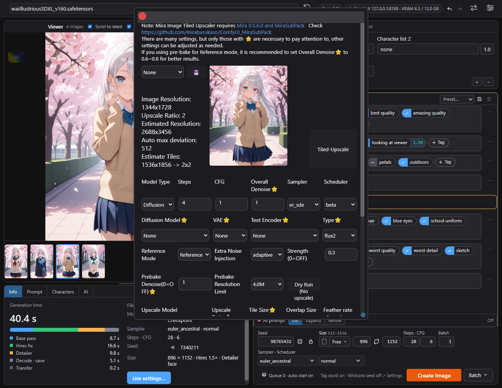   |

The generated results depend on the model. The `SDXL` model requires a `tagger` to provide precise content descriptions, and an `upscale model` is recommended. Models such as `Flux2`, which accept a `reference latent`, can skip the upscale model and stretch the original image directly; then use the `Positive Prompt` to configure all tiles consistently.

| Upscale Ratio 1024x1360(1536) | Tile Size | VAE 8G | VAE 24G~ |
| --- | --- | --- | --- |
| x1.5 | 768 | Full | Full |
| x2 | 1280 | Full/Tiled | Full |
| x3 | 1536 | Tiled | Full |
| x4 | 2048 | Tiled | Full |
| x6 | 2048/2560 | Tiled | Full |
| x8 | 2560/3072 | Tiled | Full/Tiled |

Note: due to limitations of the SDXL model, exceeding 8x magnification results in overly fragmented slices. For higher magnification use a dedicated ComfyUI workflow instead:
[ComfyUI Workflow MiraITU](https://github.com/mirabarukaso/ComfyUI_MiraSubPack/blob/main/examples/MiraITU_workflow.png)
</details>

## Image Tagger
Supports [WD@SmilingWolf](https://huggingface.co/SmilingWolf), [CL@cella110n](https://huggingface.co/cella110n/cl_tagger) and [Camie@Camais03](https://huggingface.co/spaces/Camais03/camie-tagger-v2-app) models in ONNX format.

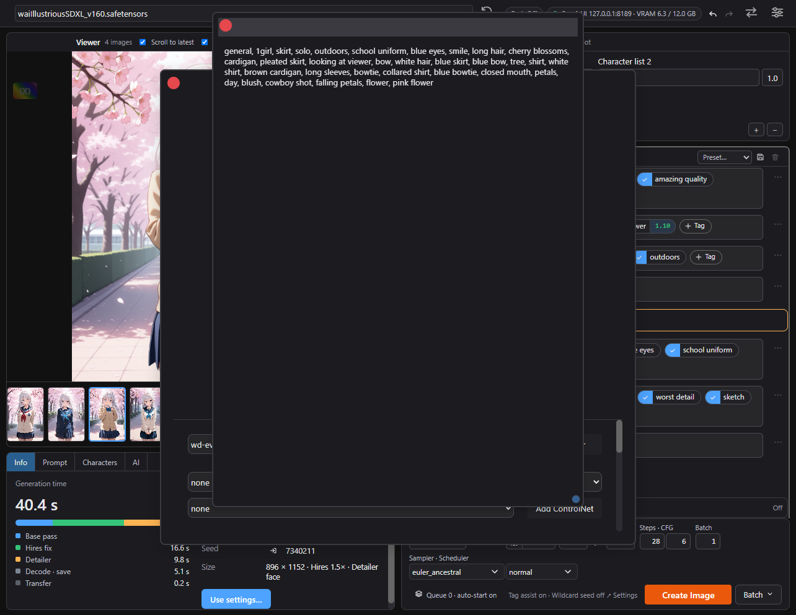

<details>
<summary>Details about Image Tagger</summary>

Download models with tags from [HF](https://huggingface.co), rename them according to the following rules, then copy them into the `models/tagger` folder:
  - cl_tagger_v2.onnx + cl_tagger_v2_tag_mapping.json
  - wd-eva02-large-tagger-v3.onnx + wd-eva02-large-tagger-v3_selected_tags.csv
  - wd-v1-4-convnext-tagger.onnx + wd-v1-4-convnext-tagger_selected_tags.csv

```
SAA
|---models
|   |---tagger
|       |---cl_tagger_1_02.onnx
|       |---cl_tagger_1_02_tag_mapping.json
|       |---wd-eva02-large-tagger-v3.onnx
|       |---wd-eva02-large-tagger-v3_selected_tags.csv
|       |---wd-vit-large-tagger-v3.onnx
|       |---wd-vit-large-tagger-v3_selected_tags.csv
|       |---camie-tagger-v2.onnx
|       |---camie-tagger-v2-metadata.json

Options:
Model Name  >>>  General Threshold(CL/WD/Camie)  >>>  Character Threshold(CL/WD)  >>> Categories(CL/Camie) or mCut(WD)
```

The Image Tagger runs on Node.js with `onnxruntime-node`. *It DOES NOT require any backend support*, but GPU acceleration does not seem to work.
Tagging is about 3 times slower than `Python` with `onnxruntime` in CPU mode, and 12 times slower than `onnxruntime-gpu`.
The good news: you can run the `Image tagger` while generating.

| Device | Avg Tagging Time | Model | Platform | Resolution | Recommend Value |
| --- | --- | --- | --- | --- | --- |
| onnxruntime | 1.053s | cl_tagger_1_02 | Python | 448 | 0.55/0.60 |
| onnxruntime-gpu | 0.297s | cl_tagger_1_02 | Python | 448 | 0.55/0.60 |
| onnxruntime-node | 3.185s | cl_tagger_1_02 | Electron(NodeJS@CPU) | 448 | 0.55/0.60 |
| onnxruntime-node | 2.917s | wd-eva02-large-tagger-v3 | Electron(NodeJS@CPU) | 448 | 0.35/0.85 |
| onnxruntime-node | 2.113s | camie-tagger-v2 | Electron(NodeJS@CPU) | 512 |  0.50/(NOT USE) |
</details>

## ControlNet / IP Adapter
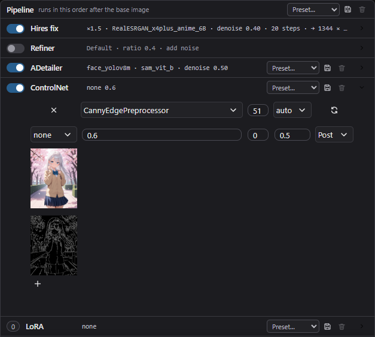

<details>
<summary>Details about ControlNet / IP Adapter</summary>

### For ComfyUI
Upgrade your [ComfyUI_Mira](https://github.com/mirabarukaso/ComfyUI_Mira) to `0.5.6.0 or above`.

`ControlNet` requires [comfyui_controlnet_aux](https://github.com/Fannovel16/comfyui_controlnet_aux) 1.1.5 [latest](https://github.com/Fannovel16/comfyui_controlnet_aux/commit/e8b689a513c3e6b63edc44066560ca5919c0576e)
Put your `ControlNet` models in `ComfyUI\\models\\controlnet`

`IP Adapter` requires [comfyui-art-venture](https://github.com/sipherxyz/comfyui-art-venture) 1.1.7 [latest](https://github.com/sipherxyz/comfyui-art-venture/commit/210dc072b1f103f91be18a33bdeb13ab315aaae5) and [ComfyUI_IPAdapter_plus](https://github.com/cubiq/ComfyUI_IPAdapter_plus) 2.0.0 [latest](https://github.com/cubiq/ComfyUI_IPAdapter_plus/commit/a0f451a5113cf9becb0847b92884cb10cbdec0ef)
Put your `Clip Vision` models in `ComfyUI\\models\\clip_vision`
Put your `IP Adapter` models in `ComfyUI\\models\\ipadapter`
For `SDXL/ilXL/NoobXL` we recommend `CLIP-ViT-bigG-14-laion2B-39B-b160k.safetensors` with `ipa_styleIpadapterFor_NoobAI-XL_v10.safetensors`. You may also need `CLIP-ViT-H-14-laion2B-s32B-b79K.safetensors`.
Only the first `IP Adapter` slot is accepted by ComfyUI; other slots set to `On` are ignored.

### For Forge Neo
ComfyUI `Post` feeds the processed image directly to the ControlNet model without a preprocessor, accepting `none(null)` as preProcessModel.
Forge-based ControlNet DOES NOT support `none(null)`; it accepts `None(String)`.

*Forge Neo:*
  Put your `ControlNet` and `IP Adapter` models in `models\\ControlNet`.
  Use `None` and always `On`.

### Usage
1. Drag and drop (or click `Add` then `Paste`) your image (or openPose image) into `Image Info`, select `Pre-processor`, `Resolution`, `Post-processor` and click `Add ControlNet`. After it says `Added` the preview swaps to your pre-processed image; close `Image info` and check the `ControlNet` tab for more settings. **Hover over a dropdown / text item to see its description.**
2. In the `ControlNet` tab you can change the `Pre-processor` and click `Refresh` to regenerate the preview (or set `Method` to `On`; the SAA preview will not update).
3. Images are too big to store in the settings file, so `ControlNet` settings are not saved when SAA closes; switching to another settings file does not override the current `ControlNet` settings either.
4. `ControlNet` works with normal and regional conditioning.
5. If you are new to `ControlNet`, try `Canny` or `OpenPose` first.
6. ComfyUI does not like receiving the same data twice; you may get an `Empty response error` when submitting identical data.
7. [comfyui-art-venture](https://github.com/sipherxyz/comfyui-art-venture) requires a `square image`; non-square input produces warnings.
8. If your IPA image is too big, the `Resolution` selection for `IP Adapter` resizes it; `1024` is enough in most cases.
9. The `Info` button does not work when `Pre-Process Model` is `IP Adapter`.
10. **Union models** (xinsir `controlnet-union-sdxl`, ProMax): every slot has a `Union control type`. `auto` derives the type from the `Pre-processor` (OpenPose, Depth, Canny/LineArt, …) when the `Post-processor` name contains `union` / `promax`, and leaves plain single-purpose models alone; pick a type by hand when the slot carries a ready-made map with `Pre-processor` = `none`. On ComfyUI this adds a `SetUnionControlNetType` node between the loader and `Apply ControlNet`.

All `Pre-processor` models are managed by [comfyui_controlnet_aux](https://github.com/Fannovel16/comfyui_controlnet_aux) (ComfyUI); most download from Hugging Face.
All `Post-processor` models (the `Apply ControlNet Model`) must be downloaded by yourself from `ComfyUI Model Manager` or Hugging Face.
</details>

## LoRA Slot
Forge Neo (WebUI) supports its default LoRA prompt style `<lora:xxxxx:1.0>`.
ComfyUI supports more detailed LoRA configuration; see [LoRA from Text](https://github.com/mirabarukaso/ComfyUI_Mira#lora).
In Nishiki the LoRA slots are the rows of the LoRA card, and the LoRA tab of the tag picker shows what each LoRA does; see [LoRA catalog and LoRA card](#lora-catalog-and-lora-card).

**To use LoRA with the ComfyUI API, update ComfyUI_Mira to 0.5.6.0 or above.**

## ADetailer
> [!TIP]
> If the settings are confusing, just remember to adjust the last number of a slot (Denoise). Hover over a field to see its name.

*For ComfyUI*
> [!CAUTION]
> Check before you download any .pt file from an unknown / untrusted site!
> https://github.com/ltdrdata/ComfyUI-Impact-Pack/issues/843

`ADetailer` requires [Impact Pack](https://github.com/ltdrdata/ComfyUI-Impact-Pack) 8.28.3 [latest](https://github.com/ltdrdata/ComfyUI-Impact-Pack/commit/429d0159ad429e64d2b3916e6e7be9c22d025c3c) and [Impact Subpack](https://github.com/ltdrdata/ComfyUI-Impact-Subpack) [latest](https://github.com/ltdrdata/ComfyUI-Impact-Subpack/commit/50c7b71a6a224734cc9b21963c6d1926816a97f1)
Put your `ADetailer` models in `ComfyUI\\models\\ultralytics\\bbox`
Put your `SAM` models in `ComfyUI\\models\\sams`

*For Forge Neo*
`ADetailer` requires [ADetailer Neo](https://github.com/Haoming02/ADetailer-Neo) [latest](https://github.com/Haoming02/ADetailer-Neo/commits/main/)
The `Upscaler`, `Control Processor` and `ADetailer` lists are read from the API.
The default ADetailer model list is updated after the first generation; simply generate an image as normal.
Put your `ADetailer` models in `sd-webui-forge-neo\\models\\adetailer` or `stable-diffusion-webui\\models\\adetailer`

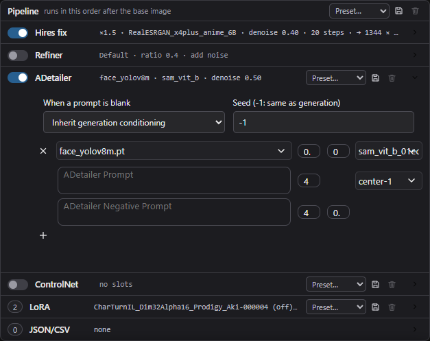

## Queue Manager
Submit multiple generation tasks, each with its own parameters. The queue processes them automatically and removes completed tasks.
If an error occurs, or if you switch off `Auto-start`, the queue pauses after the current task and is preserved.
You can `delete` or `view details` of queued tasks. Deleting the first task cancels the current generation.
*The queue length should not exceed 10,000.*

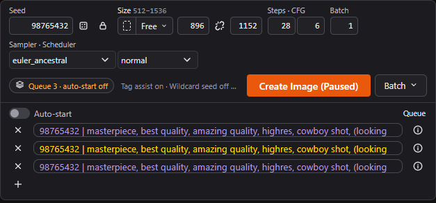

## JSON/CSV List
**JSON/CSV lists are NOT saved into your settings file.**
Supports `*.json` and `*.csv` files: drag and drop (or click `Add` then `Paste`) them into the `Image Info` window. For the file format see `wai_characters.csv` and `wai_tag_assist.json`; try dragging them into SAA.
`__Random__` picks a random item from the list without a seed bound; works in `Single` and `Batch (Random)` mode.
`__Enumerate__` walks every item one by one; only works in `Batch (Random)` mode, in `Single` it degrades to `__Random__`.

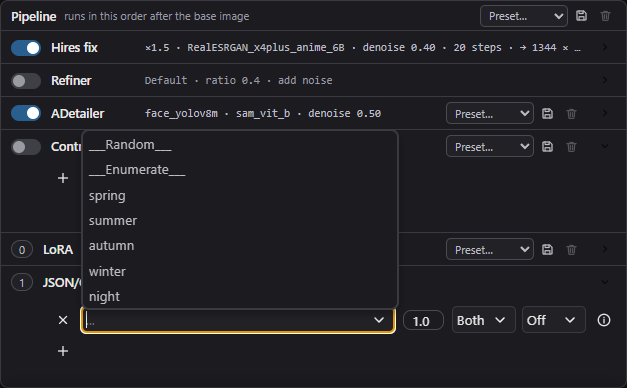

## Wildcards
Supports `*.txt` wildcard files; copy them into `data/wildcards` (`resources\app\data\wildcards` for a packaged build).
By default wildcards are selected with the current seed. If `wildcard random seed` is checked, a new random seed is generated for every selection.
**Subfolders are not supported.**

Wildcard tags need a DOUBLE underscore `__` at both ends:
```
__YourWildCardName__
```

Inline alternatives also work:
```
{ standing | sitting | on stomach | on back }
{ red | green | blue | blonde } { {long | short} hair | eyes}
```

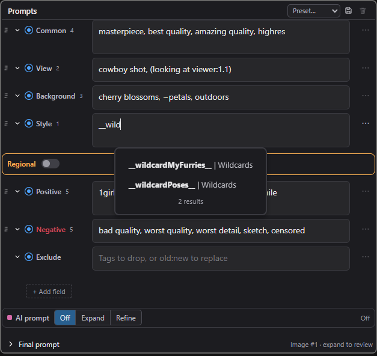

## Regional Condition / Couple
> [!TIP]
> Now supports the Anima model.

Try Regional Condition in 3 steps:
1. Switch on `Regional` in the Prompts card.
2. Choose a listed character or your OC.
3. Start the `common prompt` with `duo, masterpiece, best quality, amazing quality` (don't forget quality words), have fun!

*For Forge Neo*
`Regional Condition` requires [SD Forge Attention Couple](https://github.com/Haoming02/sd-forge-couple) [latest](https://github.com/Haoming02/sd-forge-couple/commits/main/)

**Sides (Nishiki).** With Regional on, the Prompts card keeps the shared rows (Common, View, Background, Style, Negative, Exclude) and shows a **LEFT** and a **RIGHT** block between them, each with its own Positive, Negative and rows of its own (`+ Add field` in the block). The side of each character is set on its slot in the Characters card (L / R / ·), and the blocks name the slots they take. **Swap** exchanges left and right in one step (prompts, negatives, weight plans, characters, strengths) and can be undone. `Split Ratio` moves the border and `Overlap` widens the shared band. On ComfyUI the left and right negatives are masked like the positives; Forge Neo folds them into one negative. Regional works for Diffusion (Anima) too.

**Panels.** The `Panels` switch combines a split-line tag with the region masks into a two-panel layout. Off by default.

**Split and emphasis.** `Split` cuts the image **Left / Right** or **Top / Bottom**. With Top / Bottom the LEFT / RIGHT blocks read **TOP** / **BOTTOM**: the left prompt goes to the top region and the right prompt to the bottom one (ComfyUI and Forge Neo). Top / Bottom suits a scene where one character's head really is in the lower part (lying down, sitting on the floor): with two standing characters both heads fall in the top region, and in the regional bench all 6 results drew the top prompt's character twice. `Emphasis` (formerly *Strength*) only works as a difference between the two sides. The same value on both sides changes nothing, because the combined conditioning is normalized; a gap makes one side more prominent without changing what the characters do.

**Who does what to whom.** Regions keep two characters' looks apart, but they do not decide an interaction. Write the action as one short English sentence after the tags, actor first, and name each character by a look that is already in the tags (hair colour works best), e.g. `the black haired girl is patting the blonde girl's head`. Naming them by position (`the girl on the left`) was not tested. Give it a row of its own named `Action` (`+ Add field`): a row of that name stays text when the card shows chips. On WAI Illustrious, a sentence after the tags got the direction right in 9 of 15 test images, against 3 of 15 for the sentence alone. Keep looks out of the sentence: its adjectives can spill onto hair or clothes.

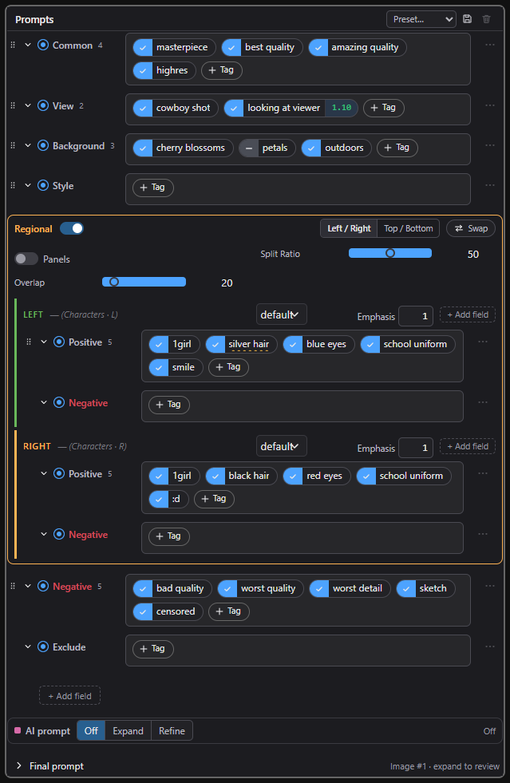

## Semi-Auto Tag Complete
Tags credit: [DraconicDragon/dbr-e621-lists-archive/danbooru_e621_merged_2026-04-01_pt20-ia-dd-ed-spc.csv](https://github.com/DraconicDragon/dbr-e621-lists-archive/blob/main/tag-lists/danbooru_e621_merged/README.MD)


<details>
<summary>Details about Semi-Auto Tag Complete</summary>
Typing the first few characters searches for matching tags. Nishiki matches the beginning, the middle and the end of a tag by default; `*tag` and `*tag*` still work as explicit end / middle patterns.
Use the mouse or `keyboard up and down` with `Enter` / `Tab` to select; press `Esc` to close the box.
`ctrl + up` / `ctrl + down` adjust the weight of the current tag or of a selected fragment (similar to ComfyUI and WebUI).

Supports English, Chinese and Japanese tag search.
**Special thanks to Kiratian(天痕) for the Chinese tag translation.**

*The `@` prefix*
`@` is not a search prefix: a word is looked up as written. In an `Action` field, `@alias` refers to a character slot (the alias set on the Characters card, Diffusion model type). To apply an `Artist` tag in the `Anima Model`, write it with the `@` prefix yourself, e.g. `mira` → `@mira`.

| Mark | ID | Category | Group |
| --- | --- | --- |  --- |
| `[G]` | 0 | General | Danbooru |
| `[A]` | 1 | Artist | Danbooru |
| `[©]` | 3 | Copyright | Danbooru |
| `[C]` | 4 | Character | Danbooru |
| `[M]` | 5 | Meta | Danbooru |
| `<G>` | 7 | General | E621 |
| `<A>` | 8 | Artist | E621 |
| `<©>` | 10 | Copyright | E621 |
| `<C>` | 11 | Character | E621 |
| `<S>` | 12 | Species | E621 |
| `<M>` | 14 | Meta | E621 |
| `<L>` | 15 | Lore | E621 |
| `Wildcards` | 255 | Wildcards | SAA |
</details>

### Japanese tag alias review (maintainers)

`scripts/reviewJapaneseTags.mjs` audits the bundled aliases in
`data/danbooru_e621_merged_ja.csv` with an LLM: a review pass proposes
keep / change / remove for every row, a verification pass double-checks each
proposal, and `--apply` writes back only high-confidence decisions accepted by
both passes. Every batch goes to Codex first (`codex exec`, model
`gpt-5.6-luna`); a batch Codex refuses or garbles is re-run on an uncensored
Ollama model, on the Runpod pod when Pod SSH is configured or locally
otherwise (`--backend`, `--fallback`, `--model`, `--pod-model`).

Rows are scoped against the merged base file (`--groups`, default Danbooru
General; `--min-heat` keeps the most used tags) and picked by `--select`:

| Selection | Rows |
| --- | --- |
| `suspicious` | untranslated, English-only, or known machine-translation aliases (default) |
| `style` | polite or sentence endings (`〜ます`, `〜です`, `〜ています`) |
| `ambiguous` | one alias shared by several tags; the sibling tags are sent for disambiguation |
| `missing` | base tags with no alias row; accepted translations are appended |
| `all` | every row in scope |

```text
node scripts/reviewJapaneseTags.mjs --select suspicious,style,ambiguous,missing --min-heat 542 --report review.jsonl
node scripts/reviewJapaneseTags.mjs --apply --report review.jsonl --output data/danbooru_e621_merged_ja.csv
```

`--dry-run` writes the selection without calling a model. A removed alias
drops its row; a decision applies to every repeated row of the same tag.
`data/japanese_alias_pins.csv` (tag,alias) holds the aliases settled by
hand; `--apply` and the reference sync write them last, so a model run
cannot undo them. Add a row there instead of editing the dictionary
directly.
Several workers can share a large audit with `--offset` / `--limit` (the
pool is ordered by heat); a rate-limited Codex call is retried, not split.

`scripts/syncReferenceAliases.mjs` copies the reviewed picker names into the
dictionary before such a review: character names from
`data/character_names.json` (with the curated work title in the qualifier)
and work titles from `data/character_works.json` replace the Character and
Copyright aliases, and tags without a row are appended. The same map is the
`reference` the review treats as authoritative.

```text
node scripts/syncReferenceAliases.mjs --dry-run --report sync.jsonl
node scripts/syncReferenceAliases.mjs --output data/danbooru_e621_merged_ja.csv
```
`scripts/categorizeTags.mjs` uses the same backends to fill
`data/tag_categories.json` for the tag-picker category filters.

### Japanese tag alias integration (maintainers)

`scripts/integrateJapaneseTagAliases.mjs` builds a review candidate from a
four-column Danbooru/e621 base tag file and a two-column Japanese alias file.
Only tags whose base group is Danbooru General (`0`) are imported. Artist,
Copyright, Character, and e621 aliases are not added by this tool; the runtime
also keeps Artist aliases disabled for Japanese autocomplete.

The base file is the same
[`danbooru_e621_merged.csv`](https://raw.githubusercontent.com/DominikDoom/a1111-sd-webui-tagcomplete/main/tags/danbooru_e621_merged.csv)
downloaded by SAA. A suitable Japanese candidate source is
[`PYU224/tagdb-updater`](https://github.com/PYU224/tagdb-updater), using its
`dist/danbooru-jp.csv` output.

Example:

```text
node scripts/integrateJapaneseTagAliases.mjs --base data/danbooru_e621_merged.csv --source danbooru-jp.csv --output danbooru_e621_merged_ja.general-candidates.csv --candidates-output danbooru_general_new.csv --kana-output danbooru_general_kana_review.csv --kanji-only-output danbooru_general_manual_review.csv
```

The output is a candidate file. Run the Japanese review workflow before
replacing the bundled translation data. The kana output is suitable for the
automated review pass; the kanji-only output needs manual confirmation because
Japanese and Chinese can share the same character set.

The review is intentionally staged. First review the kana candidates, then
apply only rows accepted with high confidence by both review passes:

```text
node scripts/reviewJapaneseTags.mjs --input danbooru_general_kana_review.csv --report danbooru_general_kana_review.jsonl
node scripts/reviewJapaneseTags.mjs --apply --input danbooru_general_kana_review.csv --report danbooru_general_kana_review.jsonl --output danbooru_general_kana_reviewed.csv
```

The apply step also refuses a high-confidence change when a tag containing
`unworn` or `removed` would lose its removal/wear-state meaning.

Feed the reviewed candidate back into the integration command to create a
full replacement candidate. Keep the kanji-only output out of this step until
it has been manually checked; an empty alias means that the candidate is
removed rather than imported.

### Character names and works (maintainers)

`data/character_works.json` records the Danbooru copyright tags every
character of the bundled lists belongs to, plus each work's Japanese title
and its other names (the picker searches them). It is built offline from the
[SpadeA/danbooru-tag-csv](https://huggingface.co/datasets/SpadeA/danbooru-tag-csv)
dump (`danbooru_tags.csv`, `danbooru_tags_cooccurrence.csv`) and the Danbooru
wiki cache written by `scripts/fetchDanbooruWiki.mjs`:

```text
node scripts/fetchDanbooruWiki.mjs --input character_tags.csv --cache data/.cache/danbooru-wiki.jsonl
node scripts/buildCharacterWorks.mjs --tags danbooru_tags.csv --pairs danbooru_tags_cooccurrence.csv
```

A character keeps the works it shares at least a fifth of its posts with
(`--min-share`, top `--max-works`); characters the dump does not know inherit
the works of the characters carrying the same `(qualifier)`. Reviewed Japanese
titles in the output file survive a rebuild.

`scripts/reviewCharacterNames.mjs` reviews the Japanese side with the same
LLM batch backend as the tag review (Codex first, `--backend` / `--fallback`
as above): `--stage works` names the works in Japanese (official Japanese
titles, evidence: the Danbooru other names), `--stage characters` reviews
`data/character_names.json` (official spellings, translated qualifiers such
as 改二 / 水着, the work title from `character_works.json` appended when the
tag carries one). `--apply` writes only rows at or above `--min-confidence`
(default `high`). `data/official_work_names.json` (qualifier -> curated title,
applied at display time) is hand-maintained and not touched:

```text
node scripts/reviewCharacterNames.mjs --stage works --report works.jsonl
node scripts/reviewCharacterNames.mjs --stage works --apply works.jsonl --min-confidence medium
node scripts/reviewCharacterNames.mjs --stage characters --report names.jsonl
node scripts/reviewCharacterNames.mjs --stage characters --apply names.jsonl
node scripts/reviewCharacterNames.mjs --stage verify --input names.jsonl --report verify.jsonl
node scripts/reviewCharacterNames.mjs --stage verify --apply verify.jsonl
```

`--stage verify` is the regression gate: it shows the model every applied
change as before / after with the same evidence and asks which one is right;
`--apply` reverts the changes judged "before" (medium confidence and up).
Read the reverted list — a verdict against an official rename (Raymond ->
ジャック) is wrong, and a "(1st costume)" verdict usually means the qualifier
translation, not the name, needs a hand fix.

## Image info
<details>
<summary>Drag and drop an image into the SAA window; supports Png/Jpeg/Webp.</summary>
Works with WebUI (Forge Neo and A1111) and ComfyUI (with the image save node from ComfyUI_Mira).
Double-click the image to close.
The `Send` button overrides `Common Prompt`, `Negative Prompt`, `Width & Height`, `CFG`, `Step` and `Seed`.
LoRA in `Common Prompt` also works if you have the same one. If you don't like LoRA in prompts, try `Send LoRA to Slot`.

A generated image can be opened the same way: the image context menus (split, grid and full-screen view) have `Open in Image Info`. From there `Send tags`, `Add ControlNet`, `Run Tagger` and `Tiled-Upscale` work on that image.

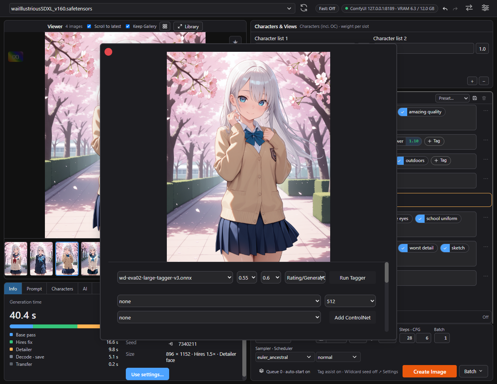
</details>

## Character List
### Favorites
Favorite characters, original characters and tags are managed in the selection modal: open the modal, toggle the star on an entry, and use the favorites group at the top to find them again. Favorite tags are highlighted on capsules. Favorites are saved with your settings.

### Preview and Search
The Character List supports keyword search in English, Chinese and Japanese, and by the work a character belongs to: `艦これ`, `kantai collection`, `FGO`, `ボカロ`, `崩壊` all narrow the list to that series, and `kantai 加賀` combines a work with a name. The works are shown after the character name (`data/character_works.json`, see the maintainers section below).


## Top buttons and Right Click Menu
Top bar from left to right: the model, Reload Model List, Fast mode, the backend status (GPU target Local / Pod), Undo, Redo, Right to Left and Settings. The theme switch is in Settings → General and Refresh page in Settings → Advanced; settings are saved automatically.

<details>
<summary>Right-click menus</summary>

Menus depend on what you right-click: a chip (edit weight, enable / disable, related tags, copy, remove, move / copy to another field), a prompt field (copy / clear field, enable / disable all tags, send LoRA to slot, move / copy the selection), a gallery image (copy image / metadata, remove current image, clear gallery), the AI field (test AI generate).

**Spell Check (English)**
Right-click a word with a spell check error (wavy underline) to see suggestions.
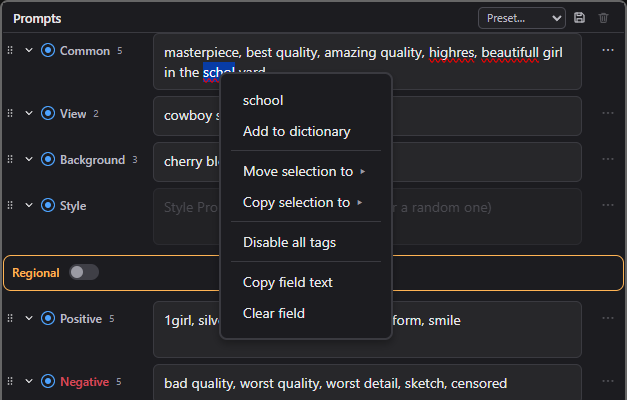

**AI prompt generate test**
Right-click the `AI prompt` field to get an AI prompt without generating. The result opens in a pop-up; switch the AI rule to `Last` to reuse it in later generations.
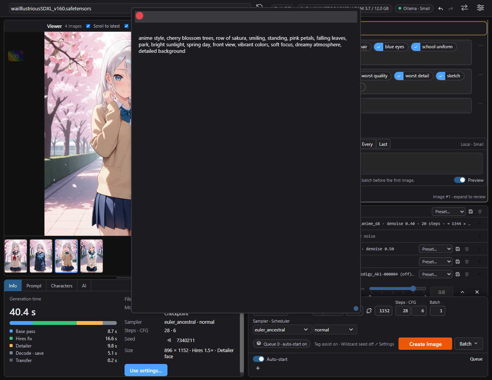

**Copy Image/Metadata**
Right-click the `Gallery` to copy the current image or its metadata to the clipboard.
ComfyUI with the Image Saver node outputs a1111-like metadata.
Copy image converts base64 back to PNG, but the metadata is trimmed by the Chromium core; if you need the original image, check the ComfyUI/WebUI output folder.
For SAAC: drag the image from the browser to a local folder or use `save as` from the browser menu.
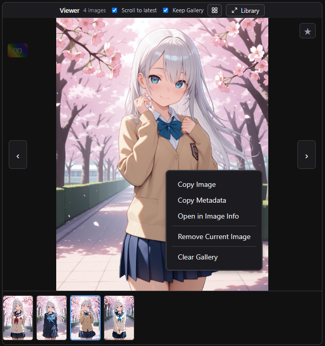

**Send LoRA to Slot**
Right-click `Common` or `Positive` to send text-form LoRA to the LoRA Slot.
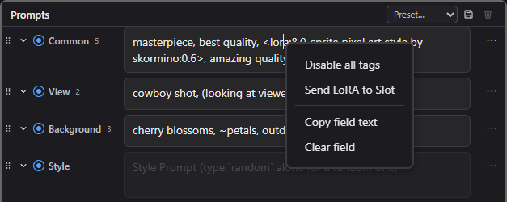
</details>

------
# AI prompt
Remote
1. Follow the setup guide to set your `Remote AI url`, `Remote AI model` and `API Key`.
2. Put something in `AI Prompt`, e.g. `make character furry, and I want a detailed portrait`.

Local
1. Build [Llama.cpp](https://github.com/ggml-org/llama.cpp) yourself, or download it from a [trusted source](https://github.com/ggml-org/llama.cpp/releases).
2. Download a model from [HuggingFace](https://huggingface.co/); a GGUF like `oh-dcft-v3.1-claude-3-5-sonnet-20241022.Q8_0` ([here](https://huggingface.co/mradermacher/oh-dcft-v3.1-claude-3-5-sonnet-20241022-GGUF)) is recommended.
3. Recommended server args: `llama-server.exe -c 16384 --port <your local LLM port> -m "<your GGUF model here>"`
4. Set `AI Prompt Generator` to `Local`.
5. Set `Local Llama.cpp server` to your local AI address and port.
6. (Optional) Check the API settings for any other local AI service.
7. Put something like `make character furry, and I want a detailed portrait` in `AI Prompt`.

Refine (Nishiki)
1. Install [Ollama](https://ollama.com/) and pull a model.
2. Set the AI mode to `Refine` and enter the Ollama address and model.
3. Write your prompt as usual. Before the first image of each batch, Refine rewrites the whole prompt in one structured call and applies the result to the editor; undo with `Ctrl + Z` if you don't like it.
4. `Pod` can be selected as the AI host if a Runpod pod is registered.

------
# Image API Interface
*For ComfyUI*
> [!IMPORTANT]
> If workflows fail to load correctly, try `2025-05-03-022732_1775747588.json` instead.

1. Enable `DEV mode` in ComfyUI Settings and load `examples\2025-05-03-022732_1775747588.png` into ComfyUI; make sure [ComfyUI_Mira](https://github.com/mirabarukaso/ComfyUI_Mira) **v0.5.6.0 or above** is installed.
    1.1. You might need to install `opencv-python` via ComfyUI → Manager → Install PIP packages → opencv-python.
2. Set `Image API Interface` to `ComfyUI`.
3. Make sure `Image Interface IP Address:Port` matches your ComfyUI page.
4. Have fun.

If previews don't work in SAA, add `--preview-method latent2rgb` to your startup BAT:
```
py ComfyUI\main.py --fast --use-sage-attention --cuda-malloc --windows-standalone-build --listen 0.0.0.0 --port 58188 --preview-method latent2rgb
```

*For Forge Neo (WebUI)*
1. Enable `API mode` by adding ` --api` to `COMMANDLINE_ARGS` (webui-user.bat).
2. Start WebUI.
3. Set `Image API Interface` to `WebUI`.
4. Make sure `Image Interface IP Address:Port` matches your WebUI page.
5. Have fun.

## Custom path for some 3rd-party mixed backends
> [!WARNING]
> Enabling a custom path overrides your model path settings.
> Not recommended for the official WebUI (Forge Neo/A1111) and ComfyUI.

To enable a custom path, edit `data/custom_path.yaml`:
1. Set `use_custom_path` to `true`.
2. Set `enable` to `false` to disable a whole category.
3. Comment out any single custom path you don't want to override.
4. Both single strings and multi-line strings are supported for path lists.
5. Absolute and relative paths (relative to base_path) are supported.

[#92 Setup custom path when using ComfyUI with Stability Matrix](https://github.com/mirabarukaso/character_select_stand_alone_app/issues/92)

## Folder path issue for remote usage
SAA searches your ComfyUI/WebUI checkpoints folder to list models, LoRAs and other items. With a remote backend address (not 127.0.0.1) the folder search fails and SAA runs in `Default` mode, where you cannot change models or set LoRAs by slot.
Two solutions:
1. `Mirror folder` — copy the remote `models` folder locally and point SAA at it. Simple, but needs disk space.
2. `Symbolic link or shared folder` — create a symbolic link or share the remote `models` folder (read-only recommended), then point SAA at it.

## Advanced security settings (API authentication)
> [!WARNING]
> *DO NOT forward any UNSECURED local port to the public internet.*
> *WebUI (Forge Neo) ONLY. DO NOT forward the ComfyUI API to the public internet until a proper secured way exists.*

See more WebUI (Forge Neo) command args at [Command-Line-Arguments-and-Settings](https://github.com/AUTOMATIC1111/stable-diffusion-webui/wiki/Command-Line-Arguments-and-Settings).

Copy `webui-user.bat` to `webui-user-api.bat` and edit it with the following args.
Replace `user:pass` with your `Username:Password`.
`--api` `--api-auth` enable the API and API authentication.
`--nowebui` means you don't need the browser interface.
`--port 58189` sets the API port to `58189`.
```
set COMMANDLINE_ARGS= --xformers --no-half-vae --api --api-auth user:pass --nowebui --port 58189
```
Start Forge Neo with the new `webui-user-api.bat`.
Paste your `Username:Password` into SAA → Settings → `WebUI API Auth`, then set `Enable` to `ON`.

------
# Hires Fix and Image Color Transfer
See [Image Color Transfer](https://github.com/mirabarukaso/ComfyUI_Mira#image-color-transfer) for details.
*Due to the lack of a generate rule and missing openCV, Color transfer is no longer supported on WebUI.*

Make sure all upscaler models are located in the `upscale_models` folder.

Notes for ComfyUI:
Download upscale models yourself: `Manager` → `Model Manager`, filter with `upscale`.

Upscaler notes for WebUI (Forge Neo/A1111):
WebUI uses a name-based upscaler model list. The `static upscaler list` should work and is updated from the API after the first generation.

Forge uses a file-based upscaler model list, which is messy:
  **IMPORTANT: if the upscale_models folder does NOT exist, SAA uses the static upscaler list.**
  **If in doubt, run generate once and the HiFix model list will update.**
  The solution:
  1. Create a folder called `upscale_models` inside `models` and put all your upscaler models in it.
  2. Create a symbolic link named after the upscaler model folder, e.g. `ESRGAN`, pointing to `upscale_models`.
  3. Restart Forge. `Hires Fix` models should now work and update from the API after the first generation.

------
# Chinese Translation and Character Verification
Many thanks to the following people for their selfless contributions of Chinese translation and character data verification, in no particular order:
**Silence, 燦夜, 镜流の粉丝, 樱小路朝日, 满开之萤, and two more who wish to remain anonymous.**

# Character List Special Thanks
lanner0403 [WAI-NSFW-illustrious-character-select](https://github.com/lanner0403/WAI-NSFW-illustrious-character-select)
Cell1310  [Illustrious XL (v0.1) Recognized Characters List](https://civitai.com/articles/10242/illustrious-xl-v01-recognized-characters-list)
mobedoor [#23](https://github.com/mirabarukaso/character_select_stand_alone_app/issues/23)
UdinXProgrammer [#62](https://github.com/mirabarukaso/character_select_stand_alone_app/issues/62)
Nurimtod [#75](https://github.com/mirabarukaso/character_select_stand_alone_app/issues/75) [#83](https://github.com/mirabarukaso/character_select_stand_alone_app/issues/83)
atmogenic [#84](https://github.com/mirabarukaso/character_select_stand_alone_app/issues/84) [#85](https://github.com/mirabarukaso/character_select_stand_alone_app/issues/85)
funnygeeker [#87](https://github.com/mirabarukaso/character_select_stand_alone_app/issues/87)

------
# FAQ
Double-clicked `saa.exe` but nothing happens?
1. Probably a download issue or missing files.
2. Run it from a console: type `cmd` in the Explorer address bar to open one.
3. Type `saa` and press Enter, then check the backend logs.

I messed up the setup wizard...
1. Close the app.
2. Delete `app.json` in `settings` (`resources/app/settings` for a packaged build).
3. Try again.

ERR_CONNECTION_REFUSED
1. In most cases the (ComfyUI/WebUI) backend API address is wrong.

A browser-based SAA?
1. YES.
2. See `Advanced security settings (API authentication)` for more information.

Error HTTP 400 ...... Cannot execute because node StepAndCfg does not exist ......
1. Install `ComfyUI_Mira`.
2. Restart ComfyUI.

Upscale Model list is `None` (ComfyUI)
1. Have you modified the default directory configuration?
2. A non-official version?
3. Check [#58](https://github.com/mirabarukaso/character_select_stand_alone_app/issues/58)

ComfyUI/WebUI is busy, cannot run a new generation, please try again later.
Refer to 5 and 6 in [README_SAAC.md](docs/README_SAAC.md).

Where are my settings and presets?
1. `settings/app.json`, `settings/state.json`, `settings/presets/`, `settings/user_lists.json`, and the parts, LoRA catalog and Library files beside them. See [Settings store](#settings-store).
2. Pre-Nishiki `settings/*.json` files are moved to `settings/legacy/` on first start.
