# SAA-Nishiki（二式）

[English](../README.md) | **日本語** | [简体中文](README.zh-CN.md)

[Character Select SAA](https://github.com/mirabarukaso/character_select_stand_alone_app) のフォークです。AI プロンプト、セミオートのタグ補完、ComfyUI / Forge Neo (WebUI) API に対応したスタンドアロンアプリです。
Nishiki では、日本語タグ翻訳、タグをチップで扱う行形式のプロンプトエディタ、Parts、Cast と Prose を備えた独立したモデル種別としての Diffusion（Anima）、作った内容（レシピ）を持つ画像、Library、サンプルのグリッドで見る LoRA カタログ、AI プロンプトリファイナー、高速生成モード、Runpod Pod ターゲットを追加しています。

現在のリリース: **v4.1.0** — 上流 SAA 2.8.9 ベース。ダウンロードとリリースノートは [Releases](https://github.com/FUMIHITO-EGUCHI/saa-nishiki/releases) を参照してください。

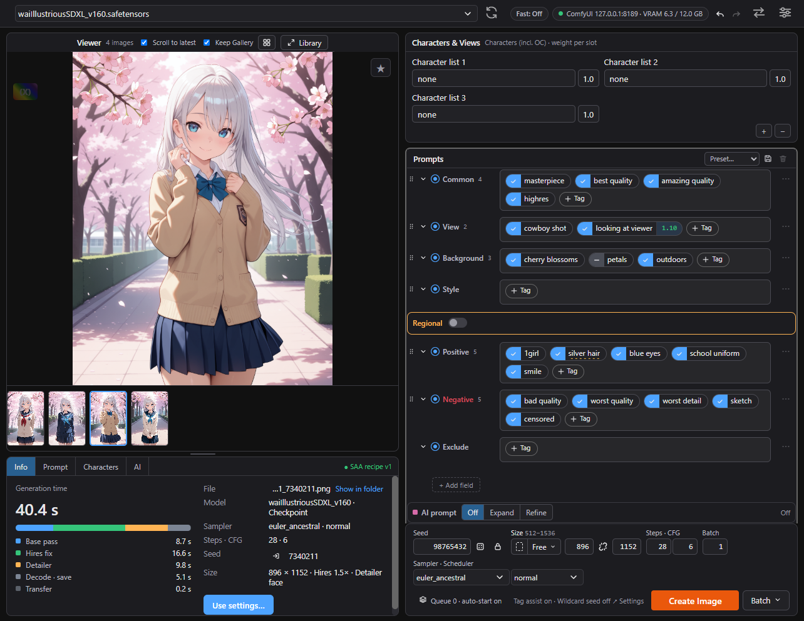

## 目次
- [Nishiki の追加機能](#nishiki-の追加機能)
- [インストールと起動](#インストールと起動)
- [更新](#更新)
- [Highlights（上流由来の機能）](#highlights)
- [AI プロンプト](#ai-プロンプト)
- [Image API Interface](#image-api-interface)
- [FAQ](#faq)

------

# Nishiki の追加機能

## 日本語タグ翻訳・ローカライズ
- danbooru / e621 統合タグリストの日本語辞書（約 10 万エントリ、`data/danbooru_e621_merged_ja.csv`）により、日本語でタグを検索・表示できます。作者と e621 のキャラクターを除くすべてのグループを、heat 10（投稿数 10 件）まで見直しています。
- タグ検索は辞書全体を順位付けして返します（前方一致が先、同じ帯の中では投稿数の多いタグが先）。スクロールすると次の 50 件を読み込み、最後の行に一致件数を表示します。各行には訳語と、一致した別名だけを表示します。入力中のスペースはタグの `_` にも一致します（`white d` で `white_dress` が見つかります）。
- キャラクター名・作品名の日本語ローカライズと、タグカテゴリ表示。タグ検索とキャラクター選択で同じ名前を表示します。
- 設定で UI 言語に `ja-JP` を選択すると、タグ・名前・カテゴリが日本語で表示されます。日本語訳のない UI 文言は英語にフォールバックします。

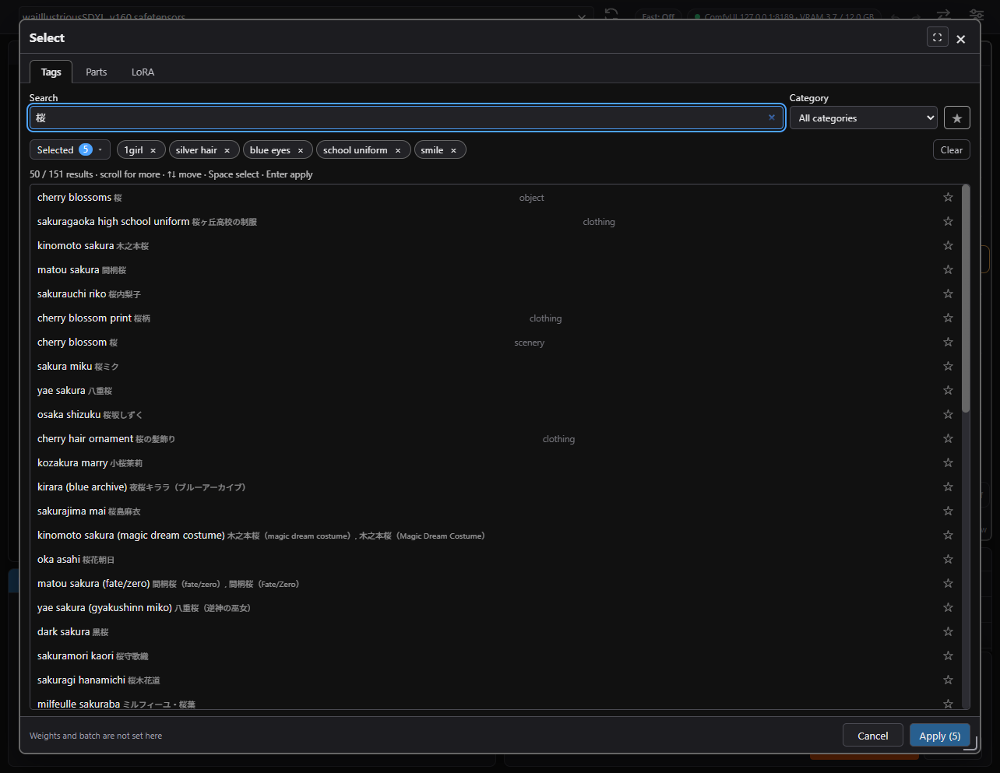

## プロンプトエディタ
Prompts カードは 1 本の行リストです。Common、View、Background、Style、Positive、Negative、Exclude と、自分で足した行が並びます。各行はタグを**チップ**で表示します。つまみで行を移動、● スイッチでミュート、名前のダブルクリックで名前の変更、それ以外は ⋯ メニュー（Show as text / Show as chips、Insert part…、Weights per image…、Presets…、Make negative / Make positive、Rename、Delete field）から行います。`+ Add field` で自分用の行を追加できます。最終的なプロンプトは、行の並び順で組み立てられます。

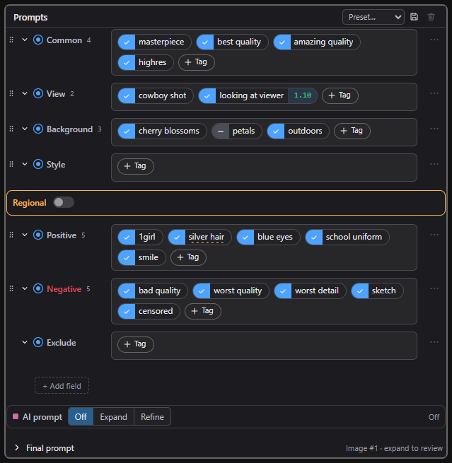

- **チップ。** 左端に状態（✓ 有効、− 無効、★ お気に入り、× 除外）、右端に重みかウェイトプランを表示します。✓ をクリックすると、タグを削除せずに無効にできます。`+ Tag` で、Tags・Parts・LoRA のタブを持つタグ選択が開きます。
- **ウェイトのポップオーバー。** チップをクリックすると、重み（テキスト表示では `Ctrl + 上下`）、バッチ用のウェイトプラン、関連タグ（共起と同じ語族。`data/tag_related.txt` からオフラインで提示）、訳語、お気に入りの ★ を扱えます。`(a, b:1.2)` のようなグループの重みは 1 つのチップです。
- **行の間でタグを移動。** チップを行の中や別の行へドラッグします（`Ctrl` か `Alt` を押しながらでコピー）。右クリックメニューの `Move to…` / `Copy to…` でも移動できます。重みと無効状態もタグと一緒に移ります。1 回のドロップは 1 回の Undo で戻せます。
- **複数のタグを選択。** `Ctrl + クリック` で個別に選択、`Shift + クリック` で範囲を拡張、`Ctrl + A` で行の全チップを選択、`Esc` で解除。選択中のタグはまとめてドラッグ・削除・切り替えでき、右クリックメニューも選択全体に効きます（`Disable tag (3)`、`Move to (3)` など）。
- **View 行。** アングル、カメラ、構図は、View 行に置く通常のタグと Parts です。重みや検索も他の行と同じように使えます。
- **プリセット。** 行ごとにプリセットを持てます（⋯ → Presets…）。カードのプリセットは行の構成全体（行、名前、順序、内容）を保存し、適用するとその構成をそのまま復元します。
- **辞書にないタグの表示。** タグ辞書にないチップには波線の下線が付きます。SDXL モデルはこうした語をほぼ無視するためです。検証では `long staff` と `ancient staff` は何も変えず、実在タグの `wooden staff` は毎回杖を変えました。文のように読めるチップ（4 語以上で既知のタグではないもの）は破線・斜体で表示され、そのまま送られます。LoRA トークン、ワイルドカード、ランダム構文には印を付けません。
- **投稿数の目安。** 投稿数 100 件未満のタグに黄色の点線、1,000 件未満のタグに灰色の点線が付き、ポップオーバーに投稿数が出ます。Danbooru / e621 の投稿数を見るための参考表示で、Diffusion では表示しません。

## Parts
よく使うタグの組み合わせを、`parts:<名前>` という 1 つのチップとして保存できます。チップの重みは中のタグに反映され、ミュート、最終プロンプト、AI Refine、Prose、バッチ展開でも同じタグを使います。タグ選択の Parts タブにカテゴリ別・サンプル付きで並び、今のタグからの作成、編集、タグへの展開、他の Part への差し替えができ、Part 自体に LoRA を持たせることもできます。outfit、hair、body、background、camera、composition、tone、pose、expression などの 295 件のスターターセットを同梱しています。Parts は `settings/parts.json` に、サンプルは `settings/parts/` に保存します。

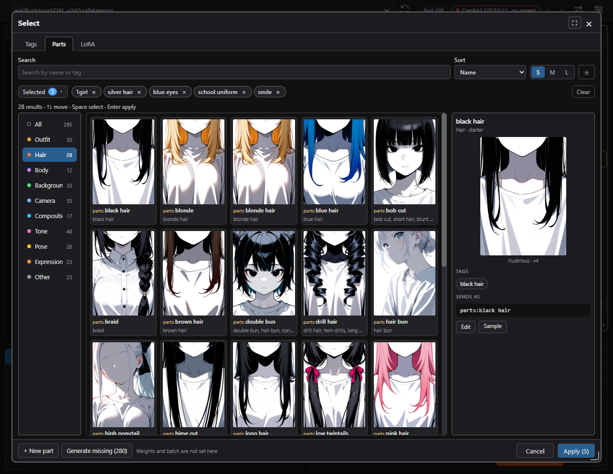

## ウェイトバッチ
ポップオーバーでタグに**ウェイトプラン**（開始、ステップ、終了）を設定するか、行の ⋯ → Weights per image… を使ってバッチを実行すると、SAA は seed を固定したまま 1 枚ずつプランを進め、重みだけを変えます。`÷ batch count` オプションを使うと、ステップをバッチ数から自動計算します。seed がランダムでない状態でバッチを始めると警告が出ます。

## キャラクター・お気に入り・リスト管理
- Characters カードには、必要な数だけキャラクタースロットを置けます（`+` / `−`）。スロットごとに重みを持ち、Regional が ON のときは左右の側も持ちます。
- キャラクターとオリジナルキャラクターは、訳語と**お気に入り**グループ付きの検索可能な選択画面で選びます。名前は英語・中国語・日本語のどれでも検索でき、作品名でも絞り込めます（`艦これ`、`kantai collection`、`FGO`）。
- **リスト管理**（Settings → Lists）: キャラクター / OC / アングル / カメラのリストに項目を追加・上書き・非表示にできます。上流のデータは読み取り専用のまま、編集内容は差分として `settings/user_lists.json` に保存され、エクスポート・インポートできます。リスト項目には複数タグのプロンプトを持たせられ、項目エディタ内でもタグ選択を使えます。

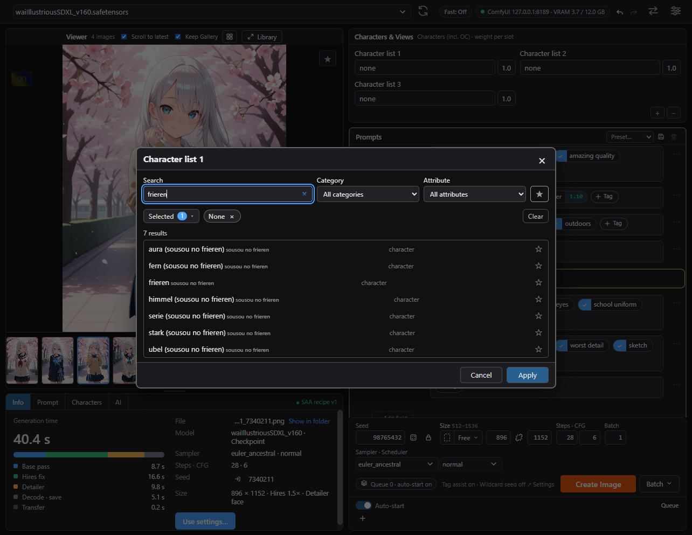

## Diffusion（Anima）
Diffusion は Checkpoint と並ぶ独立したモデル種別で、sampler、scheduler、steps、CFG、サイズ、Hires、Regional、プロンプトを種別ごとに持ちます。種別を切り替えても、一方の設定がもう一方に持ち込まれることはありません。
- **Cast。** キャラクタースロットごとに別名と専用のプロンプト行が付き、Action 行で `@別名` を使って誰が何をするかを書けます。
- **Prose。** Anima は Danbooru タグではなく英語を読むため、画像のリクエストを送る前に、組み立てたタグを 1 つの英文の段落に書き直します。段落は画像と同じ解決済みのタグ（同じワイルドカード、同じ重み）から書かれ、編集、元に戻す、書き直しができます。書き手は、AI カードの LLM（ローカルか Pod の Ollama）か **Student**（35B モデルから蒸留した Qwen3.5-2B の LoRA）です。Student は SAA が自分で起動する llama-server で動きます（設定 > AI で実行ファイル、GGUF、ポートを指定。どちらも同梱していません）。12GB の GPU で ComfyUI と並べて、1 段落あたり約 1 秒です。
- **Artist。** Danbooru の作者 17,716 人が何を描くかの辞書を持ち、名前でも題材でも検索できます（`cat ears` で猫耳を描く作者が見つかります）。1 枚に最大 3 人まで指定できます。
- **Regional と Panels** も Diffusion で使えます（[Regional Condition / Couple](#regional-condition--couple) を参照）。

## 画像が作った内容を持つ
- SAA で作った画像は、作ったときの内容（Generate を押した時点のエディタ、seed、Random の枠が選んだキャラクター、送ったプロンプト、AI の回答、Prose の段落、Fast モードが送った値）と、各段階にかかった時間を、PNG の `saa_recipe` と `saa_time` のテキストチャンクとして持ちます。時間は、同じ PC で動く ComfyUI の場合に書き込みます。
- **ビューワー。** Info タブに、表示中の画像の生成時間（バーと内訳）、ファイル、モデル、sampler、steps、CFG、seed（Seed 欄へ入れるボタン付き）、サイズと段、実際に効いた LoRA を表示します。他のアプリで作った画像も、PNG のチャンクから読みます。実行時のテキストは Prompt タブにあります。★ で画像を残し、矢印で前後の画像へ移動します。
- **Use settings…** は、画像のレシピと今のエディタを並べて開きます。項目（行ごとのタグ、Prose、LoRA、モデルと sampler、サイズと段、Regional、seed）ごとにチェックがあり、違う項目は最初からチェックされています。全部チェックすると、同じ画像をもう一度作れる状態になります。A1111 の parameters しかない画像も読み込めます。読み込みは 1 回の Undo で戻せます。
- **Library。** Library ボタンで、ComfyUI の出力フォルダと Pod の保存フォルダにあるすべての画像を、フォルダと日付ごとに開きます。このセッション、★、レシピありのビュー、プロンプト・キャラクター・LoRA・モデル・seed・ファイル名での検索と絞り込みがあります。横のパネルから Use settings…、★、フォルダで表示、ゴミ箱へ移動ができます。インデックスとサムネイルは `settings/library/` に保存し、画像から作り直せます。

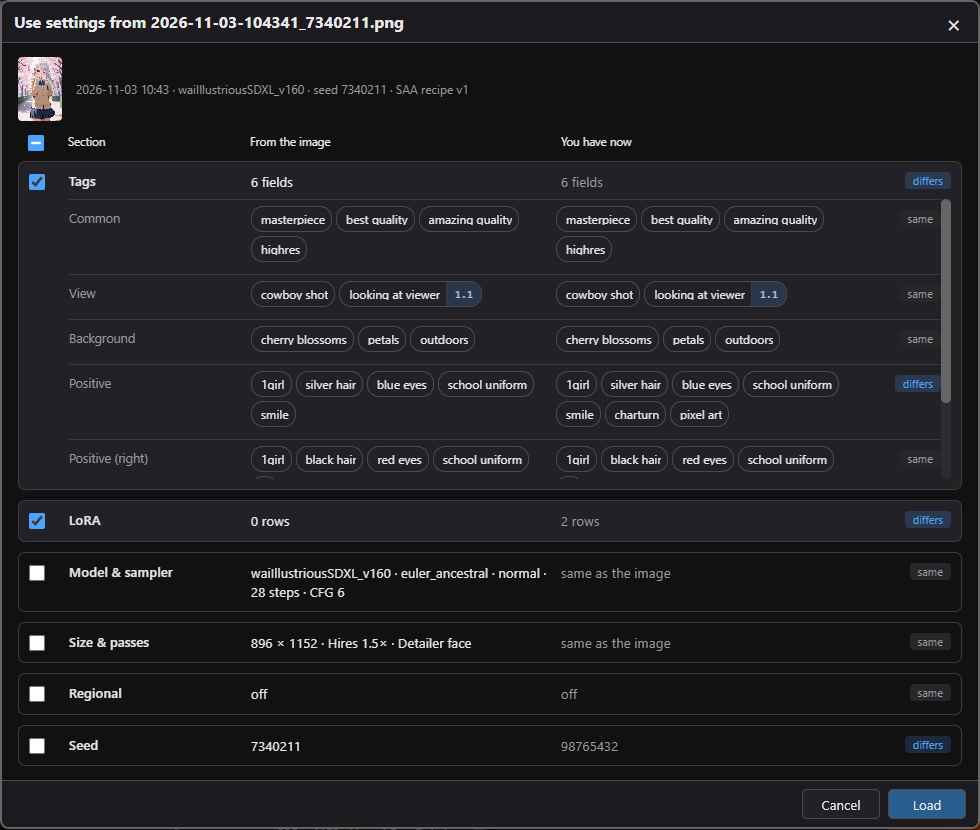 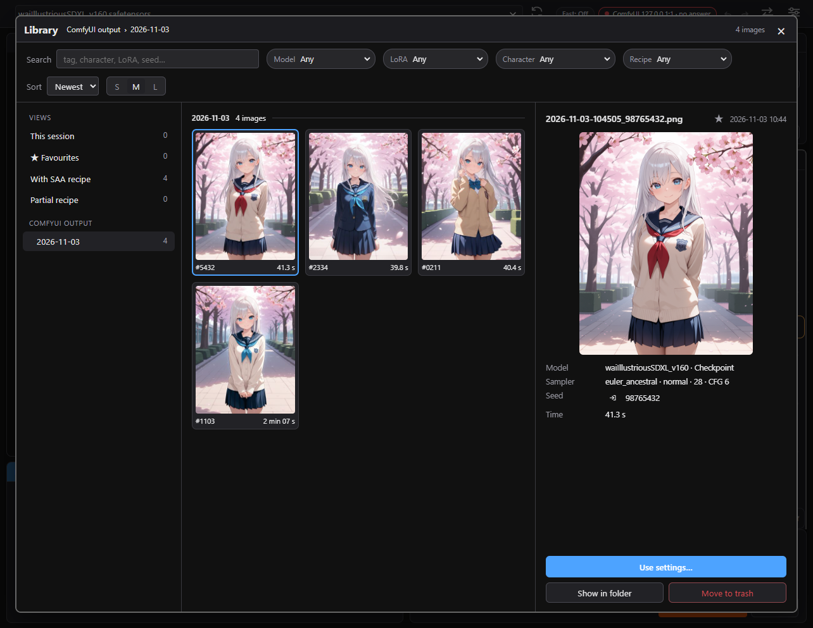

## LoRA カタログと LoRA 欄
- **LoRA タブ。** タグ選択の LoRA タブは、各 LoRA をサンプルのグリッドで表示します。OFF と、範囲内の 5 段階の重みを、今のモデルと同じ seed で並べるので、説明を読まなくても効き方が分かります。横のパネルで、既定の重み、サンプルの範囲（Take samples / Retake。サンプルのプロンプトは LoRA ごと、または全体の既定）、トリガー語、推奨するタグ、自分用の名前を設定します。推定は `.safetensors` のヘッダーだけから行い、Civitai にはボタンを押したときだけ、ファイルの sha256 で問い合わせます。カタログは `settings/loras.json` に、サンプルは `settings/loras/` に保存します。
- **LoRA 欄。** 各 LoRA は 1 行で、ON/OFF のスイッチ、名前、トリガー語（クリックでプロンプトから外す・入れる）、サンプルの重みに目盛りのあるスライダーと数値が並びます（ホイールで 0.05、Shift を押しながらで 0.25 ずつ）。折りたたみの中に、段（All、Base、Hires）、CLIP、範囲、トリガー語があります。行を OFF にすると、そのトリガー語もプロンプトから外します。`+ LoRA` は LoRA タブだけのタグ選択を開きます。
- **タグ・Parts と LoRA。** ある LoRA の推奨するタグに当たるチップには `LoRA N` のバッジが付き、ポップオーバーから LoRA を追加できます。クリックしない限り、何も追加しません。

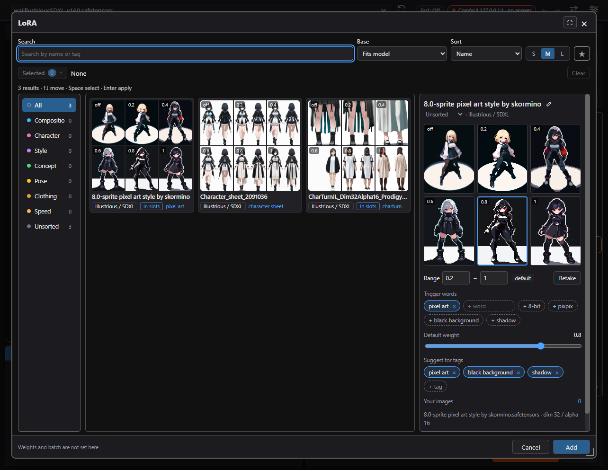 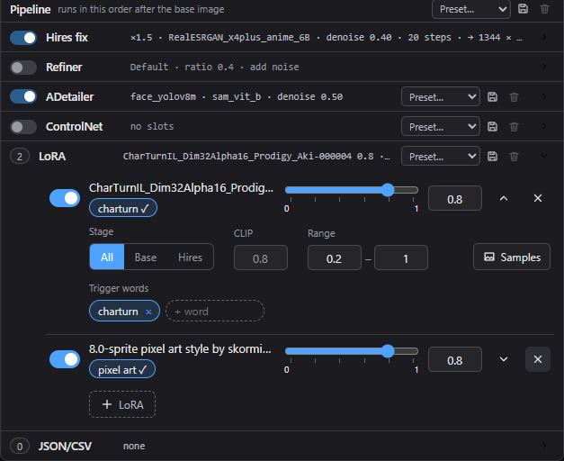

## サイズと比率
Run bar の Size は `[縦横 | 比率 ▾] [W] [チェーン] [H]` です。チップの左半分で幅と高さを入れ替え、右半分で 1:1、4:5、3:4、A4（1:√2）、2:3、黄金比（1:φ）、9:16、Free のタイルを開きます。タイルにはそれぞれのサイズが出ます。比率を選ぶと画素数を保ったまま 8 px 単位でサイズを決め、チェーンでつなぐと片方の入力にもう片方が比率で追従します。サイズの欄はモデル種別の範囲に従います（Checkpoint 512〜1536、Diffusion 512〜2048。上限は設定で変更可）。

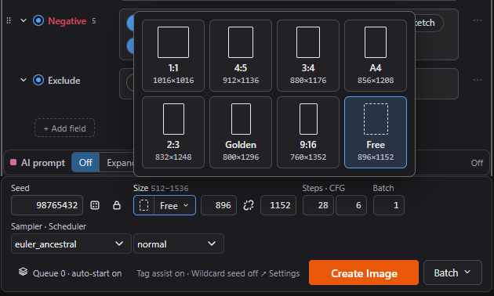

## Undo / Redo
プロンプト編集、プリセット適用、AI Refine の結果は、すべてグローバルな編集履歴の 1 ステップとして記録されます。`Ctrl + Z` / `Ctrl + Shift + Z`（または `Ctrl + Y`）かツールバーのボタンで操作します。

## AI プロンプトリファイナー
上流のリモート / ローカル `llama.cpp` による AI プロンプトに加え、[Ollama](https://ollama.com/) を使う **Refine** モードを追加しています。Refine はバッチごとに最初の 1 枚の前で、構造化した 1 回のリクエストでプロンプト全体を書き直し、その結果を行ごとにエディタへ反映します。Refine による編集は編集履歴に記録され、Undo できます。タグの中にある平易な英文の動作文（Regional Condition の「誰が誰に何をするか」を参照）は、タグに分解せず文のまま残します。
`Regional` が ON のときは、側別の Negative も含めて両側を書き直します。生成時に追加されるもの（キャラクター、JSON スロット、ワイルドカード、スロットの LoRA）は元の位置に残し、書き直した行の前後に戻します。
AI の結果は、毎回のポップアップではなく **Info パネルの AI タブ**に表示されます。

## 高速生成モード
設定 → Backend → **Fast generation** は、ステップ蒸留 LoRA（DMD2 / Hyper-SD / Lightning / LCM）を適用し、ベース・Hires fix・ADetailer の各パスの steps、CFG、sampler、scheduler を上書きします。ローカル ComfyUI と Pod の両方で動作します。
RTX 4070 SUPER での実測（600×1024、Hires 1.5x、ADetailer）: 30 steps ≈ 29 秒 → DMD2 8 steps ≈ 16 秒。

Diffusion（Anima）モデル種別には専用のセットがあります。Anima Turbo LoRA v0.2 を 0.8、8 steps、CFG 1.5、euler / simple に加え、ComfyUI の起動フラグ `--use-sage-attention --fast` を使います。これらのフラグはプロセス全体に効くため、別のフラグが必要な実行の前に、SAA は 設定 → Backend → ComfyUI process → 起動コマンド（追加引数を `main.py` に渡せるもの）でローカル ComfyUI を再起動します。SAA が外すのは、自分で ComfyUI を起動したときに付けたフラグだけです。RTX 4070 での実測（832×1216、waiANIMA）: 25 steps ≈ 17〜19 秒 → 両フラグ付きの Turbo 8 steps ≈ 4.8 秒。`--fast` は色と細部をわずかに変えます。LoRA は Pod でも使えますが、フラグはローカル ComfyUI のみです。

プロンプトの LoRA は Hires と ADetailer のパスにも効きます。ワークフローは 1 枚の間、LoRA を掛けた同じモデルを使い続けるので、1 回の実行の中で ComfyUI がモデルファイルを読み直すことはありません。

## ローカルの ComfyUI を SAA から操作
設定 → Backend から、ローカルの ComfyUI の起動・再起動・停止ができ、SAA と一緒に起動することもできます。停止するのは SAA が通信している ComfyUI だけで、ポートを使っている別のプログラムは pid とプログラム名を示し、指示した場合だけ終了します。起動コマンドは、ネイティブのダイアログで一度許可してから実行します。

## Runpod Pod ターゲット
設定で Runpod の Pod（SSH の接続先と鍵）を登録し、ツールバーのステータスピルで画像生成を **GPU: Local** と **GPU: Pod** に切り替えられます。生成画像は SSH 経由で送り返され、ローカルにのみ保存されます。Pod のディスクには何も書き込みません。Pod は LLM 機能（AI プロンプト / Refine / Prose）にも使えます。Pod のエンドポイントには、認証付きの `https` / `wss` バックエンドも使えます。
AI プロンプト / Refine のリクエストも同じ SSH リレー経由で Pod 上の Ollama に送られます。セットアップ、Pod 再起動時の復元スクリプト、トラブルシューティングは [README_POD.md](README_POD.md) を参照してください。

## UI シェル
- 新しいビューポートレイアウト、ステータスピル、実行の進捗表示、ダーク / ライトテーマ。
- 両テーマの色は 1 つのトークンファイル `design/tokens.json` から作られ、`scripts/buildThemeTokens.mjs` がテーマのファイルに書き出します。アイコンも 1 つのセット `scripts/shared/iconSet.js` から描きます。
- すべてのダイアログでボタンの並びは同じです（Cancel / No が左、主のボタンが右）。Esc では手前のダイアログから閉じます。
- 右クリックメニューは、対象（チップ、プロンプト行、ギャラリー画像、AI 欄）ごとに内容が変わります。

## 設定の保存先
設定はセクションに分割され、スキーマバージョン付きで保存されます。
- `settings/app.json` — アプリ設定（バックエンド、パス、AI、高速モード、Pod）
- `settings/state.json` — プロンプト / 生成 / LoRA / ADetailer / ControlNet の作業状態（モデル種別ごと）
- `settings/presets/<section>/<name>.json` — プリセット
- `settings/user_lists.json` — リスト管理の差分
- `settings/parts.json`、`settings/parts/` — Parts とそのサンプル
- `settings/loras.json`、`settings/loras/` — LoRA カタログとそのサンプル
- `settings/library.json`、`settings/library/` — ★、ComfyUI の出力フォルダ、Library のインデックスとサムネイル
- `settings/legacy/` — 分割前の `settings/*.json`。初回起動時にここへ移動され、以降は読み込まれません

すべて自動保存・アトミック書き込みです。`settings/` は同梱の MiraITU ワークフローファイルを除いて git 管理外です。

## バージョニング
Nishiki は 3.0.0 から独自のセマンティックバージョンを使います。minor が機能追加、patch がバグ修正です。上流のベースは `package.json` の `upstreamBase`（2.8.9）とリリースノートに記録し、新しい上流を取り込むときは minor を上げます。リリースごとに `v<version>` のタグと GitHub Release を作り、Release の本文が変更履歴です（`docs/CHANGELOGS.md` は上流のものです）。

------

> [!NOTE]
> リストに表示されないものの正しく生成できるキャラクターを見つけたら、issue で知らせてください。
>
> 既定の thumbList は `waiIllustriousSDXL_v160` ベースです。代替の thumbList `waiANIMA_v10Base10` と `waiNSFWIllustrious_v120` は、選択すると `HuggingFace` から自動ダウンロードされます。
> 独自の thumbList は [SAA Thumb Generator](../scripts/python/thumb-generator/README.md) で作成できます。

| 検証済み | [ComfyUI](https://github.com/comfyanonymous/ComfyUI)  | [Forge Neo](https://github.com/Haoming02/sd-webui-forge-classic/tree/neo) |
| --- | --- | --- |
| Release | 0.40.0 | 2.27 |
| Refiner (SDXL) | Yes | Yes |
| Image Color Transfer (ALL) | Yes | No |
| Regional Condition / Couple (SDXL/Anima) | Yes | Yes |
| ControlNet/IPA (SDXL) | Yes | Yes |
| ADetailer (ALL) | Yes | Yes |
| API authentication| No | Yes |
| MiraITU | Yes | No |
| 高速生成モード | Yes | No |
| Runpod Pod ターゲット | Yes | No |

> [!IMPORTANT]
> `Forge Neo` の `Regional Condition / Couple` と `ADetailer` は `SDXL と Anima` に対応。
> `ComfyUI` では SAA が対応するすべての diffusion モデルで動作するはずですが、要検証です。
>
> *ComfyUI Desktop は非対応です。*
> *A1111 はメンテナンス停止のため対応リストから外しました。SAA で動作はしますがテストしていません。*
>
> *オンライン版 Character Select* [Hugging Face Space](https://huggingface.co/spaces/flagrantia/character_select_saa)
>
> ブラウザ版 SAAC は [README_SAAC.md](README_SAAC.md) を参照。
> OpenClaw 向け Python CLI ツールは [SAA Agent](../scripts/python/saa-agent/README_HUMAN.md) と [ClawHub](https://clawhub.ai/mirabarukaso/saa-agent) を参照。

## thumbList 手動ダウンロード
<details>
<summary>SAA 内のダウンロードが遅い、または失敗する場合は手動でダウンロードしてください。</summary>

[HF データセット](https://huggingface.co/datasets/flagrantia/character_select_stand_alone_app/tree/main) から以下のファイルを `data` フォルダにダウンロードし、次の名前にリネームします。

### waiIllustriousSDXL_v160
[waiIllustriousSDXL_v160_thumbs.json](https://huggingface.co/datasets/flagrantia/character_select_stand_alone_app/resolve/main/wai_character_thumbs_v160.json?download=true)

[waiIllustriousSDXL_v160_characters.csv](https://huggingface.co/datasets/flagrantia/character_select_stand_alone_app/raw/main/wai_characters_v160.csv)

[waiIllustriousSDXL_v160_tag_assist.json](https://huggingface.co/datasets/flagrantia/character_select_stand_alone_app/raw/main/waiIllustriousSDXL_v160_tag_assist.json)

### waiIllustriousSDXL_v120
[waiNSFWIllustrious_v120_thumbs.json](https://huggingface.co/datasets/flagrantia/character_select_stand_alone_app/resolve/main/wai_character_thumbs_v120.json?download=true)

[waiNSFWIllustrious_v120_characters.csv](https://huggingface.co/datasets/flagrantia/character_select_stand_alone_app/raw/main/wai_characters_v120.csv)

[waiNSFWIllustrious_v120_tag_assist.json](https://huggingface.co/datasets/flagrantia/character_select_stand_alone_app/raw/main/waiIllustriousSDXL_v160_tag_assist.json)

### waiANIMA_v10Base10
[waiANIMA_v10Base10_thumbs.json](https://huggingface.co/datasets/flagrantia/character_select_stand_alone_app/resolve/main/waiANIMA_v10Base10_thumbs.json?download=true)

[waiANIMA_v10Base10_characters.csv](https://huggingface.co/datasets/flagrantia/character_select_stand_alone_app/raw/main/waiANIMA_v10Base10_characters.csv)

[waiANIMA_v10Base10_tag_assist.json](https://huggingface.co/datasets/flagrantia/character_select_stand_alone_app/raw/main/waiANIMA_v10Base10_tag_assist.json)

</details>

# インストールと起動
> [!TIP]
> SAA を起動する前に [Image API Interface](#image-api-interface) を設定してください。
>
> ComfyUI の場合は最新の [ComfyUI_Mira](https://github.com/mirabarukaso/ComfyUI_Mira) が必要です。
>
> *ワンクリックパッケージ v2.8.0（上流）*
> フルパッケージ [embeded_env_for_SAA](https://huggingface.co/datasets/flagrantia/character_select_stand_alone_app/resolve/main/embeded_env_for_SAA.zip)

リポジトリをローカルにクローンします。
```
git clone https://github.com/FUMIHITO-EGUCHI/saa-nishiki.git
cd saa-nishiki
npm install
npm start
```

### ローカル CDP デバッグ（任意）

CDP は既定で無効です。Chrome DevTools や互換の MCP クライアントから Electron レンダラーを検査するには、ローカルのデバッグポートを指定して SAA を起動します。

```powershell
$env:SAA_CDP_PORT = "9222"
npm start
```

パッケージ済みの実行ファイルでは次のオプションが同等です。

```powershell
.\saa-nishiki.exe --saa-cdp-port=9222
```

SAA の実行中は `http://127.0.0.1:9222/json/list` で DevTools エンドポイントを利用できます。`9222` が使用中なら別のポートを指定してください。CDP はレンダラーの検査・操作が可能なため、信頼できないマシンや外部から到達可能なマシンでは有効にしないでください。

# 更新
> [!IMPORTANT]
> **GitHub からの更新ではデータセットファイルは更新されません。**
> `data` フォルダ内の `danbooru_e621_merged.csv`、`*_thumbs.json`、`*_characters.csv`、`*_tag_assist.json` を手動で削除し、アプリを再起動すると最新のサムネイルデータベースを HF からダウンロードします。

```
git fetch
git pull
npm install
```

設定・プリセット・リスト管理の差分は `settings/` にあり、更新で変更されることはありません。

------
# Highlights
以下は上流 SAA から引き継いだ機能です。スクリーンショットは可能な範囲で Nishiki UI で撮り直しています。

## ComfyUI / Forge Neo 向け Diffusion モデル（UNET/CLIP/VAE）
> [!NOTE]
> テスト・検証済み: Anima / Qwen Image / Z Image / Flux / Krea2
> ComfyUI と Forge Neo に対応。オリジナルの A1111 は非対応。


> [!NOTE]
> 上のスクリーンショットは旧（上流）UI のものです。

<details>
<summary>Diffusion モデルの詳細</summary>

*ComfyUI* は [Comfy-Org@HF](https://huggingface.co/comfy-Org/) を参照。
`GGUF モデル` にはカスタムノード [gguf](https://github.com/calcuis/gguf)（小文字のもの）が必要です。
```
|---models
|   |---checkpoints
|   |---diffusion_models
|   |---text_encoders
|   |---vae
```

*Forge Neo* は [Download Models@Haoming02](https://github.com/Haoming02/sd-webui-forge-classic/wiki/Download-Models) を参照。
Forge も `GGUF モデル` に対応しますが、`Diffusion モデル` は `Checkpoint` と同じフォルダを使います。正しいフォルダで管理してください。
```
|---models
|   |---Stable-diffusion
|   |---text_encoder
|   |---VAE
```
</details>

## Mira Image Tiled Upscaler
> [!NOTE]
> MiraITU: ビジョンモデルに基づくコンテンツ認識型の画像超解像 ComfyUI カスタムノード。
> 任意の画像を SAA/SAAC にドラッグ&ドロップするだけでアップスケールできます。

| Before | 6x After (SDXL) | Before | 3x After (Flux.2) |
| --- | --- | --- | --- |
|    |   |    |   |

<details>
<summary>MiraITU の詳細</summary>

1.5 倍から 8 倍までの拡大に対応。タイルサイズの調整で VRAM 使用量を最適化でき、8GB の GPU でも 1.5〜3 倍（以上）、24GB 以上のハイエンド GPU なら 4〜8 倍のアップスケールが可能です。

[ComfyUI_Mira](https://github.com/mirabarukaso/ComfyUI_Mira) `0.5.6.0 以上` が必要
[MiraSubPack](https://github.com/mirabarukaso/ComfyUI_MiraSubPack) `最新版` が必要

および [Mira](https://github.com/mirabarukaso/ComfyUI_Mira#tagger) の Image Tagger

| Settings | Drag and Drop | Flux.2 |
| --- | --- | --- |
|  |    | 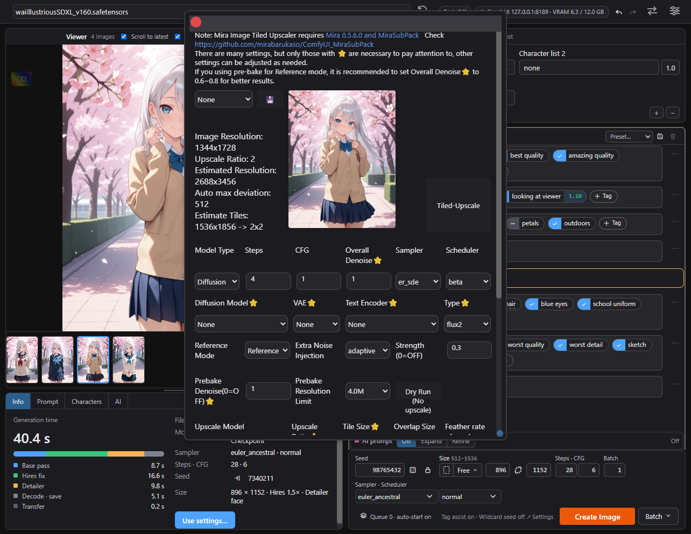   |

生成結果はモデルによって変わります。`SDXL` モデルでは正確な内容記述のために `tagger` が必要で、`upscale モデル` の使用を推奨します。`reference latent` を接続できる `Flux2` などのモデルでは upscale モデルを省略して元画像を直接引き伸ばせます。その場合は `Positive Prompt` で全タイルを統一的に設定してください。

| 拡大率 1024x1360(1536) | Tile Size | VAE 8G | VAE 24G~ |
| --- | --- | --- | --- |
| x1.5 | 768 | Full | Full |
| x2 | 1280 | Full/Tiled | Full |
| x3 | 1536 | Tiled | Full |
| x4 | 2048 | Tiled | Full |
| x6 | 2048/2560 | Tiled | Full |
| x8 | 2560/3072 | Tiled | Full/Tiled |

注: SDXL モデルの制約により、8 倍を超える拡大では視覚的な断片化が激しくなります。より高倍率が必要な場合は専用の ComfyUI ワークフローを使用してください。
[ComfyUI Workflow MiraITU](https://github.com/mirabarukaso/ComfyUI_MiraSubPack/blob/main/examples/MiraITU_workflow.png)
</details>

## Image Tagger
ONNX 形式の [WD@SmilingWolf](https://huggingface.co/SmilingWolf)、[CL@cella110n](https://huggingface.co/cella110n/cl_tagger)、[Camie@Camais03](https://huggingface.co/spaces/Camais03/camie-tagger-v2-app) モデルに対応。

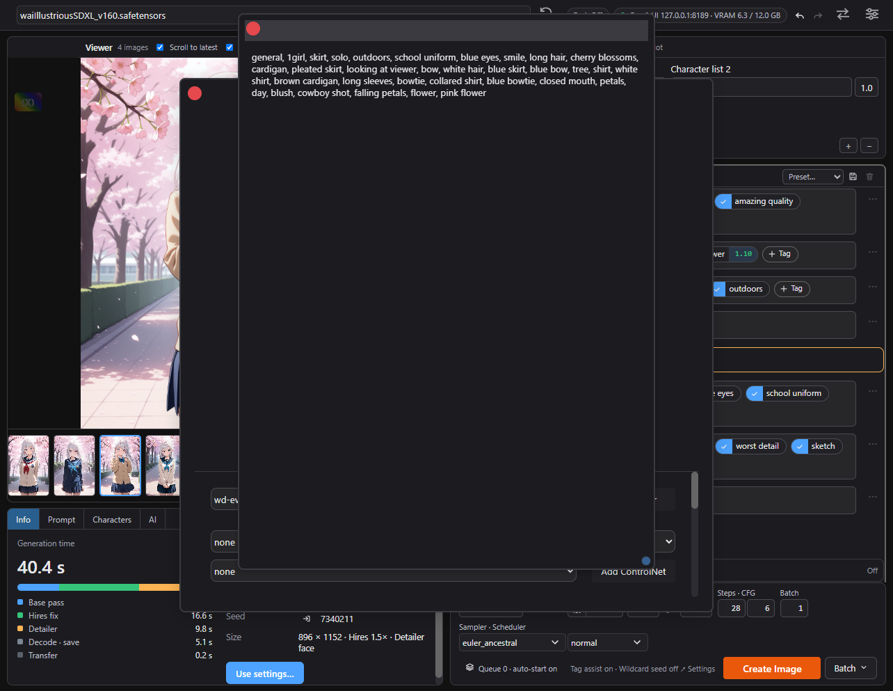

<details>
<summary>Image Tagger の詳細</summary>

[HF](https://huggingface.co) からタグ付きのモデルをダウンロードし、次の規則でリネームして `models/tagger` フォルダにコピーします。
  - cl_tagger_v2.onnx + cl_tagger_v2_tag_mapping.json
  - wd-eva02-large-tagger-v3.onnx + wd-eva02-large-tagger-v3_selected_tags.csv
  - wd-v1-4-convnext-tagger.onnx + wd-v1-4-convnext-tagger_selected_tags.csv

```
SAA
|---models
|   |---tagger
|       |---cl_tagger_1_02.onnx
|       |---cl_tagger_1_02_tag_mapping.json
|       |---wd-eva02-large-tagger-v3.onnx
|       |---wd-eva02-large-tagger-v3_selected_tags.csv
|       |---wd-vit-large-tagger-v3.onnx
|       |---wd-vit-large-tagger-v3_selected_tags.csv
|       |---camie-tagger-v2.onnx
|       |---camie-tagger-v2-metadata.json

Options:
Model Name  >>>  General Threshold(CL/WD/Camie)  >>>  Character Threshold(CL/WD)  >>> Categories(CL/Camie) or mCut(WD)
```

Image Tagger は Node.js 上の `onnxruntime-node` で動作します。*バックエンドは不要* ですが、GPU アクセラレーションは効かないようです。
タグ付け速度は CPU モードの `Python` + `onnxruntime` の約 3 倍、`onnxruntime-gpu` の約 12 倍遅くなります。
その代わり、生成中でも `Image tagger` を実行できます。

| Device | Avg Tagging Time | Model | Platform | Resolution | Recommend Value |
| --- | --- | --- | --- | --- | --- |
| onnxruntime | 1.053s | cl_tagger_1_02 | Python | 448 | 0.55/0.60 |
| onnxruntime-gpu | 0.297s | cl_tagger_1_02 | Python | 448 | 0.55/0.60 |
| onnxruntime-node | 3.185s | cl_tagger_1_02 | Electron(NodeJS@CPU) | 448 | 0.55/0.60 |
| onnxruntime-node | 2.917s | wd-eva02-large-tagger-v3 | Electron(NodeJS@CPU) | 448 | 0.35/0.85 |
| onnxruntime-node | 2.113s | camie-tagger-v2 | Electron(NodeJS@CPU) | 512 |  0.50/(NOT USE) |
</details>

## ControlNet / IP Adapter
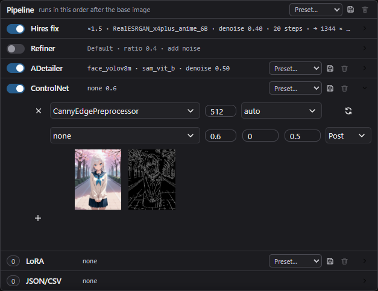

<details>
<summary>ControlNet / IP Adapter の詳細</summary>

### ComfyUI の場合
[ComfyUI_Mira](https://github.com/mirabarukaso/ComfyUI_Mira) を `0.5.6.0 以上` に更新してください。

`ControlNet` には [comfyui_controlnet_aux](https://github.com/Fannovel16/comfyui_controlnet_aux) 1.1.5 [latest](https://github.com/Fannovel16/comfyui_controlnet_aux/commit/e8b689a513c3e6b63edc44066560ca5919c0576e) が必要
`ControlNet` モデルは `ComfyUI\\models\\controlnet` に配置

`IP Adapter` には [comfyui-art-venture](https://github.com/sipherxyz/comfyui-art-venture) 1.1.7 [latest](https://github.com/sipherxyz/comfyui-art-venture/commit/210dc072b1f103f91be18a33bdeb13ab315aaae5) と [ComfyUI_IPAdapter_plus](https://github.com/cubiq/ComfyUI_IPAdapter_plus) 2.0.0 [latest](https://github.com/cubiq/ComfyUI_IPAdapter_plus/commit/a0f451a5113cf9becb0847b92884cb10cbdec0ef) が必要
`Clip Vision` モデルは `ComfyUI\\models\\clip_vision` に配置
`IP Adapter` モデルは `ComfyUI\\models\\ipadapter` に配置
`SDXL/ilXL/NoobXL` には `CLIP-ViT-bigG-14-laion2B-39B-b160k.safetensors` と `ipa_styleIpadapterFor_NoobAI-XL_v10.safetensors` の組み合わせを推奨。`CLIP-ViT-H-14-laion2B-s32B-b79K.safetensors` も必要になる場合があります。
ComfyUI が受け付けるのは最初の `IP Adapter` スロットのみで、他のスロットを `On` にしても無視されます。

### Forge Neo の場合
ComfyUI の `Post` はプリプロセッサなしで処理済み画像を ControlNet モデルに直接渡し、preProcessModel に `none(null)` を受け付けます。
Forge 系 ControlNet は `none(null)` を受け付けず、`None(String)` を受け付けます。

*Forge Neo:*
  `ControlNet` と `IP Adapter` モデルは `models\\ControlNet` に配置。
  `None` を使い、常に `On` にします。

### 使い方
1. 画像（または openPose 画像）を `Image Info` にドラッグ&ドロップ（または `Add` → `Paste`）し、`Pre-processor`、`Resolution`、`Post-processor` を選んで `Add ControlNet` をクリック。`Added` と表示されるとプレビューが前処理済み画像に切り替わります。`Image info` を閉じ、`ControlNet` タブで詳細設定を確認してください。**ドロップダウンやテキスト項目にマウスを乗せると説明が表示されます。**
2. `ControlNet` タブで `Pre-processor` を変更し `Refresh` をクリックするとプレビューが再生成されます（`Method` を `On` にした場合、SAA のプレビューは更新されません）。
3. 画像は設定ファイルに保存するには大きすぎるため、`ControlNet` 設定は SAA 終了時に保存されません。別の設定ファイルへ切り替えても現在の `ControlNet` 設定は上書きされません。
4. `ControlNet` は通常・Regional 両方の条件付けで動作します。
5. `ControlNet` が初めてなら、まず `Canny` か `OpenPose` を試してください。
6. ComfyUI は同じデータの再送信を嫌います。同一データを送ると `Empty response error` が出ることがあります。
7. [comfyui-art-venture](https://github.com/sipherxyz/comfyui-art-venture) は `正方形画像` を要求します。非正方形の入力では警告が出ます。
8. IPA 画像が大きすぎる場合、`IP Adapter` の `Resolution` で入力画像がリサイズされます。ほとんどの場合 `1024` で十分です。
9. `Pre-Process Model` が `IP Adapter` のとき `Info` ボタンは動作しません。
10. **Union モデル**（xinsir `controlnet-union-sdxl`、ProMax）: 各スロットに `Union control type` があります。`auto` は `Post-processor` 名に `union` / `promax` を含むとき `Pre-processor`（OpenPose、Depth、Canny/LineArt など）から種類を決め、通常の単機能モデルには何もしません。`Pre-processor` = `none` で加工済み画像を渡すときは種類を手動で選んでください。ComfyUI ではローダーと `Apply ControlNet` の間に `SetUnionControlNetType` ノードが追加されます。

すべての `Pre-processor` モデルは [comfyui_controlnet_aux](https://github.com/Fannovel16/comfyui_controlnet_aux)（ComfyUI）が管理し、多くは Hugging Face からダウンロードされます。
すべての `Post-processor` モデル（`Apply ControlNet Model`）は `ComfyUI Model Manager` か Hugging Face から自分でダウンロードしてください。
</details>

## LoRA スロット
Forge Neo（WebUI）は既定の LoRA プロンプト形式 `<lora:xxxxx:1.0>` に対応。
ComfyUI はより詳細な LoRA 設定に対応します。[LoRA from Text](https://github.com/mirabarukaso/ComfyUI_Mira#lora) を参照してください。
Nishiki では、LoRA スロットは LoRA 欄の行です。各 LoRA の効き方はタグ選択の LoRA タブで確認できます。[LoRA カタログと LoRA 欄](#lora-カタログと-lora-欄) を参照してください。

**ComfyUI API で LoRA を使うには ComfyUI_Mira を 0.5.6.0 以上に更新してください。**

## ADetailer
> [!TIP]
> 設定が分かりにくければ、スロットの最後の数値（Denoise）だけ調整すれば OK です。欄にマウスを乗せると名前が表示されます。

*ComfyUI の場合*
> [!CAUTION]
> 出所不明・信頼できないサイトの .pt ファイルはダウンロード前に確認してください。
> https://github.com/ltdrdata/ComfyUI-Impact-Pack/issues/843

`ADetailer` には [Impact Pack](https://github.com/ltdrdata/ComfyUI-Impact-Pack) 8.28.3 [latest](https://github.com/ltdrdata/ComfyUI-Impact-Pack/commit/429d0159ad429e64d2b3916e6e7be9c22d025c3c) と [Impact Subpack](https://github.com/ltdrdata/ComfyUI-Impact-Subpack) [latest](https://github.com/ltdrdata/ComfyUI-Impact-Subpack/commit/50c7b71a6a224734cc9b21963c6d1926816a97f1) が必要
`ADetailer` モデルは `ComfyUI\\models\\ultralytics\\bbox` に配置
`SAM` モデルは `ComfyUI\\models\\sams` に配置

*Forge Neo の場合*
`ADetailer` には [ADetailer Neo](https://github.com/Haoming02/ADetailer-Neo) [latest](https://github.com/Haoming02/ADetailer-Neo/commits/main/) が必要
`Upscaler`、`Control Processor`、`ADetailer` の一覧は API から読み込みます。
既定の ADetailer モデル一覧は初回生成後に更新されます。通常どおり画像を生成してください。
`ADetailer` モデルは `sd-webui-forge-neo\\models\\adetailer` または `stable-diffusion-webui\\models\\adetailer` に配置

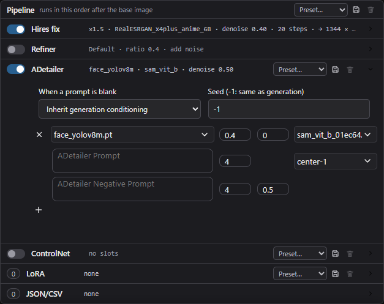

## キューマネージャ
それぞれ異なるパラメータを持つ複数の生成タスクを投入できます。キューは自動的に処理を開始し、完了したタスクを取り除きます。
エラーが発生した場合や `Auto-start` をオフにした場合、現在のタスク終了後にキューは一時停止し、内容は保持されます。
キュー内のタスクは `削除` や `詳細表示` ができます。先頭タスクを削除すると現在の生成がキャンセルされます。
*キューの長さは 10,000 を超えないことを推奨します。*

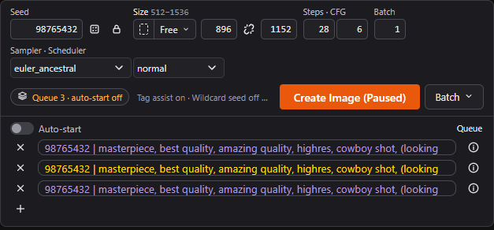

## JSON/CSV リスト
**JSON/CSV リストは設定ファイルには保存されません。**
`*.json` と `*.csv` に対応。`Image Info` ウィンドウにドラッグ&ドロップ（または `Add` → `Paste`）してください。ファイル形式は `wai_characters.csv` と `wai_tag_assist.json` を参考に、それらを SAA にドラッグして試してください。
`__Random__` は Seed に縛られずリストからランダムに 1 項目を選びます。`Single` と `Batch (Random)` モードで動作します。
`__Enumerate__` は全項目を順に列挙します。`Batch (Random)` モードでのみ動作し、`Single` では `__Random__` に格下げされます。

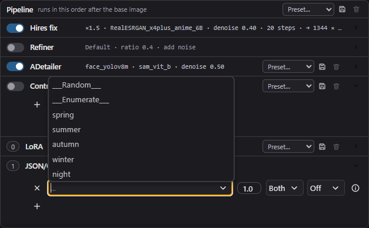

## ワイルドカード
`*.txt` ワイルドカードファイルに対応。`data/wildcards`（パッケージ版は `resources\app\data\wildcards`）にコピーしてください。
既定では現在の Seed でワイルドカードを選択します。`wildcard random seed` をチェックすると、選択のたびに新しいランダム Seed を生成します。
**サブフォルダは非対応です。**

ワイルドカードタグは前後をアンダースコア 2 つ `__` で囲みます。
```
__YourWildCardName__
```

インライン記法も使えます。
```
{ standing | sitting | on stomach | on back }
{ red | green | blue | blonde } { {long | short} hair | eyes}
```

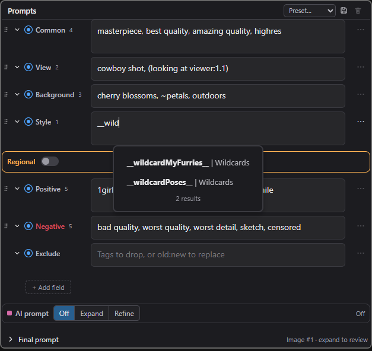

## Regional Condition / Couple
> [!TIP]
> Anima モデルに対応しました。

3 ステップで試せます。
1. Prompts カードの `Regional` をオンにする。
2. リストのキャラクターか自分の OC を選ぶ。
3. `common prompt` を `duo, masterpiece, best quality, amazing quality` で始める（品質ワードを忘れずに）。

*Forge Neo の場合*
`Regional Condition` には [SD Forge Attention Couple](https://github.com/Haoming02/sd-forge-couple) [latest](https://github.com/Haoming02/sd-forge-couple/commits/main/) が必要

**左右のサイド（Nishiki）。** Regional を ON にすると、Prompts カードは共通の行（Common、View、Background、Style、Negative、Exclude）を残し、その間に **LEFT** と **RIGHT** のブロックを表示します。各ブロックは専用の Positive、Negative と、そのブロックだけの行（ブロック内の `+ Add field`）を持ちます。キャラクターの側は Characters カードの各スロットで指定し（L / R / ·）、ブロックには受け持つスロットが表示されます。**Swap** は左右をまとめて入れ替え（プロンプト、Negative、ウェイトプラン、キャラクター、強さ）、Undo できます。`Split Ratio` で境界を動かし、`Overlap` で共有する帯を広げます。ComfyUI では左右の Negative も Positive と同じマスクで領域に適用され、Forge Neo では 1 つの Negative にまとめられます。Regional は Diffusion（Anima）でも使えます。

**Panels。** `Panels` スイッチを ON にすると、分割線用のタグと各領域のマスクを組み合わせて 2 コマの分割構図を作ります。既定ではオフです。

**分割方向と Emphasis。** `Split` で画像を **Left / Right**（左右）か **Top / Bottom**（上下）に分けます。Top / Bottom では LEFT / RIGHT の見出しが **TOP** / **BOTTOM** になり、左側のプロンプトが上の領域、右側のプロンプトが下の領域に入ります（ComfyUI と Forge Neo）。Top / Bottom は、片方の頭が実際に画面の下側に来る構図（寝そべる、床に座るなど）向けです。2 人とも立っていると両方の頭が上の領域に入り、検証では 6 枚すべてで上のプロンプトのキャラクターが 2 人描かれました。`Emphasis`（旧 *Strength*）は左右の差としてだけ効きます。左右を同じ値にしても、合成された条件付けが正規化されるため何も変わりません。差をつけると片側が目立つようになりますが、キャラクターの動作は変わりません。

**誰が誰に何をするか。** 領域分けは 2 人の外見を混ざらないようにするものであって、相互の動作は決めません。動作はタグの後ろに短い英文 1 文で書きます。動作する側を主語にし、各キャラクターはタグにある外見（髪色が最も確実）で呼び分けます（例: `the black haired girl is patting the blonde girl's head`）。位置（`the girl on the left` など）で呼ぶ書き方は検証していません。そのための行を `Action` という名前で追加してください（`+ Add field`）。この名前の行は、カードがチップ表示でもテキストのまま残ります。WAI Illustrious では、タグの後ろに文を置いた場合に 15 枚中 9 枚で向きが正しくなりました。文だけの場合は 15 枚中 3 枚でした。外見の語は文に入れないでください。形容詞が髪や服に漏れることがあります。

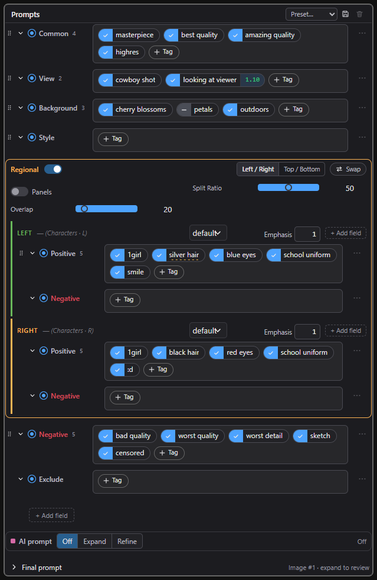

## セミオートタグ補完
タグデータ: [DraconicDragon/dbr-e621-lists-archive/danbooru_e621_merged_2026-04-01_pt20-ia-dd-ed-spc.csv](https://github.com/DraconicDragon/dbr-e621-lists-archive/blob/main/tag-lists/danbooru_e621_merged/README.MD)


<details>
<summary>セミオートタグ補完の詳細</summary>
最初の数文字を入力すると一致するタグを検索します。Nishiki では既定で前方・中間・後方一致すべてに対応し、`*tag` と `*tag*` も明示的な後方 / 中間一致パターンとして使えます。
マウスのほか、`キーボードの上下` と `Enter` / `Tab` で選択でき、`Esc` で候補を閉じます。
`ctrl + ↑` / `ctrl + ↓` で現在のタグや選択範囲のウェイトを調整できます（ComfyUI や WebUI と同様ですが細部のロジックは異なる場合があります）。

英語・中国語・日本語のタグ検索に対応。
**中国語タグ翻訳に協力してくださった Kiratian(天痕) に感謝します。**

*`@` の扱い*
`@` は検索の切り替えではなく、入力した通りに検索されます。`Action` 欄の `@別名` はキャラクタースロットへの参照です(Characters カードで付けた別名、Diffusion モデル種別のとき)。`Anima モデル` で `Artist` タグを使う場合は、先頭の `@` を自分で付けて書きます。例: `mira` → `@mira`

| Mark | ID | Category | Group |
| --- | --- | --- |  --- |
| `[G]` | 0 | General | Danbooru |
| `[A]` | 1 | Artist | Danbooru |
| `[©]` | 3 | Copyright | Danbooru |
| `[C]` | 4 | Character | Danbooru |
| `[M]` | 5 | Meta | Danbooru |
| `<G>` | 7 | General | E621 |
| `<A>` | 8 | Artist | E621 |
| `<©>` | 10 | Copyright | E621 |
| `<C>` | 11 | Character | E621 |
| `<S>` | 12 | Species | E621 |
| `<M>` | 14 | Meta | E621 |
| `<L>` | 15 | Lore | E621 |
| `Wildcards` | 255 | Wildcards | SAA |
</details>

## Image info
<details>
<summary>画像を SAA ウィンドウにドラッグ&ドロップ。Png/Jpeg/Webp に対応。</summary>
WebUI（Forge Neo と A1111）と ComfyUI（ComfyUI_Mira の画像保存ノード使用時）で動作します。
画像をダブルクリックで閉じます。
`Send` ボタンは `Common Prompt`、`Negative Prompt`、`Width & Height`、`CFG`、`Step`、`Seed` を上書きします。
同じ LoRA を持っていれば `Common Prompt` 内の LoRA も機能します。プロンプト内の LoRA が不要なら `Send LoRA to Slot` を試してください。

生成済み画像も同じように開けます。画像の右クリックメニュー（分割・グリッド・全画面表示）に `Open in Image Info` があります。そこから `Send tags`、`Add ControlNet`、`Run Tagger`、`Tiled-Upscale` がその画像に対して使えます。

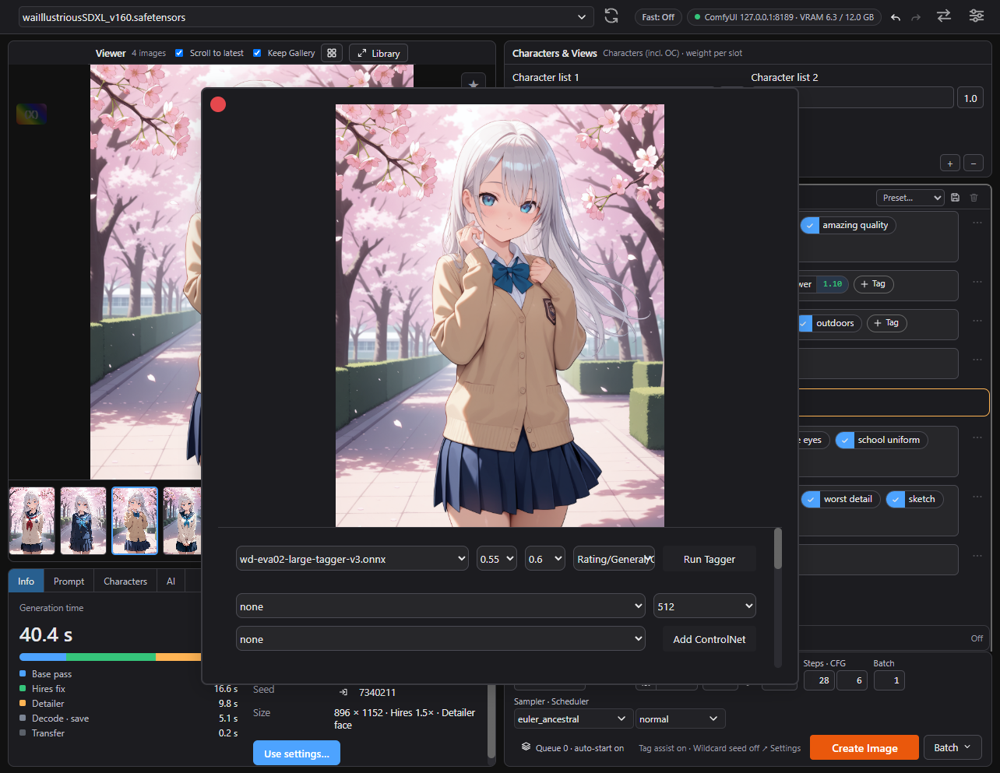
</details>

## キャラクターリスト
### お気に入り
キャラクター、オリジナルキャラクター、タグのお気に入りは選択モーダルで管理します。モーダルを開いてエントリの星を切り替え、上部のお気に入りグループから再び探せます。お気に入りタグはカプセル上で強調表示されます。お気に入りは設定と一緒に保存されます。

### プレビューと検索
キャラクターリストは英語・中国語・日本語のキーワード検索に加え、所属作品でも検索できます。`艦これ`、`kantai collection`、`FGO`、`ボカロ`、`崩壊` などでその作品のキャラクターに絞り込め、`kantai 加賀` のように作品と名前を組み合わせられます。作品名はキャラクター名の後ろに表示されます（`data/character_works.json`、生成手順は英語 README のメンテナ向けセクション参照）。


## 上部ボタンと右クリックメニュー
上部バーは左から: モデル、モデル一覧再読込、Fast モード、バックエンドの状態（GPU ターゲット Local / Pod）、Undo、Redo、右から左、設定。テーマの切り替えは 設定 → General に、ページ更新は 設定 → Advanced にあります。設定は自動で保存されます。

<details>
<summary>右クリックメニュー</summary>

メニューは右クリックした対象で変わります。チップ（ウェイト編集、有効 / 無効、関連タグ、コピー、削除、他の欄へ移動 / コピー）、プロンプト欄（欄のコピー / クリア、全タグ有効 / 無効、LoRA をスロットへ送る、選択範囲の移動 / コピー）、ギャラリー画像（画像 / メタデータのコピー、現在の画像を削除、ギャラリーをクリア）、AI 欄（AI 生成テスト）。

**スペルチェック（英語）**
スペルチェックエラー（波線）のある単語を右クリックすると候補が表示されます。
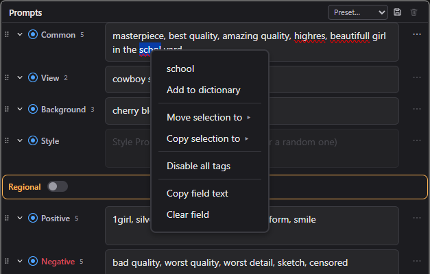

**AI プロンプト生成テスト**
`AI prompt` 欄を右クリックすると、生成せずに AI プロンプトを取得します。結果はポップアップで表示されます。AI ルールを `Last` にすると以降の生成でその結果を再利用します。
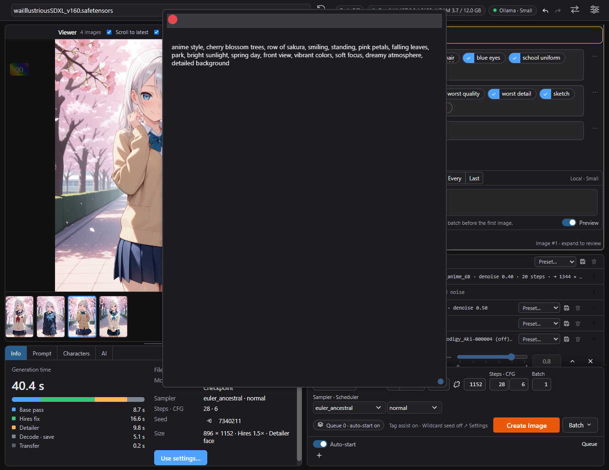

**画像 / メタデータのコピー**
`Gallery` を右クリックすると現在の画像またはメタデータをクリップボードにコピーします。
Image Saver ノードを使う ComfyUI では a1111 形式に近いメタデータが出力されます。
画像コピーは base64 を PNG に戻しますが、Chromium コアによりメタデータは除去されます。元画像が必要なら ComfyUI/WebUI の出力フォルダを確認してください。
SAAC の場合: ブラウザからローカルフォルダへ画像をドラッグするか、ブラウザメニューの `名前を付けて保存` を使ってください。
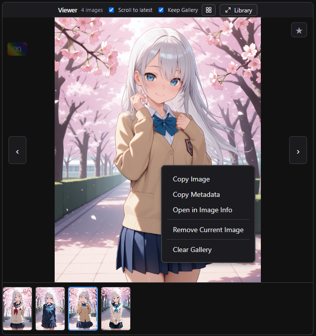

**LoRA をスロットへ送る**
`Common` または `Positive` を右クリックすると、テキスト形式の LoRA を LoRA スロットへ送ります。
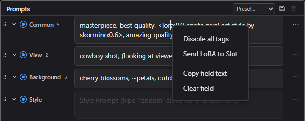
</details>

------
# AI プロンプト
リモート
1. セットアップガイドに従って `Remote AI url`、`Remote AI model`、`API Key` を設定します。
2. `AI Prompt` に何か入力します。例: `make character furry, and I want a detailed portrait`

ローカル
1. [Llama.cpp](https://github.com/ggml-org/llama.cpp) を自分でビルドするか、[信頼できるソース](https://github.com/ggml-org/llama.cpp/releases) からダウンロードします。
2. [HuggingFace](https://huggingface.co/) からモデルをダウンロードします。`oh-dcft-v3.1-claude-3-5-sonnet-20241022.Q8_0`（[こちら](https://huggingface.co/mradermacher/oh-dcft-v3.1-claude-3-5-sonnet-20241022-GGUF)）のような GGUF を推奨。
3. 推奨サーバー引数: `llama-server.exe -c 16384 --port <your local LLM port> -m "<your GGUF model here>"`
4. `AI Prompt Generator` を `Local` にします。
5. `Local Llama.cpp server` にローカル AI のアドレスとポートを設定します。
6. （任意）他のローカル AI サービスを使う場合は API 設定を確認してください。
7. `AI Prompt` に `make character furry, and I want a detailed portrait` のように入力します。

Refine（Nishiki）
1. [Ollama](https://ollama.com/) をインストールし、モデルを pull します。
2. AI モードを `Refine` にし、Ollama のアドレスとモデルを入力します。
3. 普段どおりプロンプトを書きます。各バッチの 1 枚目の前に、Refine が構造化リクエスト 1 回でプロンプト全体を書き直し、結果をエディタに適用します。気に入らなければ `Ctrl + Z` で戻せます。
4. Runpod の Pod を登録していれば、AI のホストに `Pod` を選べます。

------
# Image API Interface
*ComfyUI の場合*
> [!IMPORTANT]
> ワークフローが正しく読み込めない場合は、代わりに `2025-05-03-022732_1775747588.json` を使ってください。

1. ComfyUI の設定で `DEV mode` を有効にし、`examples\2025-05-03-022732_1775747588.png` を ComfyUI に読み込みます。[ComfyUI_Mira](https://github.com/mirabarukaso/ComfyUI_Mira) **v0.5.6.0 以上** がインストールされていることを確認してください。
    1.1. ComfyUI → Manager → Install PIP packages → opencv-python で `opencv-python` のインストールが必要な場合があります。
2. `Image API Interface` を `ComfyUI` にします。
3. `Image Interface IP Address:Port` が ComfyUI のページと一致していることを確認します。
4. 楽しんでください。

SAA でプレビューが表示されない場合は、起動 BAT に `--preview-method latent2rgb` を追加してください。
```
py ComfyUI\main.py --fast --use-sage-attention --cuda-malloc --windows-standalone-build --listen 0.0.0.0 --port 58188 --preview-method latent2rgb
```

*Forge Neo（WebUI）の場合*
1. `COMMANDLINE_ARGS`（webui-user.bat）に ` --api` を追加して `API mode` を有効にします。
2. WebUI を起動します。
3. `Image API Interface` を `WebUI` にします。
4. `Image Interface IP Address:Port` が WebUI のページと一致していることを確認します。
5. 楽しんでください。

## サードパーティ混在バックエンド向けカスタムパス
> [!WARNING]
> カスタムパスを有効にするとモデルパス設定が上書きされます。
> 公式の WebUI（Forge Neo/A1111）や ComfyUI では推奨しません。

`data/custom_path.yaml` を編集します。
1. `use_custom_path` を `true` にします。
2. カテゴリ全体を無効にするには `enable` を `false` にします。
3. 上書きしたくない個別のカスタムパスはコメントアウトします。
4. パス一覧は単一文字列・複数行文字列の両方に対応します。
5. 絶対パスと相対パス（base_path 基準）に対応します。

[#92 Stability Matrix で ComfyUI を使う場合のカスタムパス設定](https://github.com/mirabarukaso/character_select_stand_alone_app/issues/92)

## リモート利用時のフォルダパス問題
SAA はモデル・LoRA などを一覧するために ComfyUI/WebUI の checkpoints フォルダを検索します。バックエンドアドレスがリモート（127.0.0.1 以外）の場合、フォルダ検索に失敗し SAA は `Default` モードで動作します。このモードではモデル変更や LoRA スロットの設定ができません。
解決策は 2 つ:
1. `ミラーフォルダ` — リモートの `models` フォルダをローカルにコピーし、SAA にそのフォルダを設定します。簡単ですがディスク容量が必要です。
2. `シンボリックリンクまたは共有フォルダ` — シンボリックリンクを作るか、リモートの `models` フォルダを共有（読み取り専用推奨）し、SAA にそのフォルダを設定します。

## 高度なセキュリティ設定（API 認証）
> [!WARNING]
> *保護されていないローカルポートを公開インターネットに転送しないでください。*
> *WebUI（Forge Neo）のみ。適切で安全な方法が用意されるまで ComfyUI API を公開インターネットに転送しないでください。*

WebUI（Forge Neo）のコマンド引数は [Command-Line-Arguments-and-Settings](https://github.com/AUTOMATIC1111/stable-diffusion-webui/wiki/Command-Line-Arguments-and-Settings) を参照。

`webui-user.bat` を `webui-user-api.bat` にコピーし、以下の引数で編集します。
`user:pass` を自分の `ユーザー名:パスワード` に置き換えてください。
`--api` `--api-auth` は API と API 認証を有効にします。
`--nowebui` はブラウザ UI が不要な場合に指定します。
`--port 58189` は API ポートを `58189` にします。
```
set COMMANDLINE_ARGS= --xformers --no-half-vae --api --api-auth user:pass --nowebui --port 58189
```
新しい `webui-user-api.bat` で Forge Neo を起動します。
`ユーザー名:パスワード` を SAA → Settings → `WebUI API Auth` に貼り付け、`Enable` を `ON` にします。

------
# Hires Fix と Image Color Transfer
Image Color Transfer の詳細は [Image Color Transfer](https://github.com/mirabarukaso/ComfyUI_Mira#image-color-transfer) を参照してください。
*生成ルールがなく openCV も無いため、WebUI では Color transfer に対応しなくなりました。*

すべてのアップスケーラーモデルを `upscale_models` フォルダに置いてください。

ComfyUI の注意:
アップスケールモデルは自分でダウンロードします。`Manager` → `Model Manager` で `upscale` で絞り込んでください。

WebUI（Forge Neo/A1111）のアップスケーラーの注意:
WebUI は名前ベースのアップスケーラー一覧を使います。`静的なアップスケーラー一覧` が動作し、初回生成後に API の一覧に更新されます。

Forge はファイルベースの一覧を使いますが、これが厄介です。
  **重要: upscale_models フォルダが存在しない場合、SAA は静的な一覧を使います。**
  **迷ったら一度生成してください。HiFix モデル一覧が正しく更新されます。**
  解決策:
  1. `models` 内に `upscale_models` フォルダを作り、すべてのアップスケーラーモデルを入れます。
  2. アップスケーラーモデルのフォルダ名（例: `ESRGAN`）でシンボリックリンクを作り、`upscale_models` を指すようにします。
  3. Forge を再起動します。`Hires Fix` モデルが動作し、初回生成後に API の一覧に更新されます。

------
# 中国語翻訳とキャラクター検証
中国語翻訳とキャラクターデータの検証に貴重な時間を割いてくださった以下の方々に感謝します（順不同）。
**Silence, 燦夜, 镜流の粉丝, 樱小路朝日, 满开之萤, および匿名希望の 2 名。**

# キャラクターリスト Special Thanks
lanner0403 [WAI-NSFW-illustrious-character-select](https://github.com/lanner0403/WAI-NSFW-illustrious-character-select)
Cell1310  [Illustrious XL (v0.1) Recognized Characters List](https://civitai.com/articles/10242/illustrious-xl-v01-recognized-characters-list)
mobedoor [#23](https://github.com/mirabarukaso/character_select_stand_alone_app/issues/23)
UdinXProgrammer [#62](https://github.com/mirabarukaso/character_select_stand_alone_app/issues/62)
Nurimtod [#75](https://github.com/mirabarukaso/character_select_stand_alone_app/issues/75) [#83](https://github.com/mirabarukaso/character_select_stand_alone_app/issues/83)
atmogenic [#84](https://github.com/mirabarukaso/character_select_stand_alone_app/issues/84) [#85](https://github.com/mirabarukaso/character_select_stand_alone_app/issues/85)
funnygeeker [#87](https://github.com/mirabarukaso/character_select_stand_alone_app/issues/87)

------
# FAQ
`saa-nishiki.exe` をダブルクリックしても何も起きない
1. ファイルのダウンロード失敗やファイル不足が原因の可能性があります。
2. コンソールから実行してください。エクスプローラーのアドレスバーに `cmd` と入力するとコンソールが開きます。
3. `saa-nishiki` と入力して Enter を押し、バックエンドのログを確認してください。

セットアップウィザードで失敗した
1. アプリを閉じます。
2. `settings`（パッケージ版は `resources/app/settings`）の `app.json` を削除します。
3. もう一度試します。

ERR_CONNECTION_REFUSED
1. ほとんどの場合、（ComfyUI/WebUI）バックエンド API のアドレスが間違っています。

ブラウザ版の SAA は?
1. あります。
2. `高度なセキュリティ設定（API 認証）` を参照してください。

Error HTTP 400 ...... Cannot execute because node StepAndCfg does not exist ......
1. `ComfyUI_Mira` をインストールします。
2. ComfyUI を再起動します。

Upscale モデル一覧が `None`（ComfyUI）
1. 既定のディレクトリ設定を変更していませんか?
2. 非公式版ではありませんか?
3. [#58](https://github.com/mirabarukaso/character_select_stand_alone_app/issues/58) を確認してください。

ComfyUI/WebUI is busy, cannot run new generation, please try again later.
[README_SAAC.md](README_SAAC.md) の 5 と 6 を参照してください。

設定やプリセットはどこにある?
1. `settings/app.json`、`settings/state.json`、`settings/presets/`、`settings/user_lists.json` と、その隣の Parts、LoRA カタログ、Library のファイルです。[設定の保存先](#設定の保存先) を参照してください。
2. Nishiki 以前の `settings/*.json` は初回起動時に `settings/legacy/` へ移動されます。
