# SAA-Nishiki（二式）

[English](../README.md) | **日本語** | [简体中文](README.zh-CN.md)

> [!TIP]
> **TL;DR**
> - アニメキャラ画像のプロンプト組立 → 手元の ComfyUI / Forge Neo へ送信。描画はバックエンド側
> - 起動: [Releases](https://github.com/FUMIHITO-EGUCHI/saa-nishiki/releases) の zip → `saa-nishiki.exe`。または `git clone` → `npm install` → `npm start`（[詳細](#インストールと起動)）
> - 必要: ComfyUI + [ComfyUI_Mira](https://github.com/mirabarukaso/ComfyUI_Mira)、または Forge Neo。Illustrious 系 SDXL（サムネ基準 `waiIllustriousSDXL_v160`）。Anima = Diffusion 種別
> - キャラ約 5,000（日英中の名前で検索）。タグ = 日本語訳付きチップ。LoRA = サンプルグリッド。画像にレシピ → 読戻し・再生成

[Character Select SAA](https://github.com/mirabarukaso/character_select_stand_alone_app) のフォーク。AI プロンプト、セミオートタグ補完、ComfyUI / Forge Neo (WebUI) API 対応のスタンドアロンアプリ。

Nishiki の追加分:
- 日本語タグ翻訳
- タグをチップで扱う行形式のプロンプトエディタ
- Parts
- 独立モデル種別 Diffusion（Anima）。Cast と Prose 付き
- レシピを持つ画像、Library
- サンプルグリッド付き LoRA カタログ
- AI プロンプトリファイナー
- 高速生成モード
- Runpod Pod ターゲット

現在のリリース: **v4.2.0** — 上流 SAA 2.8.9 ベース。ダウンロードとリリースノートは [Releases](https://github.com/FUMIHITO-EGUCHI/saa-nishiki/releases)。

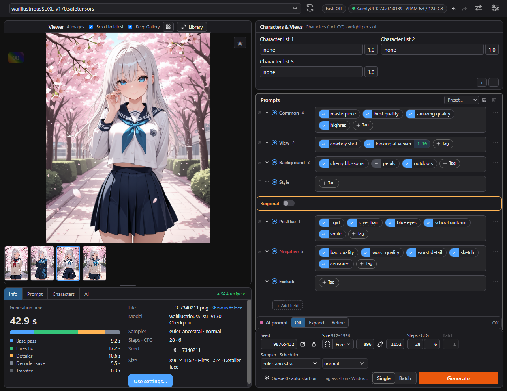

## 目次
- [Nishiki の追加機能](#nishiki-の追加機能)
- [インストールと起動](#インストールと起動)
- [更新](#更新)
- [Highlights（上流由来の機能）](#highlights)
- [AI プロンプト](#ai-プロンプト)
- [Image API Interface](#image-api-interface)
- [FAQ](#faq)

------

# Nishiki の追加機能

## 日本語タグ翻訳・ローカライズ
タグ・キャラ名・作品名を日本語で検索・表示。

- **辞書**: danbooru / e621 統合タグリストの日本語版、約 10 万エントリ（`data/danbooru_e621_merged_ja.csv`）
  - 作者と e621 のキャラクター以外の全グループを heat 10（投稿数 10 件）まで見直し済み
- **検索の順位**: 辞書全体が対象。前方一致が先、同じ帯の中では投稿数の多いタグが先
- **検索結果**:
  - スクロールで次の 50 件を読込、最後の行に一致件数
  - 各行に訳語と、一致した別名だけを表示
  - 入力中のスペースはタグの `_` にも一致（`white d` で `white_dress`）
- **キャラ名・作品名**: 日本語ローカライズ。タグ検索とキャラクター選択で同じ名前、タグカテゴリも日本語表示
- **UI 言語**: 設定で `ja-JP` を選ぶ。日本語訳のない UI 文言は英語にフォールバック

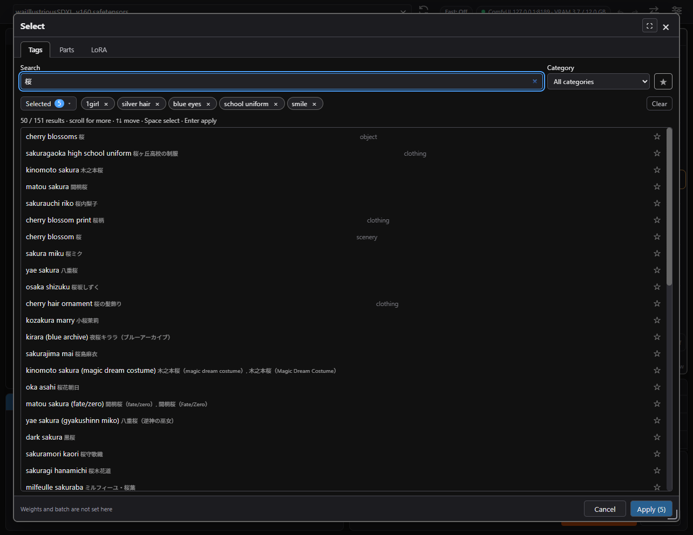

## プロンプトエディタ
Prompts カードは 1 本の行リスト。最終プロンプトは行の並び順で組立。

- **既定の行**: Common、View、Background、Style、Positive、Negative、Exclude。`+ Add field` で自分用の行を追加
- **行の操作**:
  - つまみ: 行の移動
  - ● スイッチ: ミュート
  - 名前のダブルクリック: 改名
  - ⋯ メニュー: Show as text / Show as chips、Insert part…、Weights per image…、Presets…、Make negative / Make positive、Rename、Delete field

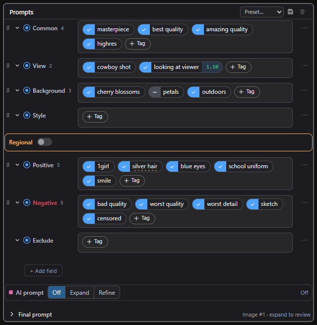

- **チップ**: 各行のタグは**チップ**表示
  - 左端に状態: ✓ 有効、− 無効、★ お気に入り、× 除外
  - 右端に重みかウェイトプラン
  - ✓ のクリックで、タグを消さずに無効化
  - `+ Tag` で Tags・Parts・LoRA タブ付きのタグ選択
- **ウェイトのポップオーバー**: チップのクリックで開く
  - 重み（テキスト表示では `Ctrl + 上下`）
  - バッチ用ウェイトプラン
  - 関連タグ: 共起と同じ語族。`data/tag_related.txt` からオフラインで提示
  - 訳語、お気に入りの ★
  - `(a, b:1.2)` のようなグループの重みは 1 チップ
- **行の間でタグを移動**:
  - チップを行の中や別の行へドラッグ。`Ctrl` か `Alt` を押しながらでコピー
  - 右クリックメニューの `Move to…` / `Copy to…` でも可
  - 重みと無効状態もタグと一緒に移る。1 回のドロップは 1 回の Undo で戻る
- **複数のタグを選択**:
  - `Ctrl + クリック` で個別選択、`Shift + クリック` で範囲拡張、`Ctrl + A` で行の全チップ、`Esc` で解除
  - 選択中のタグはまとめてドラッグ・削除・切替
  - 右クリックメニューも選択全体に効く（`Disable tag (3)`、`Move to (3)` など）
- **View 行**: アングル、カメラ、構図を置く行。中身は普通のタグと Parts で、重みも検索も他の行と同じ
- **プリセット**:
  - 行ごとのプリセット: ⋯ → Presets…
  - カードのプリセット: 行構成全体（行、名前、順序、内容）を保存し、適用でそのまま復元
- **辞書にないタグ**: 波線の下線
  - 理由: SDXL モデルはこうした語をほぼ無視する
  - 検証: `long staff` と `ancient staff` は何も変えず、実在タグの `wooden staff` は毎回杖を変えた
  - 文のように読めるチップ（4 語以上で既知タグでないもの）は破線・斜体で、そのまま送信
  - LoRA トークン、ワイルドカード、ランダム構文には印なし
- **投稿数の目安**: Danbooru / e621 の投稿数による参考表示。Diffusion では非表示
  - 100 件未満: 黄色の点線
  - 1,000 件未満: 灰色の点線
  - ポップオーバーに投稿数

## Parts
よく使うタグの組み合わせを、`parts:<名前>` という 1 チップとして保存。

- **中身の扱い**: チップの重みは中のタグに反映。ミュート、最終プロンプト、AI Refine、Prose、バッチ展開でも同じタグを使う
- **一覧**: タグ選択の Parts タブにカテゴリ別・サンプル付きで並ぶ
- **操作**: 今のタグからの作成、編集、タグへの展開、他の Part への差し替え。Part 自体に LoRA も持たせられる
- **スターターセット**: 295 件同梱（outfit、hair、body、background、camera、composition、tone、pose、expression など）
- **保存先**: Parts は `settings/parts.json`、サンプルは `settings/parts/`

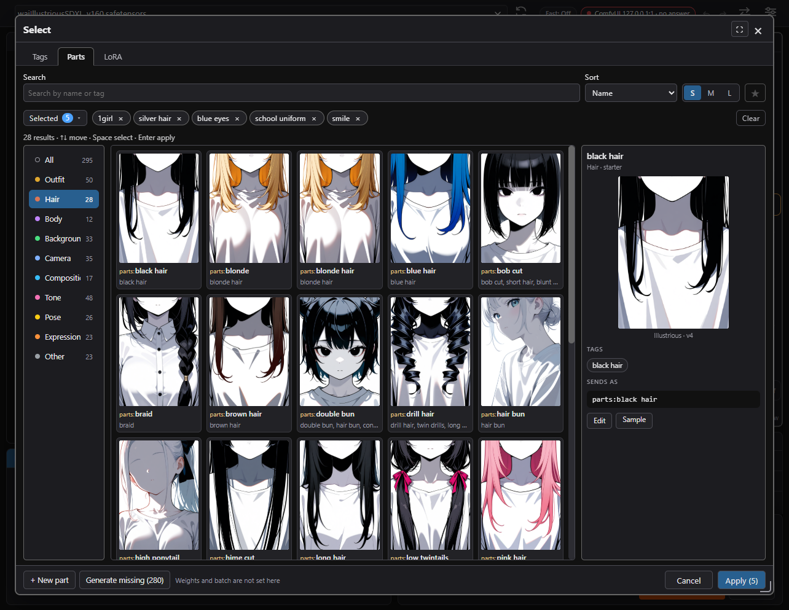

## ウェイトバッチ
バッチ 1 枚ごとに、タグの重みだけを変えて生成。seed は固定のまま。

- **設定**: ポップオーバーでタグに**ウェイトプラン**（開始、ステップ、終了）。または行の ⋯ → Weights per image…
- **`÷ batch count`**: ステップをバッチ数から自動計算
- **警告**: seed がランダムでない状態でバッチを始めると出る

## キャラクター・お気に入り・リスト管理
- **Characters カード**: キャラクタースロットを必要な数だけ（`+` / `−`）
  - スロットごとに重み
  - Regional ON のときは左右の側も持つ
- **選択画面**: キャラクターとオリジナルキャラクターを、訳語と**お気に入り**グループ付きで検索
  - 名前は英語・中国語・日本語のどれでも可
  - 作品名でも絞込可（`艦これ`、`kantai collection`、`FGO`）
- **リスト管理**（Settings → Lists）: キャラクター / OC / アングル / カメラのリストに項目を追加・上書き・非表示
  - 上流データは読み取り専用のまま。編集内容は差分として `settings/user_lists.json` に保存
  - エクスポート・インポート可
  - リスト項目に複数タグのプロンプトを持たせられる。項目エディタ内でもタグ選択が使える

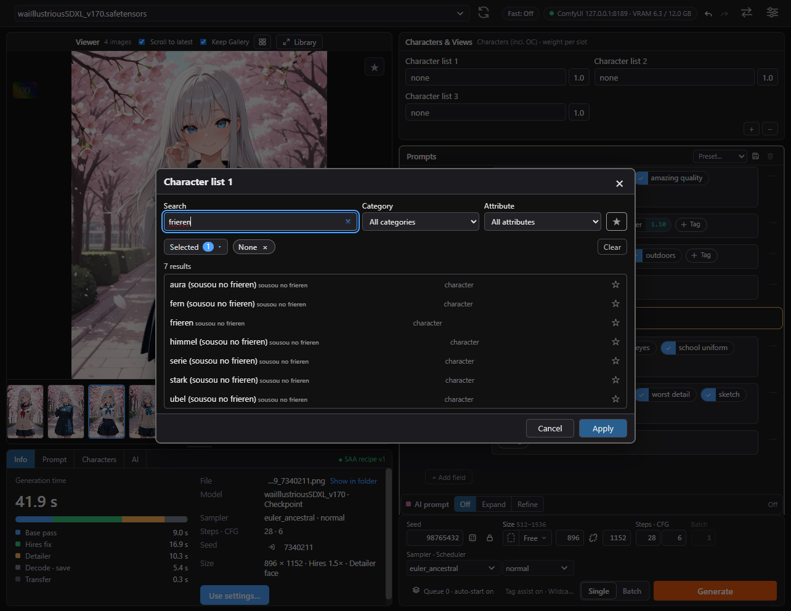

## Diffusion（Anima）
Checkpoint と並ぶ独立したモデル種別。

- **種別ごとの設定**: sampler、scheduler、steps、CFG、サイズ、Hires、Regional、プロンプト。切り替えても、一方の設定がもう一方に持ち込まれることはない
- **Cast**: キャラクタースロットごとに別名と専用のプロンプト行。Action 行で `@別名` を使い、誰が何をするかを書く
- **Prose**: Anima は Danbooru タグではなく英語を読むため、画像リクエストの前にタグを英文 1 段落に書き直す
  - 元は画像と同じ解決済みタグ（同じワイルドカード、同じ重み）
  - 編集・元に戻す・書き直しが可能
  - 書き手: AI カードの LLM（ローカルか Pod の Ollama）、または **Student**（35B モデルから蒸留した Qwen3.5-2B の LoRA）
  - Student は SAA が自分で起動する llama-server で動く。設定 > AI で実行ファイル、GGUF、ポートを指定（どちらも同梱なし）
  - 速さ: 12GB の GPU で ComfyUI と並べて 1 段落約 1 秒
- **Artist**: Danbooru の作者 17,716 人が何を描くかの辞書
  - 名前でも題材でも検索可（`cat ears` で猫耳を描く作者）
  - 1 枚に最大 3 人
- **Regional と Panels** も Diffusion で使える（[Regional Condition / Couple](#regional-condition--couple) 参照）

## 画像が作った内容を持つ
SAA で作った画像は、作ったときの内容と各段階の所要時間を PNG に持つ。

- **記録先**: PNG の `saa_recipe` と `saa_time` のテキストチャンク
- **記録する内容**: Generate を押した時点のエディタ、seed、Random の枠が選んだキャラクター、送ったプロンプト、AI の回答、Prose の段落、Fast モードが送った値
- **時間**: 同じ PC で動く ComfyUI の場合のみ記録
- **ビューワー**:
  - Info タブ: 表示中の画像の生成時間（バーと内訳）、ファイル、モデル、sampler、steps、CFG、seed（Seed 欄へ入れるボタン付き）、サイズと段、実際に効いた LoRA
  - 他のアプリで作った画像も PNG のチャンクから読む
  - Prompt タブ: 実行時のテキスト
  - ★ で画像を残し、矢印で前後の画像へ
- **Use settings…**: 画像のレシピと今のエディタを並べて開く
  - 項目ごとにチェック: 行ごとのタグ、Prose、LoRA、モデルと sampler、サイズと段、Regional、seed
  - 違う項目は最初からチェック済み。全部チェックすると同じ画像をもう一度作れる状態
  - A1111 の parameters しかない画像も読込可
  - 読込は 1 回の Undo で戻る
- **Library**: ComfyUI の出力フォルダと Pod の保存フォルダの全画像を、フォルダと日付ごとに開く
  - ビュー: このセッション、★、レシピあり
  - 検索と絞込: プロンプト・キャラクター・LoRA・モデル・seed・ファイル名
  - 横のパネル: Use settings…、★、フォルダで表示、ゴミ箱へ移動
  - インデックスとサムネイルは `settings/library/` に保存、画像から作り直し可

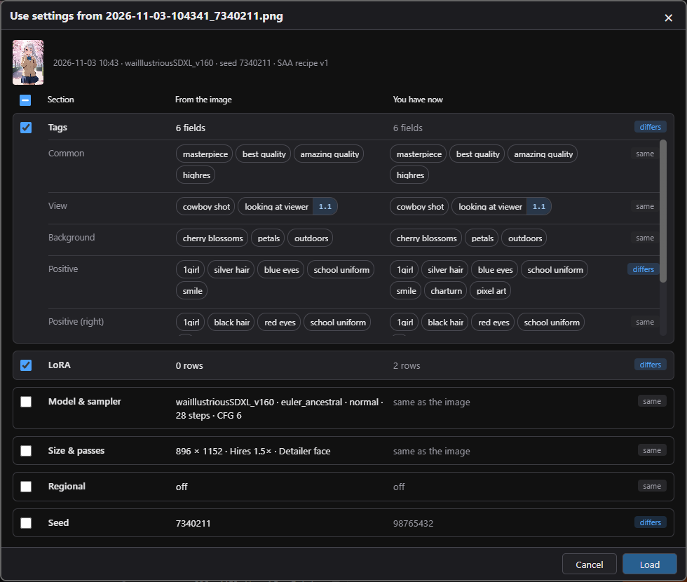 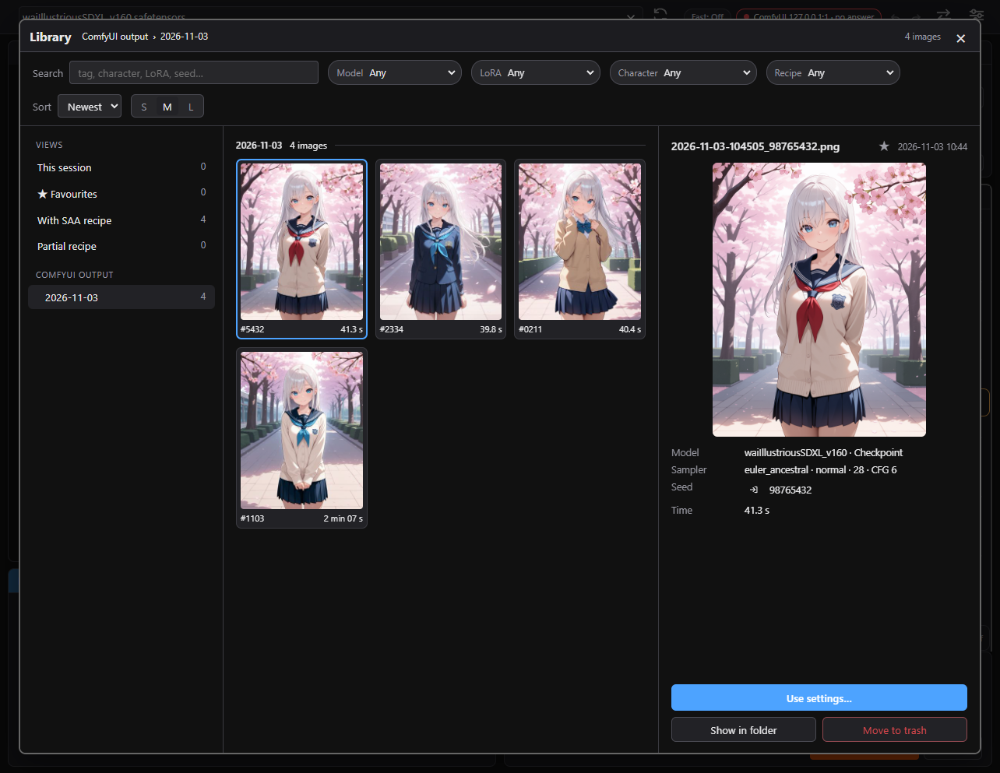

## LoRA カタログと LoRA 欄
- **LoRA タブ**: タグ選択の中。各 LoRA をサンプルのグリッドで表示
  - OFF と範囲内 5 段階の重みを、今のモデルと同じ seed で並べる。説明なしで効き方が分かる
  - 横のパネル: 既定の重み、サンプルの範囲、トリガー語、推奨タグ、自分用の名前
  - サンプル: Take samples / Retake。プロンプトは LoRA ごと、または全体の既定
  - 推定は `.safetensors` のヘッダーだけから。Civitai へはボタンを押したときだけ、ファイルの sha256 で問い合わせ
  - 保存先: カタログは `settings/loras.json`、サンプルは `settings/loras/`
- **LoRA 欄**: 各 LoRA が 1 行
  - 行の中身: ON/OFF スイッチ、名前、トリガー語（クリックでプロンプトから外す・入れる）、スライダーと数値
  - スライダーはサンプルの重みに目盛り。ホイールで 0.05、Shift 併用で 0.25 刻み
  - 折りたたみの中: 段（All、Base、Hires）、CLIP、範囲、トリガー語
  - 行を OFF にすると、そのトリガー語もプロンプトから外れる
  - `+ LoRA` は LoRA タブだけのタグ選択を開く
- **タグ・Parts と LoRA**: ある LoRA の推奨タグに当たるチップには `LoRA N` バッジ
  - ポップオーバーから LoRA を追加可
  - クリックしない限り何も追加しない

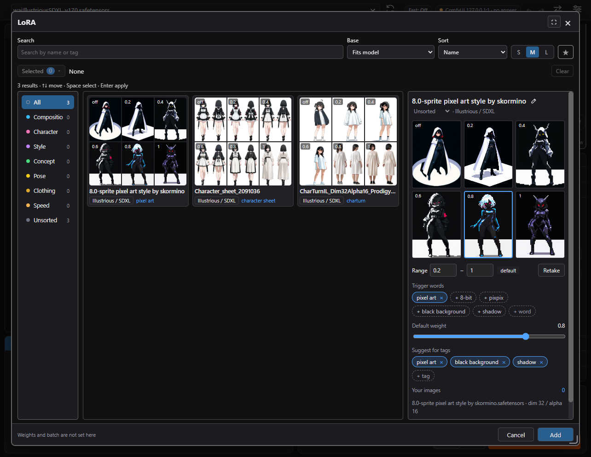 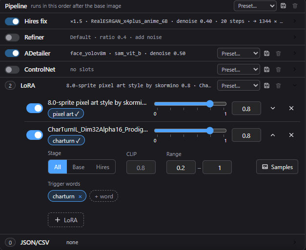

## サイズと比率
Run bar の Size は `[縦横 | 比率 ▾] [W] [チェーン] [H]`。

- **チップの左半分**: 幅と高さを入替
- **チップの右半分**: 比率タイルを開く。1:1、4:5、3:4、A4（1:√2）、2:3、黄金比（1:φ）、9:16、Free。タイルにはそれぞれのサイズを表示
- **比率を選ぶと**: 画素数を保ったまま 8 px 単位でサイズを決める
- **チェーン**: つなぐと、片方の入力にもう片方が比率で追従
- **範囲**: モデル種別に従う。Checkpoint 512〜1536、Diffusion 512〜2048（上限は設定で変更可）

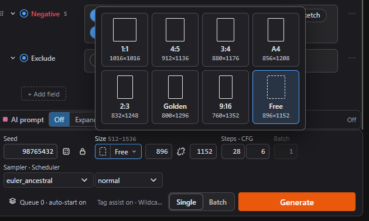

## Undo / Redo
プロンプト編集、プリセット適用、AI Refine の結果は、すべてグローバルな編集履歴の 1 ステップ。

- **操作**: `Ctrl + Z` / `Ctrl + Shift + Z`（または `Ctrl + Y`）、ツールバーのボタン

## AI プロンプトリファイナー
上流のリモート / ローカル `llama.cpp` による AI プロンプトに加え、[Ollama](https://ollama.com/) を使う **Refine** モードを追加。

- **動き**: バッチごとに最初の 1 枚の前で、構造化した 1 回のリクエストでプロンプト全体を書き直し、結果を行ごとにエディタへ反映
- **履歴**: Refine による編集は編集履歴に残り、Undo 可
- **動作文**: タグの中の平易な英文の動作文（Regional Condition の「誰が誰に何をするか」参照）は、タグに分解せず文のまま残す
- **`Regional` ON のとき**: 側別の Negative も含めて両側を書き直す
- **生成時に追加されるもの**: キャラクター、JSON スロット、ワイルドカード、スロットの LoRA。元の位置に残し、書き直した行の前後に戻す
- **結果の表示**: 毎回のポップアップではなく **Info パネルの AI タブ**

## 高速生成モード
設定 → Backend → **Fast generation**。ステップ蒸留 LoRA で生成を速くする。

- **Checkpoint**:
  - ステップ蒸留 LoRA（DMD2 / Hyper-SD / Lightning / LCM）を適用
  - ベース・Hires fix・ADetailer の各パスの steps、CFG、sampler、scheduler を上書き
  - ローカル ComfyUI と Pod の両方で動作
- **Diffusion（Anima）** には専用のセット:
  - Anima Turbo LoRA v0.2 を 0.8、8 steps、CFG 1.5、euler / simple
  - ComfyUI の起動フラグ `--use-sage-attention --fast`
- **フラグと再起動**:
  - フラグはプロセス全体に効くため、別のフラグが必要な実行の前に、SAA はローカル ComfyUI を再起動
  - 使うのは 設定 → Backend → ComfyUI process → 起動コマンド（追加引数を `main.py` に渡せるもの）
  - SAA が外すのは、自分で ComfyUI を起動したときに付けたフラグだけ
  - LoRA は Pod でも使えるが、フラグはローカル ComfyUI のみ
- **実測**:

| GPU | 条件 | 通常 | 高速 |
| --- | --- | --- | --- |
| RTX 4070 SUPER | 600×1024、Hires 1.5x、ADetailer | 30 steps ≈ 29 秒 | DMD2 8 steps ≈ 16 秒 |
| RTX 4070 | 832×1216、waiANIMA | 25 steps ≈ 17〜19 秒 | 両フラグ付きの Turbo 8 steps ≈ 4.8 秒 |

- **画質**: `--fast` は色と細部をわずかに変える

プロンプトの LoRA は Hires と ADetailer のパスにも効く。ワークフローは 1 枚の間、LoRA を掛けた同じモデルを使い続けるので、1 回の実行の中で ComfyUI がモデルファイルを読み直すことはない。

## ローカルの ComfyUI を SAA から操作
設定 → Backend から、ローカル ComfyUI を起動・再起動・停止。SAA と一緒の起動も可能。

- **停止の範囲**: SAA が通信している ComfyUI だけ
- **ポートを使う別のプログラム**: pid とプログラム名を示し、指示した場合だけ終了
- **起動コマンド**: ネイティブのダイアログで一度許可してから実行

## Runpod Pod ターゲット
設定で Runpod の Pod（SSH の接続先と鍵）を登録し、ツールバーのステータスピルで画像生成を **GPU: Local** と **GPU: Pod** に切替。

- **画像**: SSH 経由で送り返され、ローカルにのみ保存。Pod のディスクには何も書かない
- **LLM 機能**: AI プロンプト / Refine / Prose にも Pod を使える。AI プロンプト / Refine のリクエストは、同じ SSH リレー経由で Pod 上の Ollama へ
- **エンドポイント**: 認証付きの `https` / `wss` バックエンドも可
- **詳細**: セットアップ、Pod 再起動時の復元スクリプト、トラブルシューティングは [README_POD.md](README_POD.md)

## UI シェル
- **レイアウト**: 新しいビューポートレイアウト、ステータスピル、実行の進捗表示、ダーク / ライトテーマ
- **色**: 両テーマとも 1 つのトークンファイル `design/tokens.json` から。`scripts/buildThemeTokens.mjs` がテーマのファイルに書き出す
- **アイコン**: 1 つのセット `scripts/shared/iconSet.js` から
- **ダイアログ**: ボタンの並びは全部同じ（Cancel / No が左、主のボタンが右）。Esc は手前のダイアログから閉じる
- **右クリックメニュー**: 対象（チップ、プロンプト行、ギャラリー画像、AI 欄）ごとに内容が変わる

## 設定の保存先
設定はセクションに分割、スキーマバージョン付きで保存。

| ファイル | 中身 |
| --- | --- |
| `settings/app.json` | アプリ設定（バックエンド、パス、AI、高速モード、Pod） |
| `settings/state.json` | プロンプト / 生成 / LoRA / ADetailer / ControlNet の作業状態（モデル種別ごと） |
| `settings/presets/<section>/<name>.json` | プリセット |
| `settings/user_lists.json` | リスト管理の差分 |
| `settings/parts.json`、`settings/parts/` | Parts とそのサンプル |
| `settings/loras.json`、`settings/loras/` | LoRA カタログとそのサンプル |
| `settings/library.json`、`settings/library/` | ★、ComfyUI の出力フォルダ、Library のインデックスとサムネイル |
| `settings/legacy/` | 分割前の `settings/*.json`。初回起動時にここへ移動、以降は読まない |

- **書込**: すべて自動保存・アトミック書込
- **git**: `settings/` は同梱の MiraITU ワークフローファイル以外 git 管理外

## バージョニング
Nishiki は 3.0.0 から独自のセマンティックバージョン。

- **minor**: 機能追加。新しい上流を取り込むときも minor を上げる
- **patch**: バグ修正
- **上流のベース**: `package.json` の `upstreamBase`（2.8.9）とリリースノートに記録
- **リリース**: ごとに `v<version>` のタグと GitHub Release。Release の本文が変更履歴（`docs/CHANGELOGS.md` は上流のもの）

------

> [!NOTE]
> リストに出ないが正しく生成できるキャラクターを見つけたら、issue で知らせてほしい。
>
> - 既定の thumbList: `waiIllustriousSDXL_v160` ベース
> - 代替の thumbList: `waiANIMA_v10Base10` と `waiNSFWIllustrious_v120`。選択すると `HuggingFace` から自動ダウンロード
> - 独自の thumbList: [SAA Thumb Generator](../scripts/python/thumb-generator/README.md) で作成

| 検証済み | [ComfyUI](https://github.com/comfyanonymous/ComfyUI)  | [Forge Neo](https://github.com/Haoming02/sd-webui-forge-classic/tree/neo) |
| --- | --- | --- |
| Release | 0.40.0 | 2.27 |
| Refiner (SDXL) | Yes | Yes |
| Image Color Transfer (ALL) | Yes | No |
| Regional Condition / Couple (SDXL/Anima) | Yes | Yes |
| ControlNet/IPA (SDXL) | Yes | Yes |
| ADetailer (ALL) | Yes | Yes |
| API authentication| No | Yes |
| MiraITU | Yes | No |
| 高速生成モード | Yes | No |
| Runpod Pod ターゲット | Yes | No |

> [!IMPORTANT]
> - `Forge Neo` の `Regional Condition / Couple` と `ADetailer` は `SDXL と Anima` に対応
> - `ComfyUI` では SAA が対応する全 diffusion モデルで動くはず。要検証
> - *ComfyUI Desktop は非対応*
> - *A1111 はメンテナンス停止のため対応リストから除外。SAA で動作はするが未テスト*
>
> *オンライン版 Character Select* [Hugging Face Space](https://huggingface.co/spaces/flagrantia/character_select_saa)
>
> - ブラウザ版 SAAC: [README_SAAC.md](README_SAAC.md) を参照
> - OpenClaw 向け Python CLI ツール: [SAA Agent](../scripts/python/saa-agent/README_HUMAN.md) と [ClawHub](https://clawhub.ai/mirabarukaso/saa-agent) を参照

## thumbList 手動ダウンロード
<details>
<summary>SAA 内のダウンロードが遅い・失敗する場合は手動で。</summary>

[HF データセット](https://huggingface.co/datasets/flagrantia/character_select_stand_alone_app/tree/main) から以下のファイルを `data` フォルダにダウンロードし、次の名前にリネーム。

### waiIllustriousSDXL_v160
[waiIllustriousSDXL_v160_thumbs.json](https://huggingface.co/datasets/flagrantia/character_select_stand_alone_app/resolve/main/wai_character_thumbs_v160.json?download=true)

[waiIllustriousSDXL_v160_characters.csv](https://huggingface.co/datasets/flagrantia/character_select_stand_alone_app/raw/main/wai_characters_v160.csv)

[waiIllustriousSDXL_v160_tag_assist.json](https://huggingface.co/datasets/flagrantia/character_select_stand_alone_app/raw/main/waiIllustriousSDXL_v160_tag_assist.json)

### waiIllustriousSDXL_v120
[waiNSFWIllustrious_v120_thumbs.json](https://huggingface.co/datasets/flagrantia/character_select_stand_alone_app/resolve/main/wai_character_thumbs_v120.json?download=true)

[waiNSFWIllustrious_v120_characters.csv](https://huggingface.co/datasets/flagrantia/character_select_stand_alone_app/raw/main/wai_characters_v120.csv)

[waiNSFWIllustrious_v120_tag_assist.json](https://huggingface.co/datasets/flagrantia/character_select_stand_alone_app/raw/main/waiIllustriousSDXL_v160_tag_assist.json)

### waiANIMA_v10Base10
[waiANIMA_v10Base10_thumbs.json](https://huggingface.co/datasets/flagrantia/character_select_stand_alone_app/resolve/main/waiANIMA_v10Base10_thumbs.json?download=true)

[waiANIMA_v10Base10_characters.csv](https://huggingface.co/datasets/flagrantia/character_select_stand_alone_app/raw/main/waiANIMA_v10Base10_characters.csv)

[waiANIMA_v10Base10_tag_assist.json](https://huggingface.co/datasets/flagrantia/character_select_stand_alone_app/raw/main/waiANIMA_v10Base10_tag_assist.json)

</details>

# インストールと起動
> [!TIP]
> - SAA 起動前に [Image API Interface](#image-api-interface) を設定
> - ComfyUI の場合は最新の [ComfyUI_Mira](https://github.com/mirabarukaso/ComfyUI_Mira) が必要
>
> *ワンクリックパッケージ v2.8.0（上流）*
> フルパッケージ [embeded_env_for_SAA](https://huggingface.co/datasets/flagrantia/character_select_stand_alone_app/resolve/main/embeded_env_for_SAA.zip)

リポジトリをローカルにクローン。
```
git clone https://github.com/FUMIHITO-EGUCHI/saa-nishiki.git
cd saa-nishiki
npm install
npm start
```

### ローカル CDP デバッグ（任意）

CDP は既定で無効。Chrome DevTools や互換の MCP クライアントから Electron レンダラーを検査するときに使う。

ローカルのデバッグポートを指定して SAA を起動:

```powershell
$env:SAA_CDP_PORT = "9222"
npm start
```

パッケージ済みの実行ファイルでは次のオプションが同等:

```powershell
.\saa-nishiki.exe --saa-cdp-port=9222
```

- **エンドポイント**: SAA 実行中は `http://127.0.0.1:9222/json/list`
- **ポート**: `9222` が使用中なら別のポートを指定
- **注意**: CDP はレンダラーの検査・操作ができる。信頼できないマシンや外部から到達可能なマシンでは有効にしないこと

# 更新
> [!IMPORTANT]
> **GitHub からの更新ではデータセットファイルは更新されない。**
> 1. `data` フォルダ内の `danbooru_e621_merged.csv`、`*_thumbs.json`、`*_characters.csv`、`*_tag_assist.json` を手動で削除
> 2. アプリを再起動すると、最新のサムネイルデータベースを HF からダウンロード

```
git fetch
git pull
npm install
```

設定・プリセット・リスト管理の差分は `settings/` にあり、更新で変わることはない。

------
# Highlights
以下は上流 SAA から引き継いだ機能。スクリーンショットは可能な範囲で Nishiki UI で撮り直し済み。

## ComfyUI / Forge Neo 向け Diffusion モデル（UNET/CLIP/VAE）
> [!NOTE]
> - テスト・検証済み: Anima / Qwen Image / Z Image / Flux / Krea2
> - ComfyUI と Forge Neo に対応。オリジナルの A1111 は非対応


> [!NOTE]
> 上のスクリーンショットは旧（上流）UI のもの。

<details>
<summary>Diffusion モデルの詳細</summary>

**ComfyUI**
- モデル: [Comfy-Org@HF](https://huggingface.co/comfy-Org/) を参照
- `GGUF モデル` にはカスタムノード [gguf](https://github.com/calcuis/gguf)（小文字のもの）が必要
```
|---models
|   |---checkpoints
|   |---diffusion_models
|   |---text_encoders
|   |---vae
```

**Forge Neo**
- モデル: [Download Models@Haoming02](https://github.com/Haoming02/sd-webui-forge-classic/wiki/Download-Models) を参照
- `GGUF モデル` に対応するが、`Diffusion モデル` は `Checkpoint` と同じフォルダを使う。正しいフォルダで管理すること
```
|---models
|   |---Stable-diffusion
|   |---text_encoder
|   |---VAE
```
</details>

## Mira Image Tiled Upscaler
> [!NOTE]
> MiraITU: ビジョンモデルに基づくコンテンツ認識型の画像超解像 ComfyUI カスタムノード。
> 任意の画像を SAA/SAAC にドラッグ&ドロップするだけでアップスケール。

| Before | 6x After (SDXL) | Before | 3x After (Flux.2) |
| --- | --- | --- | --- |
|    |   |    |   |

<details>
<summary>MiraITU の詳細</summary>

- **倍率**: 1.5 倍から 8 倍まで
- **VRAM**: タイルサイズの調整で最適化。8GB の GPU でも 1.5〜3 倍（以上）、24GB 以上のハイエンド GPU なら 4〜8 倍

必要なもの:
- [ComfyUI_Mira](https://github.com/mirabarukaso/ComfyUI_Mira) `0.5.6.0 以上`
- [MiraSubPack](https://github.com/mirabarukaso/ComfyUI_MiraSubPack) `最新版`
- [Mira](https://github.com/mirabarukaso/ComfyUI_Mira#tagger) の Image Tagger

| Settings | Drag and Drop | Flux.2 |
| --- | --- | --- |
| 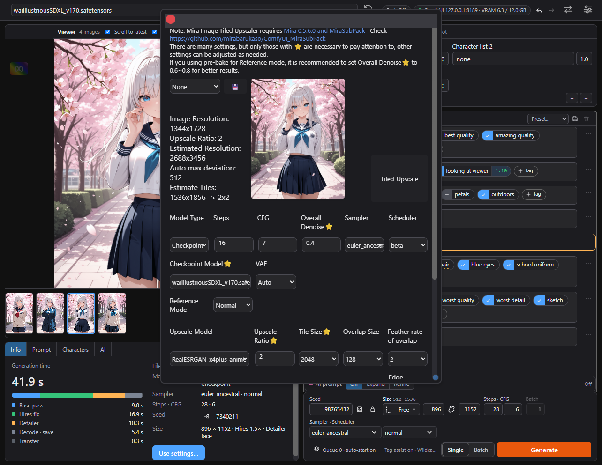 | 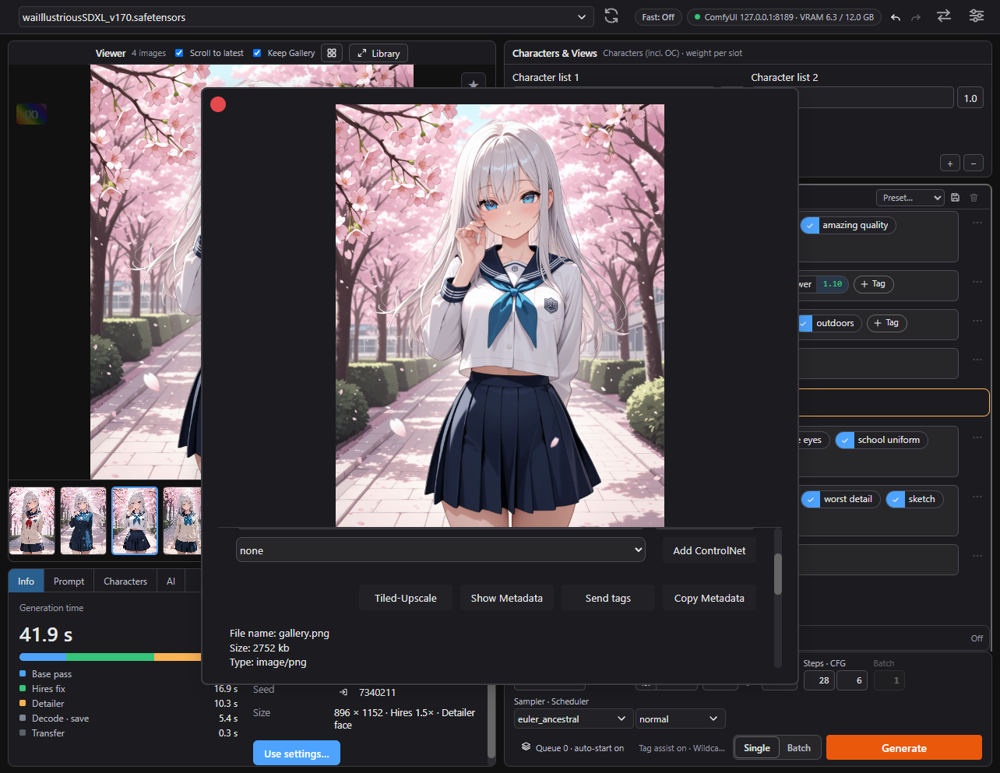   | 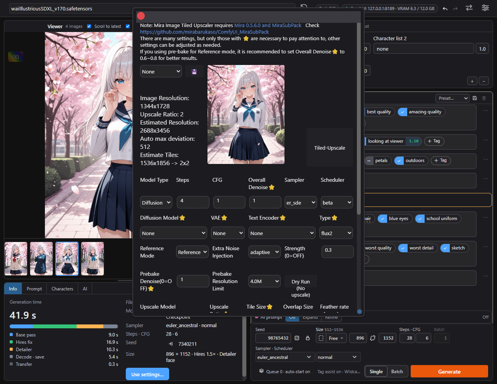   |

生成結果はモデル次第:
- **`SDXL` モデル**: 正確な内容記述のために `tagger` が必要。`upscale モデル` の使用を推奨
- **`Flux2` など `reference latent` を接続できるモデル**: upscale モデルを省略して元画像を直接引き伸ばせる。その場合は `Positive Prompt` で全タイルを統一的に設定

| 拡大率 1024x1360(1536) | Tile Size | VAE 8G | VAE 24G~ |
| --- | --- | --- | --- |
| x1.5 | 768 | Full | Full |
| x2 | 1280 | Full/Tiled | Full |
| x3 | 1536 | Tiled | Full |
| x4 | 2048 | Tiled | Full |
| x6 | 2048/2560 | Tiled | Full |
| x8 | 2560/3072 | Tiled | Full/Tiled |

注: SDXL モデルの制約により、8 倍を超える拡大では視覚的な断片化が激しい。より高倍率が必要なら専用の ComfyUI ワークフローを使用。
[ComfyUI Workflow MiraITU](https://github.com/mirabarukaso/ComfyUI_MiraSubPack/blob/main/examples/MiraITU_workflow.png)
</details>

## Image Tagger
ONNX 形式の [WD@SmilingWolf](https://huggingface.co/SmilingWolf)、[CL@cella110n](https://huggingface.co/cella110n/cl_tagger)、[Camie@Camais03](https://huggingface.co/spaces/Camais03/camie-tagger-v2-app) モデルに対応。

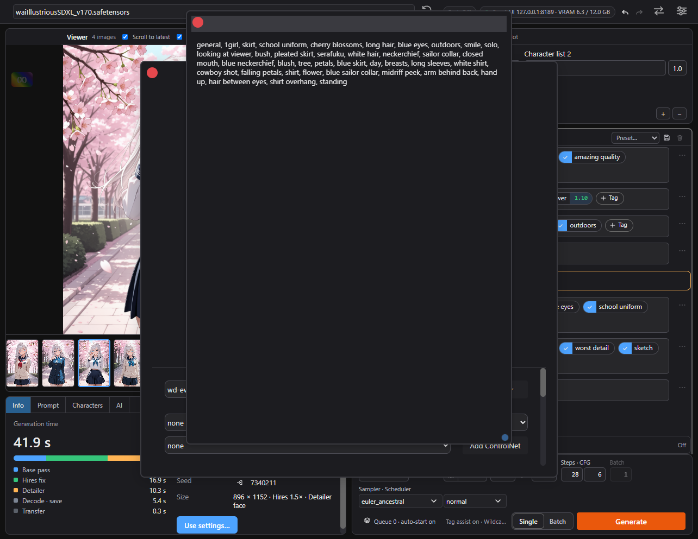

<details>
<summary>Image Tagger の詳細</summary>

[HF](https://huggingface.co) からタグ付きのモデルをダウンロードし、次の規則でリネームして `models/tagger` フォルダにコピー。
  - cl_tagger_v2.onnx + cl_tagger_v2_tag_mapping.json
  - wd-eva02-large-tagger-v3.onnx + wd-eva02-large-tagger-v3_selected_tags.csv
  - wd-v1-4-convnext-tagger.onnx + wd-v1-4-convnext-tagger_selected_tags.csv

```
SAA
|---models
|   |---tagger
|       |---cl_tagger_1_02.onnx
|       |---cl_tagger_1_02_tag_mapping.json
|       |---wd-eva02-large-tagger-v3.onnx
|       |---wd-eva02-large-tagger-v3_selected_tags.csv
|       |---wd-vit-large-tagger-v3.onnx
|       |---wd-vit-large-tagger-v3_selected_tags.csv
|       |---camie-tagger-v2.onnx
|       |---camie-tagger-v2-metadata.json

Options:
Model Name  >>>  General Threshold(CL/WD/Camie)  >>>  Character Threshold(CL/WD)  >>> Categories(CL/Camie) or mCut(WD)
```

- **動作環境**: Node.js 上の `onnxruntime-node`。*バックエンド不要* だが、GPU アクセラレーションは効かない模様
- **速度**: CPU モードの `Python` + `onnxruntime` の約 3 倍、`onnxruntime-gpu` の約 12 倍遅い
- **利点**: 生成中でも `Image tagger` を実行可能

| Device | Avg Tagging Time | Model | Platform | Resolution | Recommend Value |
| --- | --- | --- | --- | --- | --- |
| onnxruntime | 1.053s | cl_tagger_1_02 | Python | 448 | 0.55/0.60 |
| onnxruntime-gpu | 0.297s | cl_tagger_1_02 | Python | 448 | 0.55/0.60 |
| onnxruntime-node | 3.185s | cl_tagger_1_02 | Electron(NodeJS@CPU) | 448 | 0.55/0.60 |
| onnxruntime-node | 2.917s | wd-eva02-large-tagger-v3 | Electron(NodeJS@CPU) | 448 | 0.35/0.85 |
| onnxruntime-node | 2.113s | camie-tagger-v2 | Electron(NodeJS@CPU) | 512 |  0.50/(NOT USE) |
</details>

## ControlNet / IP Adapter
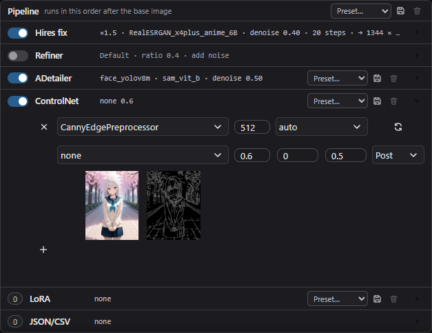

<details>
<summary>ControlNet / IP Adapter の詳細</summary>

### ComfyUI の場合
[ComfyUI_Mira](https://github.com/mirabarukaso/ComfyUI_Mira) を `0.5.6.0 以上` に更新。

**ControlNet**
- 必要: [comfyui_controlnet_aux](https://github.com/Fannovel16/comfyui_controlnet_aux) 1.1.5 [latest](https://github.com/Fannovel16/comfyui_controlnet_aux/commit/e8b689a513c3e6b63edc44066560ca5919c0576e)
- `ControlNet` モデルは `ComfyUI\\models\\controlnet` に配置

**IP Adapter**
- 必要: [comfyui-art-venture](https://github.com/sipherxyz/comfyui-art-venture) 1.1.7 [latest](https://github.com/sipherxyz/comfyui-art-venture/commit/210dc072b1f103f91be18a33bdeb13ab315aaae5) と [ComfyUI_IPAdapter_plus](https://github.com/cubiq/ComfyUI_IPAdapter_plus) 2.0.0 [latest](https://github.com/cubiq/ComfyUI_IPAdapter_plus/commit/a0f451a5113cf9becb0847b92884cb10cbdec0ef)
- `Clip Vision` モデルは `ComfyUI\\models\\clip_vision` に配置
- `IP Adapter` モデルは `ComfyUI\\models\\ipadapter` に配置
- `SDXL/ilXL/NoobXL` の推奨の組み合わせ:
  - `CLIP-ViT-bigG-14-laion2B-39B-b160k.safetensors` と `ipa_styleIpadapterFor_NoobAI-XL_v10.safetensors`
  - `CLIP-ViT-H-14-laion2B-s32B-b79K.safetensors` も必要な場合あり
- ComfyUI が受け付けるのは最初の `IP Adapter` スロットのみ。他のスロットを `On` にしても無視

### Forge Neo の場合
- ComfyUI の `Post` はプリプロセッサなしで処理済み画像を ControlNet モデルに直接渡し、preProcessModel に `none(null)` を受け付ける
- Forge 系 ControlNet は `none(null)` を受け付けず、`None(String)` を受け付ける

*Forge Neo:*
  `ControlNet` と `IP Adapter` モデルは `models\\ControlNet` に配置。
  `None` を使い、常に `On` にする。

### 使い方
1. 画像（または openPose 画像）を `Image Info` にドラッグ&ドロップ（または `Add` → `Paste`）。`Pre-processor`、`Resolution`、`Post-processor` を選んで `Add ControlNet` をクリック
   - `Added` と出るとプレビューが前処理済み画像に切り替わる
   - `Image info` を閉じ、`ControlNet` タブで詳細設定を確認
   - **ドロップダウンやテキスト項目にマウスを乗せると説明が出る**
2. `ControlNet` タブで `Pre-processor` を変更し `Refresh` をクリックするとプレビューを再生成（`Method` を `On` にした場合、SAA のプレビューは更新されない）
3. `ControlNet` 設定は SAA 終了時に保存されない（画像が設定ファイルには大きすぎるため）。別の設定ファイルへ切り替えても現在の `ControlNet` 設定は上書きされない
4. `ControlNet` は通常・Regional 両方の条件付けで動作
5. `ControlNet` が初めてなら、まず `Canny` か `OpenPose` から
6. ComfyUI は同じデータの再送信を嫌う。同一データを送ると `Empty response error` が出ることがある
7. [comfyui-art-venture](https://github.com/sipherxyz/comfyui-art-venture) は `正方形画像` を要求。非正方形の入力では警告
8. IPA 画像が大きすぎる場合、`IP Adapter` の `Resolution` で入力画像をリサイズ。ほとんどの場合 `1024` で十分
9. `Pre-Process Model` が `IP Adapter` のとき `Info` ボタンは動作しない
10. **Union モデル**（xinsir `controlnet-union-sdxl`、ProMax）: 各スロットに `Union control type`
    - `auto`: `Post-processor` 名に `union` / `promax` を含むとき、`Pre-processor`（OpenPose、Depth、Canny/LineArt など）から種類を決める。通常の単機能モデルには何もしない
    - `Pre-processor` = `none` で加工済み画像を渡すときは、種類を手動で選ぶ
    - ComfyUI ではローダーと `Apply ControlNet` の間に `SetUnionControlNetType` ノードを追加

モデルの入手:
- `Pre-processor` モデル: すべて [comfyui_controlnet_aux](https://github.com/Fannovel16/comfyui_controlnet_aux)（ComfyUI）が管理。多くは Hugging Face からダウンロードされる
- `Post-processor` モデル（`Apply ControlNet Model`）: すべて `ComfyUI Model Manager` か Hugging Face から自分でダウンロード
</details>

## LoRA スロット
- **Forge Neo（WebUI）**: 既定の LoRA プロンプト形式 `<lora:xxxxx:1.0>` に対応
- **ComfyUI**: より詳細な LoRA 設定に対応。[LoRA from Text](https://github.com/mirabarukaso/ComfyUI_Mira#lora) を参照
- **Nishiki**: LoRA スロットは LoRA 欄の行。各 LoRA の効き方はタグ選択の LoRA タブで確認。[LoRA カタログと LoRA 欄](#lora-カタログと-lora-欄) を参照

**ComfyUI API で LoRA を使うには ComfyUI_Mira を 0.5.6.0 以上に更新。**

## ADetailer
> [!TIP]
> 設定が分かりにくければ、スロットの最後の数値（Denoise）だけ調整すれば OK。欄にマウスを乗せると名前が出る。

*ComfyUI の場合*
> [!CAUTION]
> 出所不明・信頼できないサイトの .pt ファイルはダウンロード前に確認。
> https://github.com/ltdrdata/ComfyUI-Impact-Pack/issues/843

- 必要: [Impact Pack](https://github.com/ltdrdata/ComfyUI-Impact-Pack) 8.28.3 [latest](https://github.com/ltdrdata/ComfyUI-Impact-Pack/commit/429d0159ad429e64d2b3916e6e7be9c22d025c3c) と [Impact Subpack](https://github.com/ltdrdata/ComfyUI-Impact-Subpack) [latest](https://github.com/ltdrdata/ComfyUI-Impact-Subpack/commit/50c7b71a6a224734cc9b21963c6d1926816a97f1)
- `ADetailer` モデルは `ComfyUI\\models\\ultralytics\\bbox` に配置
- `SAM` モデルは `ComfyUI\\models\\sams` に配置

*Forge Neo の場合*
- 必要: [ADetailer Neo](https://github.com/Haoming02/ADetailer-Neo) [latest](https://github.com/Haoming02/ADetailer-Neo/commits/main/)
- `Upscaler`、`Control Processor`、`ADetailer` の一覧は API から読込
- 既定の ADetailer モデル一覧は初回生成後に更新。普段どおり画像を生成すればよい
- `ADetailer` モデルは `sd-webui-forge-neo\\models\\adetailer` または `stable-diffusion-webui\\models\\adetailer` に配置

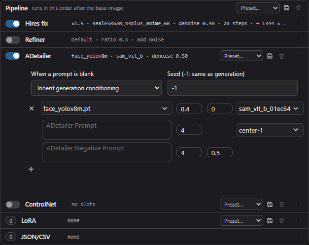

## キューマネージャ
パラメータの異なる複数の生成タスクを投入可。

- **処理**: キューは自動で処理を始め、完了したタスクを取り除く
- **一時停止**: エラー発生時や `Auto-start` オフのとき、現在のタスク終了後に停止。内容は保持
- **タスクの操作**: `削除` と `詳細表示`。先頭タスクを削除すると現在の生成をキャンセル
- *キューの長さは 10,000 以下を推奨*

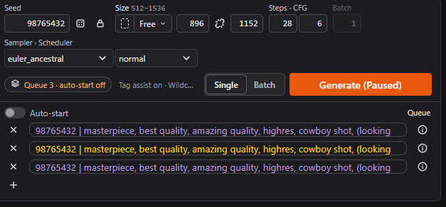

## JSON/CSV リスト
**JSON/CSV リストは設定ファイルに保存されない。**

- **形式**: `*.json` と `*.csv`
- **読込**: `Image Info` ウィンドウにドラッグ&ドロップ（または `Add` → `Paste`）
- **書式の参考**: `wai_characters.csv` と `wai_tag_assist.json`。それらを SAA にドラッグして試せる
- **`__Random__`**: Seed に縛られずリストからランダムに 1 項目を選ぶ。`Single` と `Batch (Random)` モードで動作
- **`__Enumerate__`**: 全項目を順に列挙。`Batch (Random)` モードでのみ動作し、`Single` では `__Random__` に格下げ

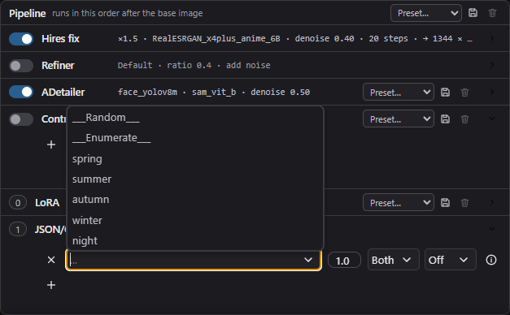

## ワイルドカード
`*.txt` ワイルドカードファイルに対応。

- **置き場所**: `data/wildcards`（パッケージ版は `resources\app\data\wildcards`）
- **選び方**: 既定では現在の Seed で選択。`wildcard random seed` をチェックすると、選択のたびに新しいランダム Seed を生成
- **サブフォルダは非対応**

ワイルドカードタグは前後をアンダースコア 2 つ `__` で囲む。
```
__YourWildCardName__
```

インライン記法も可。
```
{ standing | sitting | on stomach | on back }
{ red | green | blue | blonde } { {long | short} hair | eyes}
```

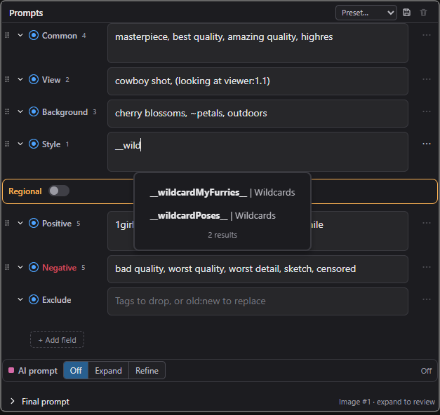

## Regional Condition / Couple
> [!TIP]
> Anima モデルに対応。

3 ステップで試せる。
1. Prompts カードの `Regional` をオン
2. リストのキャラクターか自分の OC を選ぶ
3. `common prompt` を `duo, masterpiece, best quality, amazing quality` で始める（品質ワードを忘れずに）

*Forge Neo の場合*
`Regional Condition` には [SD Forge Attention Couple](https://github.com/Haoming02/sd-forge-couple) [latest](https://github.com/Haoming02/sd-forge-couple/commits/main/) が必要

**左右のサイド（Nishiki）**
- **カードの形**: Regional ON で、共通の行（Common、View、Background、Style、Negative、Exclude）の間に **LEFT** と **RIGHT** のブロック
- **ブロックの中身**: 専用の Positive、Negative と、そのブロックだけの行（ブロック内の `+ Add field`）
- **キャラクターの側**: Characters カードの各スロットで指定（L / R / ·）。ブロックには受け持つスロットを表示
- **Swap**: 左右をまとめて入替（プロンプト、Negative、ウェイトプラン、キャラクター、強さ）。Undo 可
- **`Split Ratio`**: 境界を動かす
- **`Overlap`**: 共有する帯を広げる
- **Negative の扱い**: ComfyUI では左右の Negative も Positive と同じマスクで領域に適用。Forge Neo では 1 つの Negative にまとめる
- Regional は Diffusion（Anima）でも使える

**Panels**
- `Panels` スイッチ ON で、分割線用のタグと各領域のマスクを組み合わせて 2 コマの分割構図を作る
- 既定はオフ

**分割方向と Emphasis**
- **`Split`**: 画像を **Left / Right**（左右）か **Top / Bottom**（上下）に分ける
- **Top / Bottom のとき**: LEFT / RIGHT の見出しが **TOP** / **BOTTOM** になり、左側のプロンプトが上の領域、右側のプロンプトが下の領域に入る（ComfyUI と Forge Neo）
- **Top / Bottom の向き不向き**:
  - 向く: 片方の頭が実際に画面の下側に来る構図（寝そべる、床に座るなど）
  - 向かない: 2 人とも立っている構図。両方の頭が上の領域に入り、検証では 6 枚すべてで上のプロンプトのキャラクターが 2 人描かれた
- **`Emphasis`**（旧 *Strength*）: 左右の差としてだけ効く
  - 左右を同じ値にしても何も変わらない（合成された条件付けが正規化されるため）
  - 差をつけると片側が目立つが、キャラクターの動作は変わらない

**誰が誰に何をするか**
- **前提**: 領域分けは 2 人の外見を混ぜないためのもので、相互の動作は決めない
- **書き方**: タグの後ろに短い英文 1 文。動作する側を主語にし、各キャラクターはタグにある外見（髪色が最も確実）で呼び分ける
  - 例: `the black haired girl is patting the blonde girl's head`
  - 位置（`the girl on the left` など）で呼ぶ書き方は未検証
- **置き場所**: `Action` という名前の行を追加（`+ Add field`）。この名前の行は、カードがチップ表示でもテキストのまま残る
- **検証（WAI Illustrious）**: 向きが正しかった枚数

| 書き方 | 正しい向き |
| --- | --- |
| タグの後ろに文 | 15 枚中 9 枚 |
| 文だけ | 15 枚中 3 枚 |

- **注意**: 外見の語は文に入れないこと。形容詞が髪や服に漏れることがある

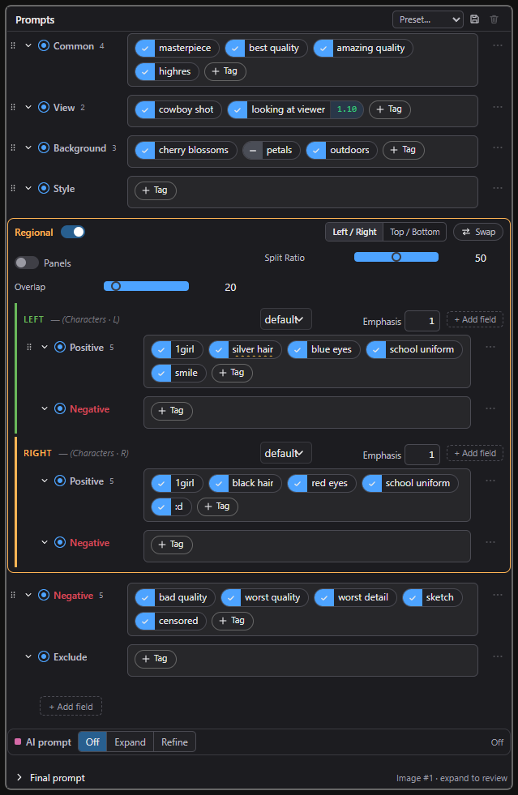

## セミオートタグ補完
タグデータ: [DraconicDragon/dbr-e621-lists-archive/danbooru_e621_merged_2026-04-01_pt20-ia-dd-ed-spc.csv](https://github.com/DraconicDragon/dbr-e621-lists-archive/blob/main/tag-lists/danbooru_e621_merged/README.MD)


<details>
<summary>セミオートタグ補完の詳細</summary>

- **検索**: 最初の数文字の入力で一致するタグを検索
  - Nishiki では既定で前方・中間・後方一致すべてに対応
  - `*tag` と `*tag*` も明示的な後方 / 中間一致パターンとして使える
- **選択**: マウスのほか、`キーボードの上下` と `Enter` / `Tab`。`Esc` で候補を閉じる
- **ウェイト**: `ctrl + ↑` / `ctrl + ↓` で現在のタグや選択範囲を調整（ComfyUI や WebUI と同様だが細部のロジックは異なる場合あり）
- **言語**: 英語・中国語・日本語のタグ検索に対応

**中国語タグ翻訳に協力してくれた Kiratian(天痕) に感謝。**

*`@` の扱い*
- `@` は検索の切替ではなく、入力した通りに検索
- `Action` 欄の `@別名` はキャラクタースロットへの参照(Characters カードで付けた別名、Diffusion モデル種別のとき)
- `Anima モデル` で `Artist` タグを使う場合は、先頭の `@` を自分で付けて書く。例: `mira` → `@mira`

| Mark | ID | Category | Group |
| --- | --- | --- |  --- |
| `[G]` | 0 | General | Danbooru |
| `[A]` | 1 | Artist | Danbooru |
| `[©]` | 3 | Copyright | Danbooru |
| `[C]` | 4 | Character | Danbooru |
| `[M]` | 5 | Meta | Danbooru |
| `<G>` | 7 | General | E621 |
| `<A>` | 8 | Artist | E621 |
| `<©>` | 10 | Copyright | E621 |
| `<C>` | 11 | Character | E621 |
| `<S>` | 12 | Species | E621 |
| `<M>` | 14 | Meta | E621 |
| `<L>` | 15 | Lore | E621 |
| `Wildcards` | 255 | Wildcards | SAA |
</details>

## Image info
<details>
<summary>画像を SAA ウィンドウにドラッグ&ドロップ。Png/Jpeg/Webp に対応。</summary>

- **対応**: WebUI（Forge Neo と A1111）と ComfyUI（ComfyUI_Mira の画像保存ノード使用時）
- **閉じる**: 画像のダブルクリック
- **`Send` ボタン**: `Common Prompt`、`Negative Prompt`、`Width & Height`、`CFG`、`Step`、`Seed` を上書き
- **LoRA**: 同じ LoRA を持っていれば `Common Prompt` 内の LoRA も機能。プロンプト内の LoRA が不要なら `Send LoRA to Slot` を使う
- **生成済み画像**: 同じように開ける。画像の右クリックメニュー（分割・グリッド・全画面表示）に `Open in Image Info`
  - そこから `Send tags`、`Add ControlNet`、`Run Tagger`、`Tiled-Upscale` をその画像に使える


</details>

## キャラクターリスト
### お気に入り
キャラクター、オリジナルキャラクター、タグのお気に入りは選択モーダルで管理。

- **登録**: モーダルを開いてエントリの星を切り替え
- **呼び出し**: 上部のお気に入りグループから
- **表示**: お気に入りタグはカプセル上で強調
- **保存**: 設定と一緒に

### プレビューと検索
キャラクターリストは英語・中国語・日本語のキーワードと、所属作品で検索可。

- **作品で絞込**: `艦これ`、`kantai collection`、`FGO`、`ボカロ`、`崩壊` など
- **組み合わせ**: `kantai 加賀` のように作品と名前
- **表示**: 作品名はキャラクター名の後ろ（`data/character_works.json`、生成手順は英語 README のメンテナ向けセクション参照）


## 上部ボタンと右クリックメニュー
上部バーは左から: モデル、モデル一覧再読込、Fast モード、バックエンドの状態（GPU ターゲット Local / Pod）、Undo、Redo、右から左、設定。

- **テーマの切替**: 設定 → General
- **ページ更新**: 設定 → Advanced
- **設定**: 自動保存

<details>
<summary>右クリックメニュー</summary>

メニューは右クリックした対象で変わる。

| 対象 | 項目 |
| --- | --- |
| チップ | ウェイト編集、有効 / 無効、関連タグ、コピー、削除、他の欄へ移動 / コピー |
| プロンプト欄 | 欄のコピー / クリア、全タグ有効 / 無効、LoRA をスロットへ送る、選択範囲の移動 / コピー |
| ギャラリー画像 | 画像 / メタデータのコピー、現在の画像を削除、ギャラリーをクリア |
| AI 欄 | AI 生成テスト |

**スペルチェック（英語）**

スペルチェックエラー（波線）のある単語を右クリックすると候補を表示。

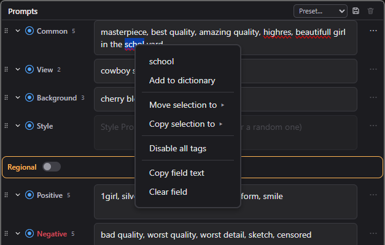

**AI プロンプト生成テスト**

- `AI prompt` 欄の右クリックで、生成せずに AI プロンプトを取得。結果はポップアップ表示
- AI ルールを `Last` にすると、以降の生成でその結果を再利用

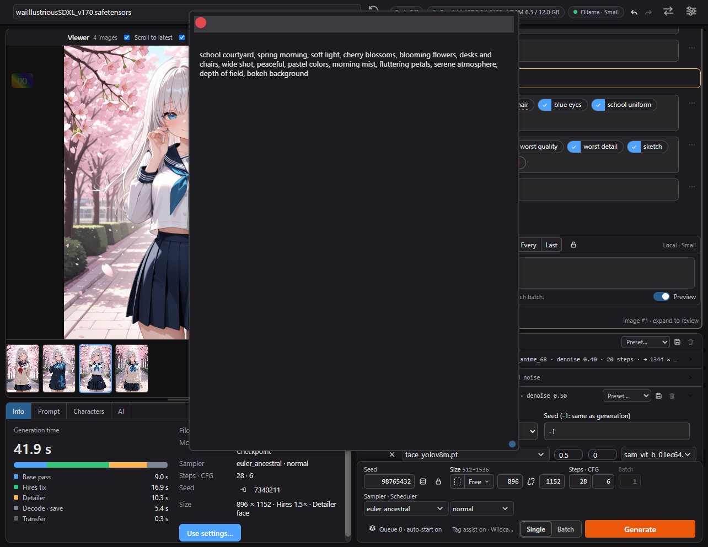

**画像 / メタデータのコピー**

- `Gallery` の右クリックで現在の画像またはメタデータをクリップボードにコピー
- Image Saver ノードを使う ComfyUI では a1111 形式に近いメタデータを出力
- 画像コピーは base64 を PNG に戻すが、Chromium コアによりメタデータは除去される。元画像が必要なら ComfyUI/WebUI の出力フォルダを確認
- SAAC の場合: ブラウザからローカルフォルダへ画像をドラッグするか、ブラウザメニューの `名前を付けて保存` を使う

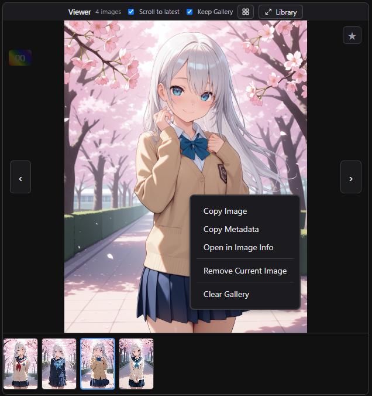

**LoRA をスロットへ送る**

`Common` または `Positive` の右クリックで、テキスト形式の LoRA を LoRA スロットへ送る。

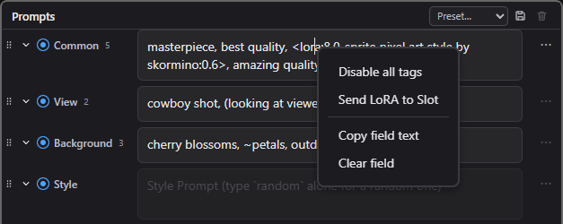
</details>

------
# AI プロンプト
**リモート**
1. セットアップガイドに従って `Remote AI url`、`Remote AI model`、`API Key` を設定
2. `AI Prompt` に何か入力。例: `make character furry, and I want a detailed portrait`

**ローカル**
1. [Llama.cpp](https://github.com/ggml-org/llama.cpp) を自分でビルドするか、[信頼できるソース](https://github.com/ggml-org/llama.cpp/releases) からダウンロード
2. [HuggingFace](https://huggingface.co/) からモデルをダウンロード。`oh-dcft-v3.1-claude-3-5-sonnet-20241022.Q8_0`（[こちら](https://huggingface.co/mradermacher/oh-dcft-v3.1-claude-3-5-sonnet-20241022-GGUF)）のような GGUF を推奨
3. 推奨サーバー引数: `llama-server.exe -c 16384 --port <your local LLM port> -m "<your GGUF model here>"`
4. `AI Prompt Generator` を `Local` に
5. `Local Llama.cpp server` にローカル AI のアドレスとポートを設定
6. （任意）他のローカル AI サービスを使う場合は API 設定を確認
7. `AI Prompt` に `make character furry, and I want a detailed portrait` のように入力

**Refine（Nishiki）**
1. [Ollama](https://ollama.com/) をインストールし、モデルを pull
2. AI モードを `Refine` にし、Ollama のアドレスとモデルを入力
3. 普段どおりプロンプトを書く。各バッチの 1 枚目の前に、Refine が構造化リクエスト 1 回でプロンプト全体を書き直し、結果をエディタに適用。気に入らなければ `Ctrl + Z` で戻る
4. Runpod の Pod を登録していれば、AI のホストに `Pod` を選べる

------
# Image API Interface
*ComfyUI の場合*
> [!IMPORTANT]
> ワークフローが正しく読み込めない場合は、代わりに `2025-05-03-022732_1775747588.json` を使う。

1. ComfyUI の設定で `DEV mode` を有効にし、`examples\2025-05-03-022732_1775747588.png` を ComfyUI に読み込む
   - [ComfyUI_Mira](https://github.com/mirabarukaso/ComfyUI_Mira) **v0.5.6.0 以上** のインストールを確認
   - ComfyUI → Manager → Install PIP packages → opencv-python で `opencv-python` のインストールが必要な場合あり
2. `Image API Interface` を `ComfyUI` に
3. `Image Interface IP Address:Port` が ComfyUI のページと一致しているか確認
4. 楽しむ

SAA でプレビューが出ない場合は、起動 BAT に `--preview-method latent2rgb` を追加。
```
py ComfyUI\main.py --fast --use-sage-attention --cuda-malloc --windows-standalone-build --listen 0.0.0.0 --port 58188 --preview-method latent2rgb
```

*Forge Neo（WebUI）の場合*
1. `COMMANDLINE_ARGS`（webui-user.bat）に ` --api` を追加して `API mode` を有効に
2. WebUI を起動
3. `Image API Interface` を `WebUI` に
4. `Image Interface IP Address:Port` が WebUI のページと一致しているか確認
5. 楽しむ

## サードパーティ混在バックエンド向けカスタムパス
> [!WARNING]
> カスタムパスを有効にするとモデルパス設定が上書きされる。
> 公式の WebUI（Forge Neo/A1111）や ComfyUI では非推奨。

`data/custom_path.yaml` を編集。
1. `use_custom_path` を `true` に
2. カテゴリ全体を無効にするには `enable` を `false` に
3. 上書きしたくない個別のカスタムパスはコメントアウト
4. パス一覧は単一文字列・複数行文字列の両方に対応
5. 絶対パスと相対パス（base_path 基準）に対応

[#92 Stability Matrix で ComfyUI を使う場合のカスタムパス設定](https://github.com/mirabarukaso/character_select_stand_alone_app/issues/92)

## リモート利用時のフォルダパス問題
- **仕組み**: SAA はモデル・LoRA などを一覧するために ComfyUI/WebUI の checkpoints フォルダを検索
- **問題**: バックエンドアドレスがリモート（127.0.0.1 以外）だとフォルダ検索に失敗し、SAA は `Default` モードで動作。このモードではモデル変更や LoRA スロットの設定ができない

解決策は 2 つ:
1. `ミラーフォルダ` — リモートの `models` フォルダをローカルにコピーし、SAA にそのフォルダを設定。簡単だがディスク容量が必要
2. `シンボリックリンクまたは共有フォルダ` — シンボリックリンクを作るか、リモートの `models` フォルダを共有（読み取り専用推奨）し、SAA にそのフォルダを設定

## 高度なセキュリティ設定（API 認証）
> [!WARNING]
> *保護されていないローカルポートを公開インターネットに転送しないこと。*
> *WebUI（Forge Neo）のみ。適切で安全な方法が用意されるまで ComfyUI API を公開インターネットに転送しないこと。*

WebUI（Forge Neo）のコマンド引数は [Command-Line-Arguments-and-Settings](https://github.com/AUTOMATIC1111/stable-diffusion-webui/wiki/Command-Line-Arguments-and-Settings) を参照。

1. `webui-user.bat` を `webui-user-api.bat` にコピーし、以下の引数で編集

| 引数 | 意味 |
| --- | --- |
| `user:pass` | 自分の `ユーザー名:パスワード` に置き換える |
| `--api` `--api-auth` | API と API 認証を有効化 |
| `--nowebui` | ブラウザ UI が不要な場合に指定 |
| `--port 58189` | API ポートを `58189` に |

```
set COMMANDLINE_ARGS= --xformers --no-half-vae --api --api-auth user:pass --nowebui --port 58189
```
2. 新しい `webui-user-api.bat` で Forge Neo を起動
3. `ユーザー名:パスワード` を SAA → Settings → `WebUI API Auth` に貼り付け、`Enable` を `ON` に

------
# Hires Fix と Image Color Transfer
- **Image Color Transfer**: 詳細は [Image Color Transfer](https://github.com/mirabarukaso/ComfyUI_Mira#image-color-transfer) を参照
- *生成ルールがなく openCV も無いため、WebUI では Color transfer 非対応になった*
- **アップスケーラーモデル**: すべて `upscale_models` フォルダに置く

**ComfyUI の注意**
- アップスケールモデルは自分でダウンロード。`Manager` → `Model Manager` で `upscale` で絞り込む

**WebUI（Forge Neo/A1111）のアップスケーラーの注意**
- WebUI は名前ベースのアップスケーラー一覧を使う。`静的なアップスケーラー一覧` が動作し、初回生成後に API の一覧に更新

**Forge の注意**: ファイルベースの一覧を使うが、これが厄介
- **重要: upscale_models フォルダが存在しない場合、SAA は静的な一覧を使う。**
- **迷ったら一度生成。HiFix モデル一覧が正しく更新される。**

解決策:
1. `models` 内に `upscale_models` フォルダを作り、アップスケーラーモデルをすべて入れる
2. アップスケーラーモデルのフォルダ名（例: `ESRGAN`）でシンボリックリンクを作り、`upscale_models` を指すようにする
3. Forge を再起動。`Hires Fix` モデルが動作し、初回生成後に API の一覧に更新

------
# 中国語翻訳とキャラクター検証
中国語翻訳とキャラクターデータの検証に貴重な時間を割いてくれた以下の方々に感謝（順不同）。
**Silence, 燦夜, 镜流の粉丝, 樱小路朝日, 满开之萤, および匿名希望の 2 名。**

# キャラクターリスト Special Thanks
- lanner0403 [WAI-NSFW-illustrious-character-select](https://github.com/lanner0403/WAI-NSFW-illustrious-character-select)
- Cell1310  [Illustrious XL (v0.1) Recognized Characters List](https://civitai.com/articles/10242/illustrious-xl-v01-recognized-characters-list)
- mobedoor [#23](https://github.com/mirabarukaso/character_select_stand_alone_app/issues/23)
- UdinXProgrammer [#62](https://github.com/mirabarukaso/character_select_stand_alone_app/issues/62)
- Nurimtod [#75](https://github.com/mirabarukaso/character_select_stand_alone_app/issues/75) [#83](https://github.com/mirabarukaso/character_select_stand_alone_app/issues/83)
- atmogenic [#84](https://github.com/mirabarukaso/character_select_stand_alone_app/issues/84) [#85](https://github.com/mirabarukaso/character_select_stand_alone_app/issues/85)
- funnygeeker [#87](https://github.com/mirabarukaso/character_select_stand_alone_app/issues/87)

------
# FAQ
**`saa-nishiki.exe` をダブルクリックしても何も起きない**
1. ファイルのダウンロード失敗やファイル不足が原因の可能性
2. コンソールから実行。エクスプローラーのアドレスバーに `cmd` と入力するとコンソールが開く
3. `saa-nishiki` と入力して Enter、バックエンドのログを確認

**セットアップウィザードで失敗した**
1. アプリを閉じる
2. `settings`（パッケージ版は `resources/app/settings`）の `app.json` を削除
3. もう一度試す

**ERR_CONNECTION_REFUSED**
1. ほとんどの場合、（ComfyUI/WebUI）バックエンド API のアドレス間違い

**ブラウザ版の SAA は?**
1. ある
2. `高度なセキュリティ設定（API 認証）` を参照

**Error HTTP 400 ...... Cannot execute because node StepAndCfg does not exist ......**
1. `ComfyUI_Mira` をインストール
2. ComfyUI を再起動

**Upscale モデル一覧が `None`（ComfyUI）**
1. 既定のディレクトリ設定を変更していないか?
2. 非公式版ではないか?
3. [#58](https://github.com/mirabarukaso/character_select_stand_alone_app/issues/58) を確認

**ComfyUI/WebUI is busy, cannot run new generation, please try again later.**
- [README_SAAC.md](README_SAAC.md) の 5 と 6 を参照

**設定やプリセットはどこにある?**
1. `settings/app.json`、`settings/state.json`、`settings/presets/`、`settings/user_lists.json` と、その隣の Parts、LoRA カタログ、Library のファイル。[設定の保存先](#設定の保存先) を参照
2. Nishiki 以前の `settings/*.json` は初回起動時に `settings/legacy/` へ移動
