# SAA-Nishiki（二式）

[English](../README.md) | [日本語](README.ja.md) | **简体中文**

[Character Select SAA](https://github.com/mirabarukaso/character_select_stand_alone_app) 的分支版本。一个独立运行的应用，支持 AI 提示词、半自动标签补全以及 ComfyUI / Forge Neo (WebUI) API。
Nishiki 新增了日语标签翻译、以标签块（chip）编辑的行式提示词编辑器、Parts、作为独立模型类型并带有 Cast 与 Prose 的 Diffusion（Anima）、记录生成配方的图像、Library、以样图网格展示的 LoRA 目录、AI 提示词重写器、快速生成模式以及 Runpod Pod 目标。

当前版本：**v4.1.0** —— 基于上游 SAA 2.8.9。下载与发布说明请见 [Releases](https://github.com/FUMIHITO-EGUCHI/saa-nishiki/releases)。

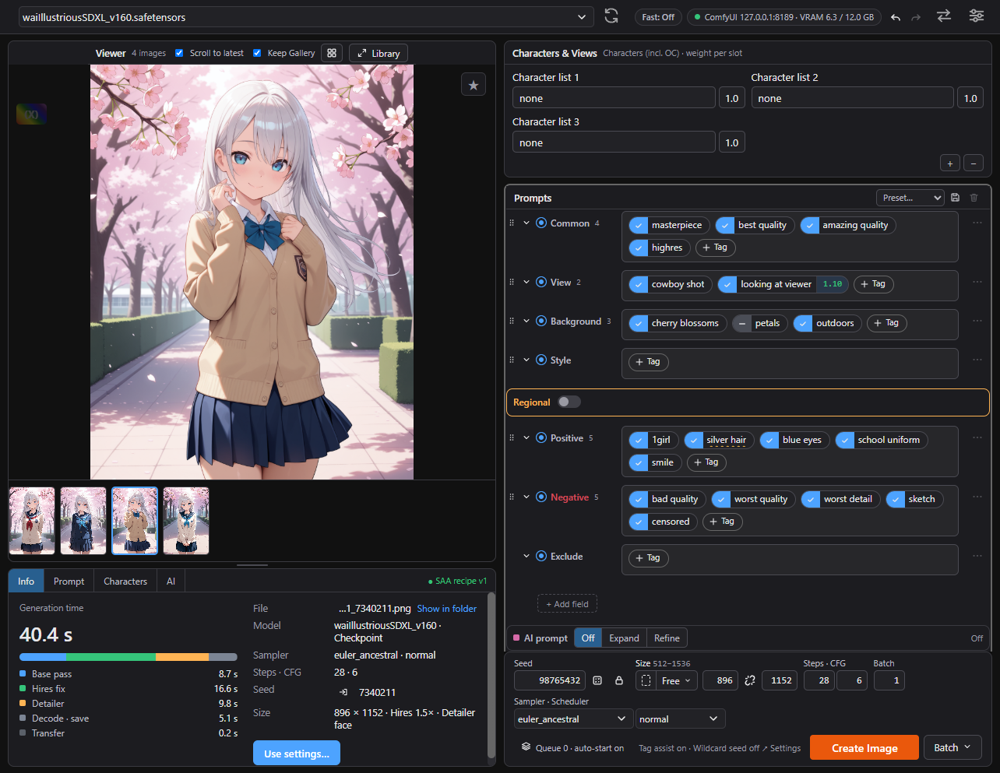

## 目录
- [Nishiki 新增功能](#nishiki-新增功能)
- [安装与运行](#安装与运行)
- [更新](#更新)
- [Highlights（继承自上游）](#highlights)
- [AI 提示词](#ai-提示词)
- [Image API Interface](#image-api-interface)
- [FAQ](#faq)

------

# Nishiki 新增功能

## 日语标签翻译与本地化
- 通过覆盖 danbooru / e621 合并标签列表的日语词典（约 10 万条，`data/danbooru_e621_merged_ja.csv`）以日语搜索和显示标签。除画师与 e621 角色外的所有分组都已审校到 heat 10（10 个投稿）。
- 标签搜索对整个词典排序（前缀匹配优先，同一档内投稿多的标签优先），滚动时加载下一批 50 条，最后一行显示匹配总数。每行显示译名以及命中的别名；输入中的空格也匹配标签里的 `_`（`white d` 可找到 `white_dress`）。
- 角色名与作品名的日语本地化，以及标签分类显示。标签搜索与角色选择显示相同的名称。
- 在设置中将界面语言选为 `ja-JP` 后，标签、名称和分类以日语显示；没有日语条目的界面文字回退为英语。

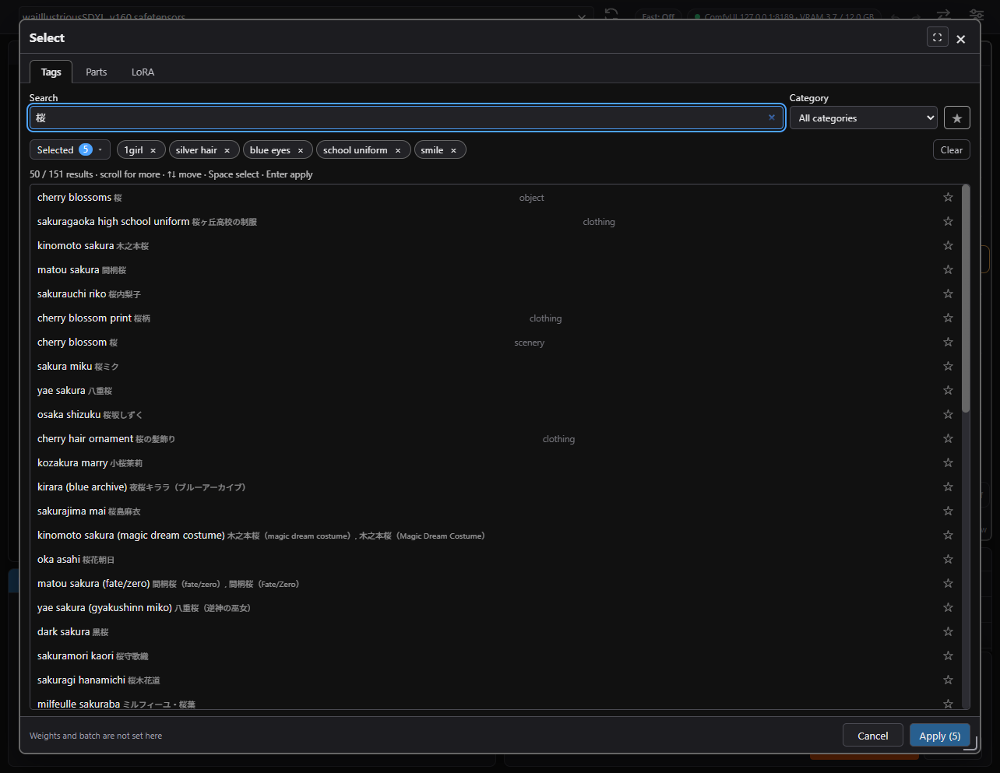

## 提示词编辑器
Prompts 卡片是一列行：Common、View、Background、Style、Positive、Negative、Exclude 以及你自己添加的行。每行以**标签块**显示标签；拖动把手移动行，● 开关静音该行，双击名称重命名，其余操作在 ⋯ 菜单中（Show as text / Show as chips、Insert part…、Weights per image…、Presets…、Make negative / Make positive、Rename、Delete field）。`+ Add field` 添加自定义行。最终提示词按行的顺序拼接。

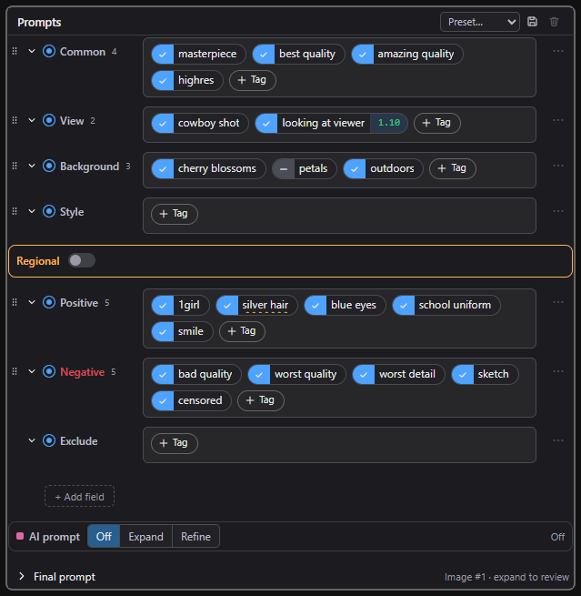

- **标签块。** 左侧显示状态（✓ 启用、− 禁用、★ 收藏、× 排除），右侧显示权重或权重计划。点击 ✓ 可在不删除的情况下禁用标签。`+ Tag` 打开带有 Tags、Parts、LoRA 三个标签页的标签选择器。
- **权重弹窗。** 点击标签块可设置权重（文本视图中用 `Ctrl + ↑ / ↓`）、批量用的权重计划、相关标签（共现与同词族，离线来自 `data/tag_related.txt`）、译名，以及收藏用的 ★。`(a, b:1.2)` 这样的分组权重是一个标签块。
- **在行之间移动标签。** 在行内或向其他行拖动标签块（按住 `Ctrl` 或 `Alt` 为复制），也可使用右键菜单中的 `Move to…` / `Copy to…`。权重与禁用状态随标签一起移动；一次拖放为一步撤销。
- **多选标签。** `Ctrl + 点击` 切换选择，`Shift + 点击` 扩展选择，`Ctrl + A` 选中行内全部标签块，`Esc` 取消。选中的标签可一起拖动、删除和切换，右键菜单也作用于整个选择（`Disable tag (3)`、`Move to (3)` 等）。
- **View 行。** 角度、镜头和构图都是放在 View 行中的普通标签与 Parts，权重和搜索与其他行相同。
- **预设。** 每行都有自己的预设（⋯ → Presets…）；卡片预设保存整个布局（行、名称、顺序和内容），应用时原样恢复。
- **词典标记。** 不在标签词典中的标签块带波浪下划线，因为 SDXL 模型基本会忽略这类词：测试中 `long staff` 与 `ancient staff` 毫无变化，而真实标签 `wooden staff` 每次都改变了法杖。读起来像句子的标签块（四个词以上且不是已知标签）以虚线和斜体显示，并按原文发送。LoRA 标记、通配符与随机组从不标记。
- **投稿数提示。** 投稿数少于 100 的标签带黄色点线，少于 1,000 的带灰色点线，弹窗中显示投稿数。这只是 Danbooru / e621 的投稿数参考，Diffusion 下不显示。

## Parts
常用的标签组合可以保存为一个 `parts:<名称>` 标签块。它的权重作用于其中的标签，静音、最终提示词、AI Refine、Prose 和批量展开都使用同样的标签。标签选择器的 Parts 标签页按分类并附样图列出它们；可以从当前标签新建、编辑、展开回标签或替换为其他 Part，Part 还可以带有自己的 LoRA。应用附带 295 个入门 Part（outfit、hair、body、background、camera、composition、tone、pose、expression 等）。Parts 保存在 `settings/parts.json`，样图在 `settings/parts/`。

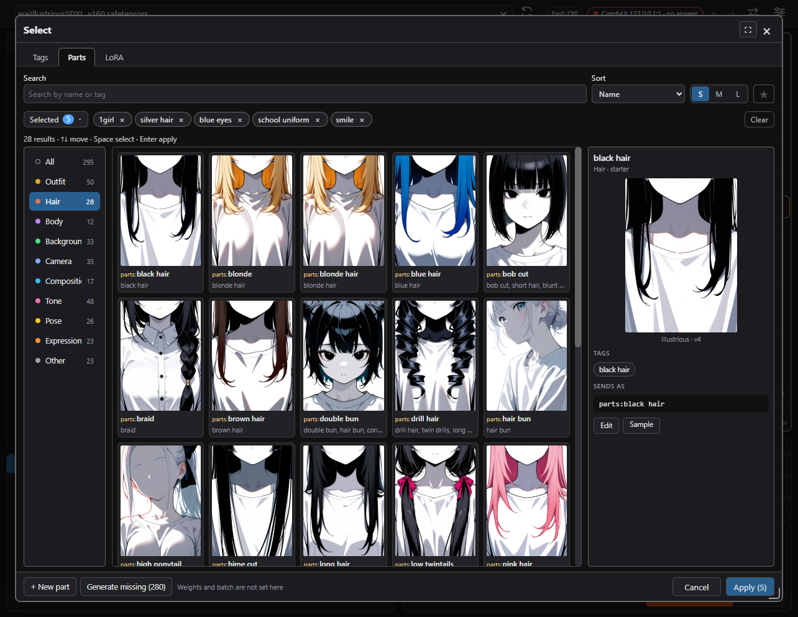

## 权重批量
在弹窗中给标签设置**权重计划**（起始、步长、结束），或使用行的 ⋯ → Weights per image…，然后运行批量：SAA 固定种子逐张执行计划，只改变权重。`÷ batch count` 选项会根据批量数自动计算步长。以非随机种子开始批量时会出现警告。

## 角色、收藏与列表管理器
- Characters 卡片可放置任意数量的角色槽位（`+` / `−`），每个槽位有自己的权重；开启 Regional 时还带有所在的一侧。
- 角色与原创角色在带译名和**收藏**分组的可搜索选择窗口中选择。可用英语、中文或日语按名称搜索，也可按所属作品筛选（`艦これ`、`kantai collection`、`FGO`）。
- **列表管理器**（Settings → Lists）：可对角色 / OC / 角度 / 镜头列表添加、覆盖或隐藏条目。上游数据保持只读，你的修改以差异形式保存在 `settings/user_lists.json`，可导出和导入。列表条目可包含多标签提示词，条目编辑器中也能使用标签选择器。

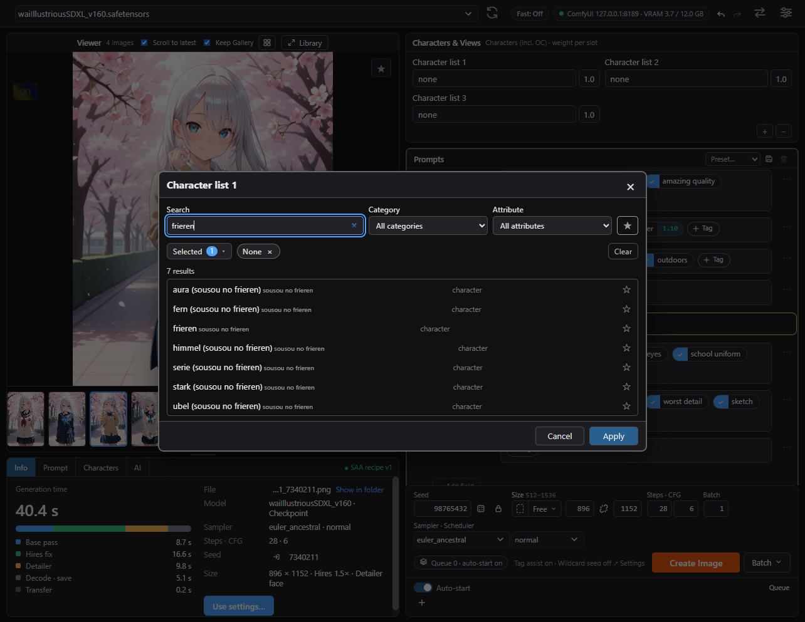

## Diffusion（Anima）
Diffusion 是与 Checkpoint 并列的独立模型类型，sampler、scheduler、steps、CFG、尺寸、Hires、Regional 和提示词都按类型分别保存，切换类型不会把一种类型的设置带到另一种。
- **Cast。** 每个角色槽位都有别名和自己的提示词行，Action 行用 `@别名` 写出谁做什么。
- **Prose。** Anima 读的是英语而不是 Danbooru 标签，因此在发送图像请求之前，会把拼好的标签改写成一段英文。段落由与图像相同的已解析标签（相同的通配符、相同的权重）写成，可以编辑、还原或重新生成。写作者可以是 AI 卡片的 LLM（本地或 Pod 上的 Ollama），也可以是 **Student**——一个从 35B 模型蒸馏的 Qwen3.5-2B LoRA，由 SAA 自己启动的 llama-server 运行（在 设置 > AI 中指定可执行文件、GGUF 和端口；两者都不随应用附带）。在 12 GB 显卡上与 ComfyUI 并行时约每段 1 秒。
- **Artist。** 收录 17,716 位 Danbooru 画师所画内容的词典，可按名称或题材搜索（`cat ears` 会找到画猫耳的画师），每张图最多指定三位画师。
- **Regional 与 Panels** 也适用于 Diffusion（参见 [Regional Condition / Couple](#regional-condition--couple)）。

## 图像记录生成配方
- SAA 生成的每张图都带有生成它的内容（按下 Generate 时的编辑器、种子、Random 槽位选中的角色、发送的提示词、AI 的回答、Prose 段落、Fast 模式发送的值）以及各步骤的耗时，保存在 PNG 的 `saa_recipe` 与 `saa_time` 文本块中。耗时只在 ComfyUI 运行于同一台机器时写入。
- **查看器。** Info 标签页显示当前图像的耗时（条形图与图例）、文件、模型、sampler、steps、CFG、种子（带一键填入 Seed 栏的按钮）、尺寸与处理阶段，以及实际生效的 LoRA。其他应用生成的图像也会从 PNG 文本块读取。运行时的文本在 Prompt 标签页中；★ 用于保留图像，箭头用于前后切换。
- **Use settings…** 把图像的配方与当前编辑器并排打开，每个部分（每行的标签、Prose、LoRA、模型与 sampler、尺寸与阶段、Regional、种子）都有复选框，不同的部分默认勾选；全部勾选即可再次生成同一张图。只有 A1111 parameters 的图像也能读取。读取为一步撤销。
- **Library。** Library 按钮按文件夹和日期打开 ComfyUI 输出文件夹与 Pod 保存文件夹中的所有图像，提供本次会话、★、带配方的视图，以及按提示词、角色、LoRA、模型、种子、文件名的搜索与筛选。侧面板提供 Use settings…、★、在文件夹中显示和移到回收站。索引与缩略图保存在 `settings/library/`，可随时从图像重建。

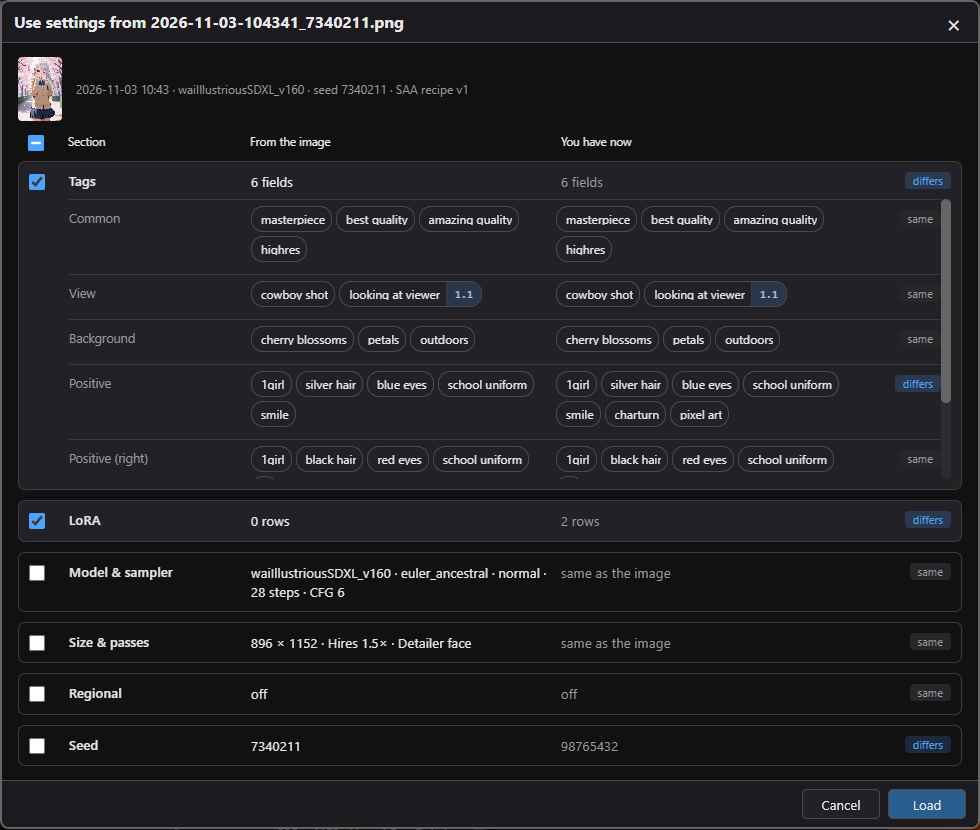 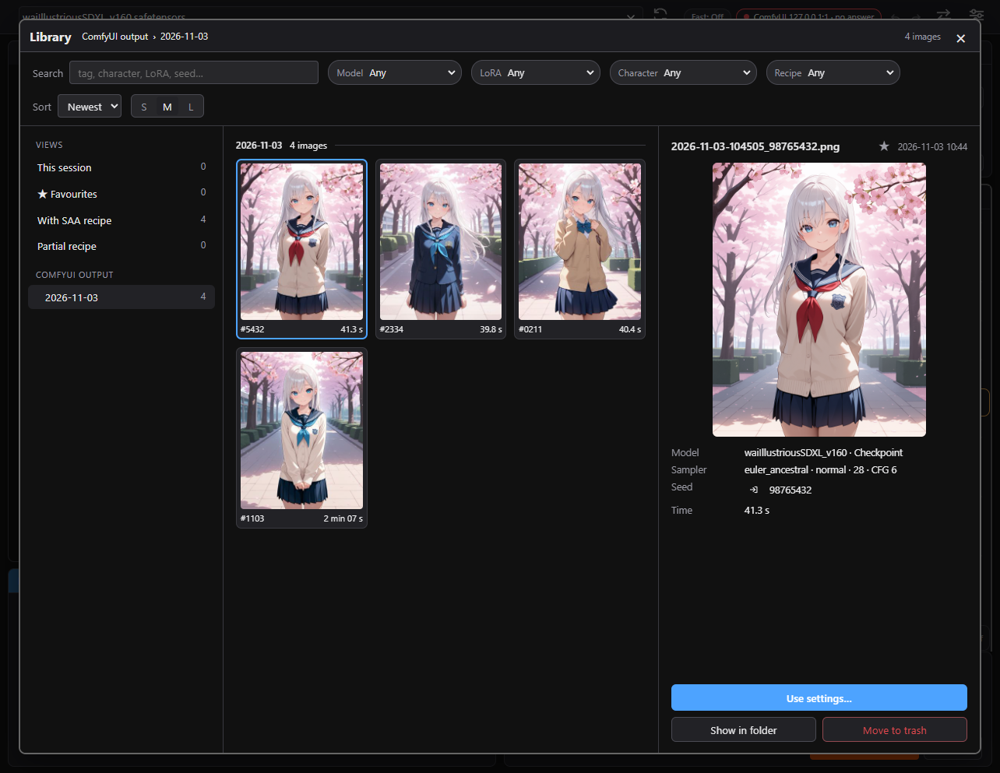

## LoRA 目录与 LoRA 卡片
- **LoRA 标签页。** 标签选择器的 LoRA 标签页以样图网格显示每个 LoRA：关闭 LoRA 时，以及范围内的五个权重，使用当前模型和同一种子生成，不看说明也能看出效果。侧面板设置默认权重、样图范围（Take samples / Retake，样图提示词可按 LoRA 设置，也可用全局默认）、触发词、推荐用于哪些标签以及你自己的名称。推测只读取 `.safetensors` 文件头；只有按下按钮时才用文件的 sha256 查询 Civitai。目录保存在 `settings/loras.json`，样图在 `settings/loras/`。
- **LoRA 卡片。** 每个 LoRA 一行：开关、名称、触发词（点击可从提示词中移除或加入）、在样图权重处带刻度的滑块和数值（滚轮步进 0.05，按住 Shift 为 0.25）。展开后有阶段（All、Base、Hires）、CLIP、范围和触发词。关闭某行时，它的触发词也会从提示词中移除。`+ LoRA` 单独打开 LoRA 标签页。
- **标签、Parts 与 LoRA。** 某个 LoRA 推荐的标签上会显示 `LoRA N` 徽标，可从其弹窗中添加该 LoRA；不点击就不会添加任何东西。

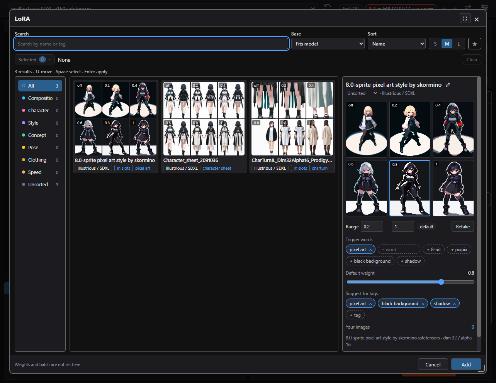 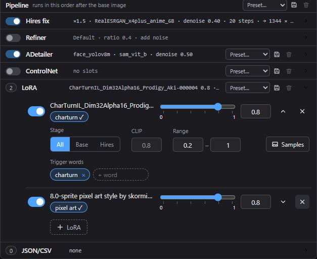

## 尺寸与比例
运行栏的 Size 为 `[横竖 | 比例 ▾] [W] [链接] [H]`。按钮左半部分交换宽高，右半部分打开 1:1、4:5、3:4、A4（1:√2）、2:3、黄金比（1:φ）、9:16 和 Free 的图块，每个图块显示对应的尺寸。选择比例会在 8 px 网格上保持像素数；链接时，输入一个框，另一个框按比例跟随。尺寸框遵循模型类型的范围（Checkpoint 512–1536，Diffusion 512–2048，上限可在设置中调整）。

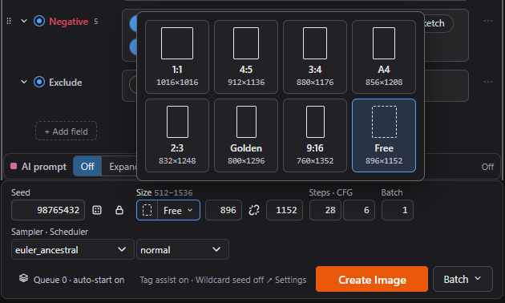

## 撤销 / 重做
每次提示词编辑、预设应用和 AI 重写结果都是全局编辑历史中的一个原子步骤。使用 `Ctrl + Z` / `Ctrl + Shift + Z`（或 `Ctrl + Y`）或工具栏按钮。

## AI 提示词重写器
在上游的远程 / 本地 `llama.cpp` AI 提示词之外，Nishiki 增加了基于 [Ollama](https://ollama.com/) 的 **Refine** 模式。Refine 在每批的第一张图之前，用一次结构化请求重写整个提示词，并按行把结果应用到编辑器。Refine 的修改记录在编辑历史中，可以撤销。标签中的一句普通英文动作句（见 Regional Condition 中的“谁对谁做什么”）会作为句子保留，不会被拆成标签。
开启 `Regional` 时，Refine 会重写两侧，包括各侧的 Negative。生成时添加的内容（角色、JSON 槽位、通配符、槽位 LoRA）保持原位，并放回到重写后的行周围。
AI 的结果显示在 **Info 面板的 AI 标签页**中，而不是每次生成后弹窗。

## 快速生成模式
设置 → Backend → **Fast generation** 会应用步数蒸馏 LoRA（DMD2 / Hyper-SD / Lightning / LCM），并覆盖基础、Hires fix 与 ADetailer 各阶段的 steps、CFG、sampler 和 scheduler。本地 ComfyUI 与 Pod 均可使用。
RTX 4070 SUPER 实测（600×1024，Hires 1.5x，ADetailer）：30 steps ≈ 29 秒 → DMD2 8 steps ≈ 16 秒。

Diffusion（Anima）模型类型有自己的一套：Anima Turbo LoRA v0.2 强度 0.8、8 steps、CFG 1.5、euler / simple，并加上 ComfyUI 启动参数 `--use-sage-attention --fast`。这些参数作用于整个进程，因此在需要其他参数的运行之前，SAA 会通过 设置 → Backend → ComfyUI process → 启动命令（需能把额外参数传给 `main.py`）重启本地 ComfyUI。SAA 只会去掉它自己启动 ComfyUI 时加上的参数。RTX 4070 实测（832×1216，waiANIMA）：25 steps ≈ 17–19 秒 → 带两个参数的 Turbo 8 steps ≈ 4.8 秒。`--fast` 会让颜色和细节略有变化。LoRA 在 Pod 上也可用，启动参数仅适用于本地 ComfyUI。

提示词中的 LoRA 也会作用于 Hires 与 ADetailer 阶段，工作流在一张图内始终使用同一个加载了 LoRA 的模型，因此一次运行中 ComfyUI 不会重新读取模型文件。

## 在 SAA 中控制本地 ComfyUI
设置 → Backend 可以启动、重启和停止本地 ComfyUI，也可以随 SAA 一起启动。停止只会结束 SAA 正在连接的 ComfyUI；占用该端口的其他程序会显示 pid 与程序名，只有在你同意时才会结束。启动命令需要先在原生对话框中允许一次才会执行。

## Runpod Pod 目标
在设置中登记 Runpod Pod（SSH 目标与密钥），即可通过工具栏的状态标签在 **GPU: Local** 与 **GPU: Pod** 之间切换图像生成。生成的图像通过 SSH 传回，只保存在本地；不会写入 Pod 的磁盘。Pod 也可以提供 LLM 功能（AI 提示词 / 重写 / Prose）。Pod 端点支持带认证的 `https` / `wss` 后端。
AI 提示词 / Refine 请求同样通过这条 SSH 中继发送到 Pod 上的 Ollama。安装、Pod 重启后的恢复脚本和故障排查见 [README_POD.md](README_POD.md)。

## UI 外壳
- 新的视口布局、状态标签、运行进度指示以及深色 / 浅色主题。
- 两套主题的颜色都来自同一个令牌文件 `design/tokens.json`，由 `scripts/buildThemeTokens.mjs` 写入主题文件；图标来自同一套 `scripts/shared/iconSet.js`。
- 所有对话框的按钮顺序一致：Cancel / No 在左，主按钮在右。Esc 先关闭最前面的对话框。
- 右键菜单因右击对象而异：标签块、提示词行、画廊图像、AI 字段。

## 设置存储
设置按区块拆分并带有 schema 版本：
- `settings/app.json` —— 应用设置（后端、路径、AI、快速模式、Pod）
- `settings/state.json` —— 提示词 / 生成 / LoRA / ADetailer / ControlNet 的工作状态（按模型类型保存）
- `settings/presets/<section>/<name>.json` —— 预设
- `settings/user_lists.json` —— 列表管理器的差异
- `settings/parts.json`、`settings/parts/` —— Parts 及其样图
- `settings/loras.json`、`settings/loras/` —— LoRA 目录及其样图
- `settings/library.json`、`settings/library/` —— ★、ComfyUI 输出文件夹、Library 索引与缩略图
- `settings/legacy/` —— 拆分前的 `settings/*.json`，首次启动时移到这里，之后不再读取

所有内容自动保存并原子写入。`settings/` 除附带的 MiraITU 工作流文件外不纳入 git。

## 版本号
Nishiki 从 3.0.0 起使用自己的语义化版本：minor 表示新功能，patch 表示修复。上游基础版本记录在 `package.json` 的 `upstreamBase`（2.8.9）和发布说明中，合并新的上游时提升 minor。每次发布都有 `v<version>` 标签和 GitHub Release，Release 正文即更新记录（`docs/CHANGELOGS.md` 为上游的记录）。

------

> [!NOTE]
> 如果发现列表中没有、但可以正确生成的角色，请提交 issue 告知。
>
> 默认 thumbList 基于 `waiIllustriousSDXL_v160`。另有两个可选 thumbList：`waiANIMA_v10Base10` 和 `waiNSFWIllustrious_v120`，选择后会自动从 `HuggingFace` 下载。
> 可用 [SAA Thumb Generator](../scripts/python/thumb-generator/README.md) 制作自己的 thumbList。

| 已验证 | [ComfyUI](https://github.com/comfyanonymous/ComfyUI)  | [Forge Neo](https://github.com/Haoming02/sd-webui-forge-classic/tree/neo) |
| --- | --- | --- |
| Release | 0.40.0 | 2.27 |
| Refiner (SDXL) | Yes | Yes |
| Image Color Transfer (ALL) | Yes | No |
| Regional Condition / Couple (SDXL/Anima) | Yes | Yes |
| ControlNet/IPA (SDXL) | Yes | Yes |
| ADetailer (ALL) | Yes | Yes |
| API authentication| No | Yes |
| MiraITU | Yes | No |
| 快速生成模式 | Yes | No |
| Runpod Pod 目标 | Yes | No |

> [!IMPORTANT]
> `Forge Neo` 上的 `Regional Condition / Couple` 与 `ADetailer` 支持 `SDXL 和 Anima`；
> `ComfyUI` 上应支持 SAA 支持的所有 diffusion 模型（待验证）。
>
> *不支持 ComfyUI Desktop。*
> *A1111 因长期缺乏维护已从支持列表移除。它仍能与 SAA 一起工作，但不再测试。*
>
> *在线版 Character Select* [Hugging Face Space](https://huggingface.co/spaces/flagrantia/character_select_saa)
>
> 浏览器版 SAAC 请见 [README_SAAC.md](README_SAAC.md)。
> 面向 OpenClaw 的 Python CLI 工具请见 [SAA Agent](../scripts/python/saa-agent/README_HUMAN.md) 与 [ClawHub](https://clawhub.ai/mirabarukaso/saa-agent)。

## thumbList 手动下载指南
<details>
<summary>如果 SAA 内的下载很慢或失败，请手动下载。</summary>

前往 [HF 数据集](https://huggingface.co/datasets/flagrantia/character_select_stand_alone_app/tree/main)，将以下文件下载到 `data` 文件夹并按如下重命名：

### waiIllustriousSDXL_v160
[waiIllustriousSDXL_v160_thumbs.json](https://huggingface.co/datasets/flagrantia/character_select_stand_alone_app/resolve/main/wai_character_thumbs_v160.json?download=true)

[waiIllustriousSDXL_v160_characters.csv](https://huggingface.co/datasets/flagrantia/character_select_stand_alone_app/raw/main/wai_characters_v160.csv)

[waiIllustriousSDXL_v160_tag_assist.json](https://huggingface.co/datasets/flagrantia/character_select_stand_alone_app/raw/main/waiIllustriousSDXL_v160_tag_assist.json)

### waiIllustriousSDXL_v120
[waiNSFWIllustrious_v120_thumbs.json](https://huggingface.co/datasets/flagrantia/character_select_stand_alone_app/resolve/main/wai_character_thumbs_v120.json?download=true)

[waiNSFWIllustrious_v120_characters.csv](https://huggingface.co/datasets/flagrantia/character_select_stand_alone_app/raw/main/wai_characters_v120.csv)

[waiNSFWIllustrious_v120_tag_assist.json](https://huggingface.co/datasets/flagrantia/character_select_stand_alone_app/raw/main/waiIllustriousSDXL_v160_tag_assist.json)

### waiANIMA_v10Base10
[waiANIMA_v10Base10_thumbs.json](https://huggingface.co/datasets/flagrantia/character_select_stand_alone_app/resolve/main/waiANIMA_v10Base10_thumbs.json?download=true)

[waiANIMA_v10Base10_characters.csv](https://huggingface.co/datasets/flagrantia/character_select_stand_alone_app/raw/main/waiANIMA_v10Base10_characters.csv)

[waiANIMA_v10Base10_tag_assist.json](https://huggingface.co/datasets/flagrantia/character_select_stand_alone_app/raw/main/waiANIMA_v10Base10_tag_assist.json)

</details>

# 安装与运行
> [!TIP]
> 启动 SAA 前先设置好 [Image API Interface](#image-api-interface)。
>
> ComfyUI 需要最新的 [ComfyUI_Mira](https://github.com/mirabarukaso/ComfyUI_Mira)。
>
> *一键整合包 v2.8.0（上游）*
> 完整包 [embeded_env_for_SAA](https://huggingface.co/datasets/flagrantia/character_select_stand_alone_app/resolve/main/embeded_env_for_SAA.zip)

将仓库克隆到本地文件夹：
```
git clone https://github.com/FUMIHITO-EGUCHI/saa-nishiki.git
cd saa-nishiki
npm install
npm start
```

### 本地 CDP 调试（可选）

CDP 默认关闭。若要让 Chrome DevTools 或兼容的 MCP 客户端检查 Electron 渲染进程，请以本地调试端口启动 SAA：

```powershell
$env:SAA_CDP_PORT = "9222"
npm start
```

打包后的可执行文件使用等价选项：

```powershell
.\saa.exe --saa-cdp-port=9222
```

SAA 运行期间，DevTools 端点位于 `http://127.0.0.1:9222/json/list`。若 `9222` 被占用请换用其他端口。不要在不受信任或可从外部访问的机器上开启此选项，因为 CDP 可以检查并控制渲染进程。

# 更新
> [!IMPORTANT]
> **从 GitHub 更新不会更新数据集文件。**
> 手动删除 `data` 文件夹中的 `danbooru_e621_merged.csv`、`*_thumbs.json`、`*_characters.csv`、`*_tag_assist.json`，然后重启应用，即可从 HF 下载最新的缩略图数据库。

```
git fetch
git pull
npm install
```

设置、预设和列表管理器差分都位于 `settings/`，更新不会改动它们。

------
# Highlights
以下章节继承自上游 SAA。截图已尽可能用 Nishiki 界面重新截取。

## ComfyUI 与 Forge Neo 的 Diffusion 模型（UNET/CLIP/VAE）
> [!NOTE]
> 已测试验证：Anima / Qwen Image / Z Image / Flux / Krea2
> 支持 ComfyUI 与 Forge Neo，不支持原版 A1111。


> [!NOTE]
> 上图为旧版（上游）界面的截图。

<details>
<summary>Diffusion 模型详情</summary>

*ComfyUI* 请参考 [Comfy-Org@HF](https://huggingface.co/comfy-Org/)
`GGUF 模型` 需要自定义节点 [gguf](https://github.com/calcuis/gguf)（小写的那个）。
```
|---models
|   |---checkpoints
|   |---diffusion_models
|   |---text_encoders
|   |---vae
```

*Forge Neo* 请参考 [Download Models@Haoming02](https://github.com/Haoming02/sd-webui-forge-classic/wiki/Download-Models)
Forge 同样支持 `GGUF 模型`，但 `Diffusion 模型` 与 `Checkpoint` 使用同一文件夹，请自行按正确文件夹管理。
```
|---models
|   |---Stable-diffusion
|   |---text_encoder
|   |---VAE
```
</details>

## Mira Image Tiled Upscaler
> [!NOTE]
> MiraITU：基于视觉模型的内容感知图像超分辨率 ComfyUI 自定义节点。
> 把任意图像拖入 SAA/SAAC 即可放大。

| Before | 6x After (SDXL) | Before | 3x After (Flux.2) |
| --- | --- | --- | --- |
|    |   |    |   |

<details>
<summary>MiraITU 详情</summary>

支持 1.5x 到 8x 的放大倍率。通过调整分块大小可以最大化优化显存占用，让 8GB 显卡也能完成 1.5x 到 3x（或更高）的放大，同时释放 24GB 以上高端显卡的潜力，实现 4x 到 8x 放大。

需要 [ComfyUI_Mira](https://github.com/mirabarukaso/ComfyUI_Mira) `0.5.6.0 或以上`
需要 [MiraSubPack](https://github.com/mirabarukaso/ComfyUI_MiraSubPack) `最新版`

以及 [Mira](https://github.com/mirabarukaso/ComfyUI_Mira#tagger) 的 Image Tagger

| Settings | Drag and Drop | Flux.2 |
| --- | --- | --- |
|  |    | 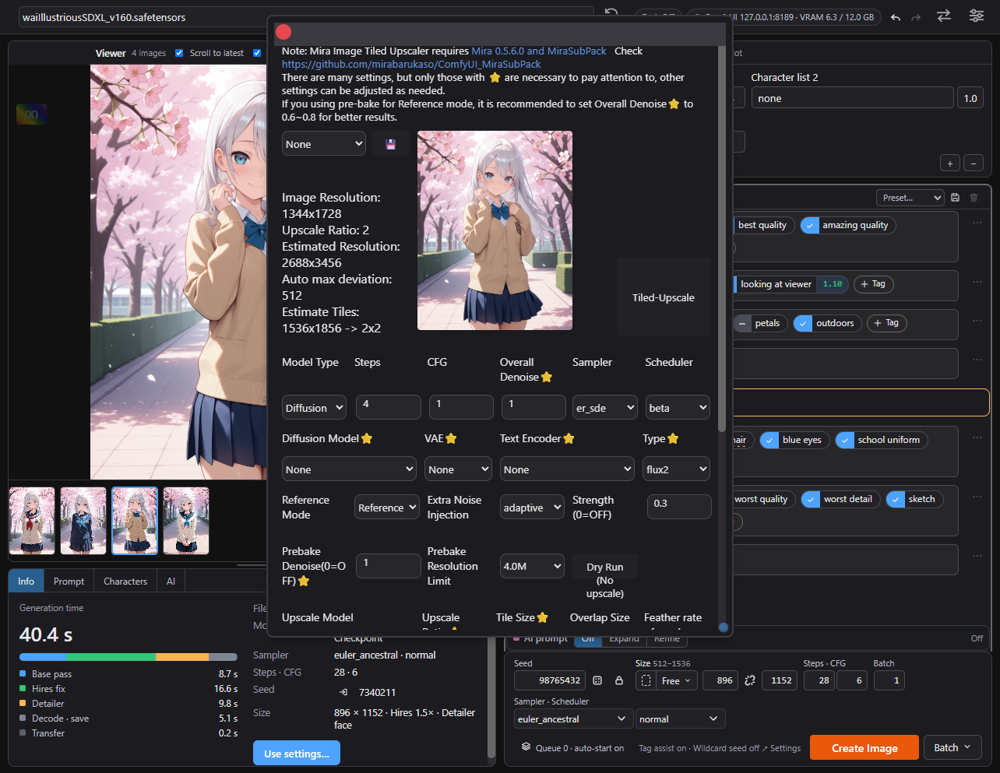   |

生成结果因模型而异。`SDXL` 模型需要 `tagger` 提供更精确的内容描述，并建议使用 `upscale 模型`。像 `Flux2` 这类可以连接 `reference latent` 的模型可以跳过 upscale 模型，直接拉伸原图，然后用 `Positive Prompt` 统一配置所有分块。

| 放大倍率 1024x1360(1536) | Tile Size | VAE 8G | VAE 24G~ |
| --- | --- | --- | --- |
| x1.5 | 768 | Full | Full |
| x2 | 1280 | Full/Tiled | Full |
| x3 | 1536 | Tiled | Full |
| x4 | 2048 | Tiled | Full |
| x6 | 2048/2560 | Tiled | Full |
| x8 | 2560/3072 | Tiled | Full/Tiled |

注：受 SDXL 模型限制，超过 8x 放大时画面切片会过于碎裂。更高倍率建议改用专用的 ComfyUI 工作流。
[ComfyUI Workflow MiraITU](https://github.com/mirabarukaso/ComfyUI_MiraSubPack/blob/main/examples/MiraITU_workflow.png)
</details>

## Image Tagger
支持 ONNX 格式的 [WD@SmilingWolf](https://huggingface.co/SmilingWolf)、[CL@cella110n](https://huggingface.co/cella110n/cl_tagger) 和 [Camie@Camais03](https://huggingface.co/spaces/Camais03/camie-tagger-v2-app) 模型。

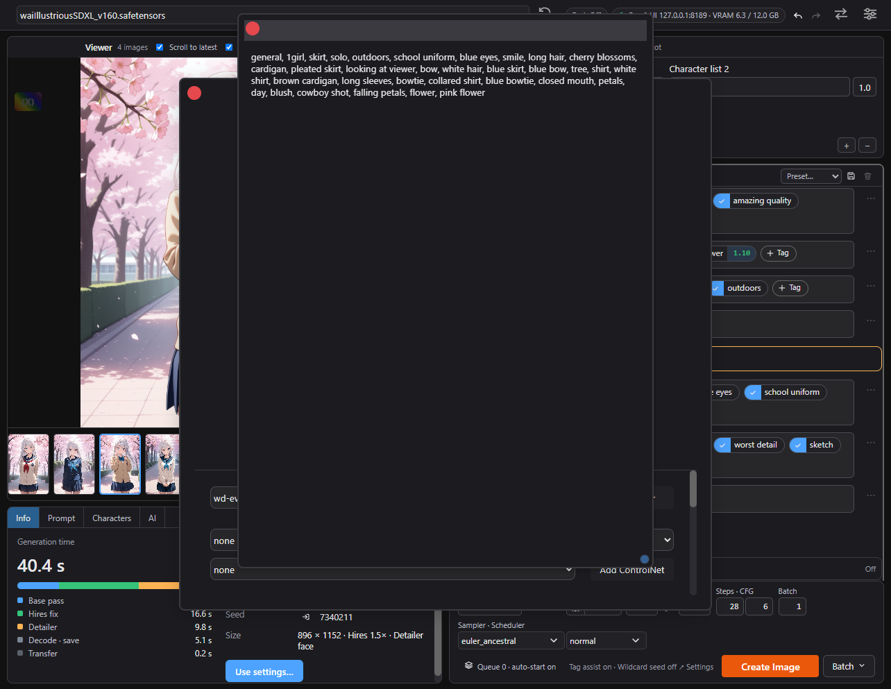

<details>
<summary>Image Tagger 详情</summary>

从 [HF](https://huggingface.co) 下载带标签的模型，按以下规则重命名后复制到 `models/tagger` 文件夹：
  - cl_tagger_v2.onnx + cl_tagger_v2_tag_mapping.json
  - wd-eva02-large-tagger-v3.onnx + wd-eva02-large-tagger-v3_selected_tags.csv
  - wd-v1-4-convnext-tagger.onnx + wd-v1-4-convnext-tagger_selected_tags.csv

```
SAA
|---models
|   |---tagger
|       |---cl_tagger_1_02.onnx
|       |---cl_tagger_1_02_tag_mapping.json
|       |---wd-eva02-large-tagger-v3.onnx
|       |---wd-eva02-large-tagger-v3_selected_tags.csv
|       |---wd-vit-large-tagger-v3.onnx
|       |---wd-vit-large-tagger-v3_selected_tags.csv
|       |---camie-tagger-v2.onnx
|       |---camie-tagger-v2-metadata.json

Options:
Model Name  >>>  General Threshold(CL/WD/Camie)  >>>  Character Threshold(CL/WD)  >>> Categories(CL/Camie) or mCut(WD)
```

Image Tagger 运行在 Node.js 的 `onnxruntime-node` 上。*不需要任何后端支持*，但 GPU 加速似乎不起作用。
打标速度约为 CPU 模式下 `Python` + `onnxruntime` 的 1/3，`onnxruntime-gpu` 的 1/12。
好消息是，生成过程中也可以运行 `Image tagger`。

| Device | Avg Tagging Time | Model | Platform | Resolution | Recommend Value |
| --- | --- | --- | --- | --- | --- |
| onnxruntime | 1.053s | cl_tagger_1_02 | Python | 448 | 0.55/0.60 |
| onnxruntime-gpu | 0.297s | cl_tagger_1_02 | Python | 448 | 0.55/0.60 |
| onnxruntime-node | 3.185s | cl_tagger_1_02 | Electron(NodeJS@CPU) | 448 | 0.55/0.60 |
| onnxruntime-node | 2.917s | wd-eva02-large-tagger-v3 | Electron(NodeJS@CPU) | 448 | 0.35/0.85 |
| onnxruntime-node | 2.113s | camie-tagger-v2 | Electron(NodeJS@CPU) | 512 |  0.50/(NOT USE) |
</details>

## ControlNet / IP Adapter
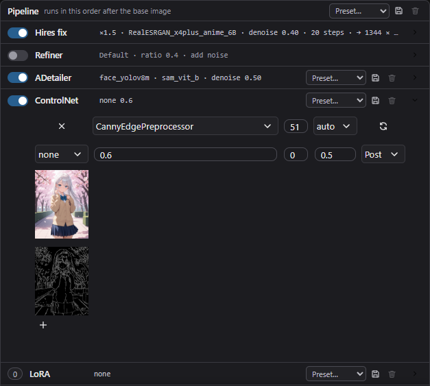

<details>
<summary>ControlNet / IP Adapter 详情</summary>

### ComfyUI
将 [ComfyUI_Mira](https://github.com/mirabarukaso/ComfyUI_Mira) 升级到 `0.5.6.0 或以上`。

`ControlNet` 需要 [comfyui_controlnet_aux](https://github.com/Fannovel16/comfyui_controlnet_aux) 1.1.5 [latest](https://github.com/Fannovel16/comfyui_controlnet_aux/commit/e8b689a513c3e6b63edc44066560ca5919c0576e)
`ControlNet` 模型放在 `ComfyUI\\models\\controlnet`

`IP Adapter` 需要 [comfyui-art-venture](https://github.com/sipherxyz/comfyui-art-venture) 1.1.7 [latest](https://github.com/sipherxyz/comfyui-art-venture/commit/210dc072b1f103f91be18a33bdeb13ab315aaae5) 与 [ComfyUI_IPAdapter_plus](https://github.com/cubiq/ComfyUI_IPAdapter_plus) 2.0.0 [latest](https://github.com/cubiq/ComfyUI_IPAdapter_plus/commit/a0f451a5113cf9becb0847b92884cb10cbdec0ef)
`Clip Vision` 模型放在 `ComfyUI\\models\\clip_vision`
`IP Adapter` 模型放在 `ComfyUI\\models\\ipadapter`
`SDXL/ilXL/NoobXL` 推荐 `CLIP-ViT-bigG-14-laion2B-39B-b160k.safetensors` 搭配 `ipa_styleIpadapterFor_NoobAI-XL_v10.safetensors`，可能还需要 `CLIP-ViT-H-14-laion2B-s32B-b79K.safetensors`。
ComfyUI 只接受第一个 `IP Adapter` 槽位，其他设为 `On` 的槽位会被忽略。

### Forge Neo
ComfyUI 的 `Post` 会把处理后的图像直接送入 ControlNet 模型而无需预处理，接受 `none(null)` 作为 preProcessModel。
Forge 系 ControlNet 不支持 `none(null)`，它接受 `None(String)`。

*Forge Neo：*
  `ControlNet` 与 `IP Adapter` 模型放在 `models\\ControlNet`。
  使用 `None` 并始终 `On`。

### 用法
1. 把图像（或 openPose 图像）拖入 `Image Info`（或点 `Add` 再 `Paste`），选择 `Pre-processor`、`Resolution`、`Post-processor`，然后点 `Add ControlNet`。显示 `Added` 后预览会切换为预处理后的图像；关闭 `Image info`，在 `ControlNet` 标签页查看更多设置。**鼠标悬停在下拉框 / 文本项上可查看说明。**
2. 在 `ControlNet` 标签页可更换 `Pre-processor` 并点 `Refresh` 重新生成预览（或把 `Method` 设为 `On`，此时 SAA 预览不会更新）。
3. 图像太大无法存入设置文件，所以 `ControlNet` 设置在 SAA 关闭时不会保存；切换到其他设置文件也不会覆盖当前的 `ControlNet` 设置。
4. `ControlNet` 在普通与区域条件下都可用。
5. 初次使用 `ControlNet` 建议先试 `Canny` 或 `OpenPose`。
6. ComfyUI 不喜欢重复提交相同数据，提交相同数据可能收到 `Empty response error`。
7. [comfyui-art-venture](https://github.com/sipherxyz/comfyui-art-venture) 需要 `正方形图像`，非正方形输入会有警告。
8. 若 IPA 图像太大，`IP Adapter` 的 `Resolution` 会把输入图缩放到目标尺寸，多数情况下 `1024` 足够。
9. `Pre-Process Model` 选为 `IP Adapter` 时 `Info` 按钮不可用。

所有 `Pre-processor` 模型由 [comfyui_controlnet_aux](https://github.com/Fannovel16/comfyui_controlnet_aux)（ComfyUI）管理，大多从 Hugging Face 下载。
所有 `Post-processor` 模型（即 `Apply ControlNet Model`）需自行从 `ComfyUI Model Manager` 或 Hugging Face 下载。
</details>

## LoRA 槽位
Forge Neo（WebUI）支持其默认的 LoRA 提示词格式 `<lora:xxxxx:1.0>`。
ComfyUI 支持更详细的 LoRA 配置，详见 [LoRA from Text](https://github.com/mirabarukaso/ComfyUI_Mira#lora)。
在 Nishiki 中，LoRA 槽位就是 LoRA 卡片的各行，每个 LoRA 的效果可在标签选择器的 LoRA 标签页中查看，参见 [LoRA 目录与 LoRA 卡片](#lora-目录与-lora-卡片)。

**在 ComfyUI API 中使用 LoRA 需要把 ComfyUI_Mira 更新到 0.5.6.0 或以上。**

## ADetailer
> [!TIP]
> 如果设置太复杂，只需记住调整槽位的最后一个数值（Denoise）。把鼠标移到字段上可看到它的名称。

*ComfyUI*
> [!CAUTION]
> 从未知 / 不可信站点下载任何 .pt 文件前请先核实！
> https://github.com/ltdrdata/ComfyUI-Impact-Pack/issues/843

`ADetailer` 需要 [Impact Pack](https://github.com/ltdrdata/ComfyUI-Impact-Pack) 8.28.3 [latest](https://github.com/ltdrdata/ComfyUI-Impact-Pack/commit/429d0159ad429e64d2b3916e6e7be9c22d025c3c) 与 [Impact Subpack](https://github.com/ltdrdata/ComfyUI-Impact-Subpack) [latest](https://github.com/ltdrdata/ComfyUI-Impact-Subpack/commit/50c7b71a6a224734cc9b21963c6d1926816a97f1)
`ADetailer` 模型放在 `ComfyUI\\models\\ultralytics\\bbox`
`SAM` 模型放在 `ComfyUI\\models\\sams`

*Forge Neo*
`ADetailer` 需要 [ADetailer Neo](https://github.com/Haoming02/ADetailer-Neo) [latest](https://github.com/Haoming02/ADetailer-Neo/commits/main/)
`Upscaler`、`Control Processor`、`ADetailer` 列表需从 API 读取。
默认 ADetailer 模型列表会在首次生成后更新，照常生成一张图即可。
`ADetailer` 模型放在 `sd-webui-forge-neo\\models\\adetailer` 或 `stable-diffusion-webui\\models\\adetailer`

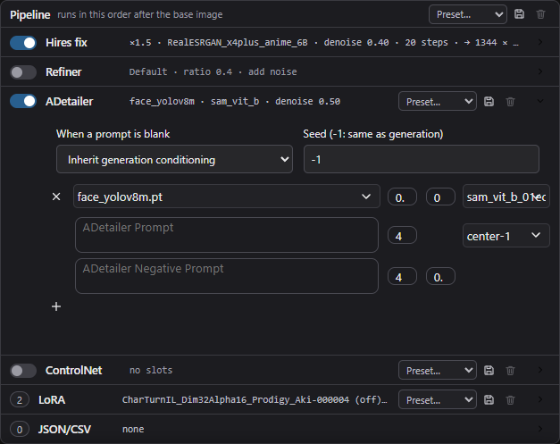

## 队列管理器
可以提交多个各自带有不同参数的生成任务。队列会自动开始处理并移除已完成的任务。
若出现错误，或你关闭 `Auto-start`，队列会在当前任务结束后暂停并保留。
可以 `删除` 或 `查看详情` 队列中的任务。删除第一个任务会取消当前生成。
*建议队列长度不要超过 10,000。*

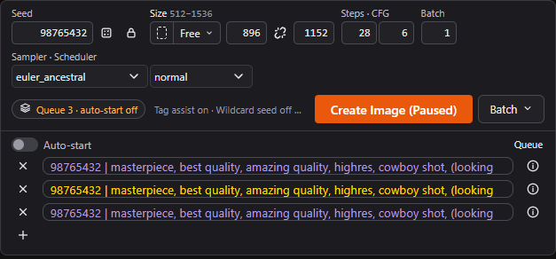

## JSON/CSV 列表
**JSON/CSV 列表不会保存到设置文件中。**
支持 `*.json` 与 `*.csv` 文件，把它们拖入 `Image Info` 窗口（或点 `Add` 再 `Paste`）即可。文件格式请参考 `wai_characters.csv` 和 `wai_tag_assist.json`，可以直接把它们拖进 SAA 试试。
`__Random__` 不受种子约束地从列表中随机选一项，在 `Single` 与 `Batch (Random)` 模式下有效。
`__Enumerate__` 逐一枚举所有条目，仅在 `Batch (Random)` 模式下有效，在 `Single` 模式下退化为 `__Random__`。

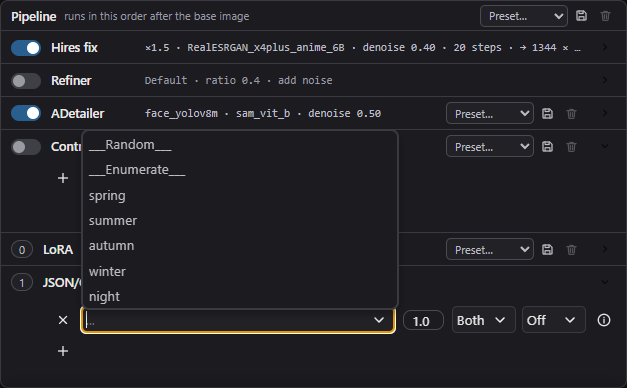

## 通配符
支持 `*.txt` 通配符文件，复制到 `data/wildcards`（打包版为 `resources\app\data\wildcards`）。
默认使用当前种子随机选择通配符。勾选 `wildcard random seed` 后，每次选择都会生成新的随机种子。
**不支持子文件夹。**

通配符标签前后都需要两个下划线 `__`：
```
__YourWildCardName__
```

也可以使用行内写法：
```
{ standing | sitting | on stomach | on back }
{ red | green | blue | blonde } { {long | short} hair | eyes}
```

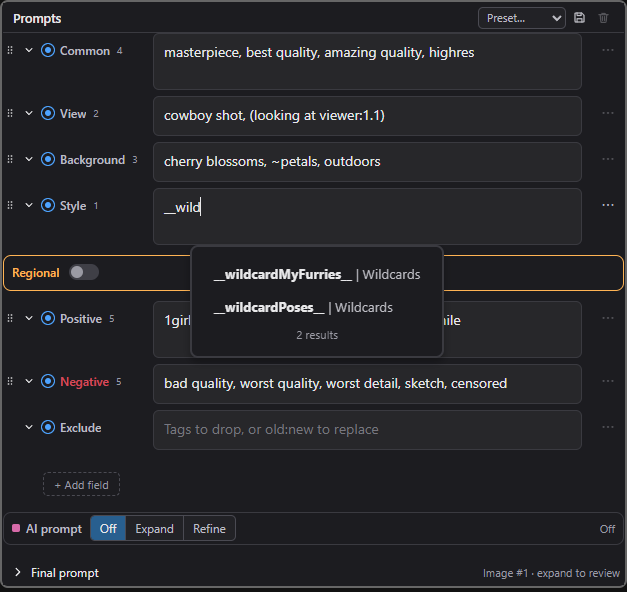

## Regional Condition / Couple
> [!TIP]
> 现已支持 Anima 模型。

三步体验 Regional Condition：
1. 在 Prompts 卡片中打开 `Regional`。
2. 选择列表中的角色或你的 OC。
3. 用 `duo, masterpiece, best quality, amazing quality` 开头写 `common prompt`（别忘了质量词）。

*Forge Neo*
`Regional Condition` 需要 [SD Forge Attention Couple](https://github.com/Haoming02/sd-forge-couple) [latest](https://github.com/Haoming02/sd-forge-couple/commits/main/)

**左右两侧（Nishiki）。** 开启 Regional 后，Prompts 卡片保留共享的行（Common、View、Background、Style、Negative、Exclude），并在其间显示 **LEFT** 与 **RIGHT** 两个区块，每个区块有自己的 Positive、Negative 以及仅属于该区块的行（区块内的 `+ Add field`）。角色所在的一侧在 Characters 卡片的各槽位上设置（L / R / ·），区块会标出它对应的槽位。**Swap** 一步交换左右（提示词、Negative、权重计划、角色、强度），可撤销。`Split Ratio` 移动分界，`Overlap` 加宽共享带。ComfyUI 中左右 Negative 与 Positive 一样按区域遮罩；Forge Neo 会把它们合并为一个 Negative。Regional 也适用于 Diffusion（Anima）。

**Panels。** 打开 `Panels` 开关后，会把分割线标签与各区域遮罩组合成两格分镜构图。默认关闭。

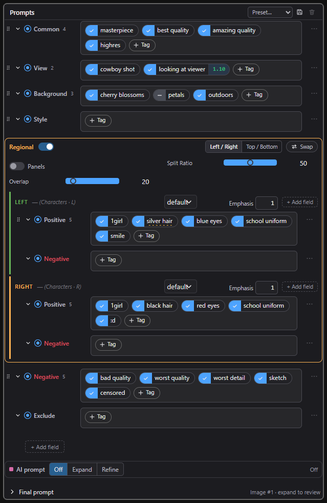

## 半自动标签补全
标签数据来源：[DraconicDragon/dbr-e621-lists-archive/danbooru_e621_merged_2026-04-01_pt20-ia-dd-ed-spc.csv](https://github.com/DraconicDragon/dbr-e621-lists-archive/blob/main/tag-lists/danbooru_e621_merged/README.MD)


<details>
<summary>半自动标签补全详情</summary>
输入前几个字符即可搜索匹配的标签。Nishiki 默认同时匹配标签的开头、中间和结尾；`*tag` 与 `*tag*` 仍可作为显式的结尾 / 中间匹配模式使用。
可用鼠标选择，也可用 `键盘上下键` 配合 `Enter` / `Tab` 选择，按 `Esc` 关闭候选框。
`ctrl + 上` / `ctrl + 下` 调整当前标签或选中片段的权重（与 ComfyUI、WebUI 类似，细节逻辑可能略有不同）。

支持英语、中文和日语标签搜索。
**特别感谢 Kiratian(天痕) 协助翻译中文标签。**

*Anima 等模型的画师搜索*
用 `@` 符号激活，结果按分组 `1` 和 `8` 过滤。
在 `Anima 模型` 中应用 `Artist` 标签需在标签前加 `@`，例如 `mira` → `@mira`。

| Mark | ID | Category | Group |
| --- | --- | --- |  --- |
| `[G]` | 0 | General | Danbooru |
| `[A]` | 1 | Artist | Danbooru |
| `[©]` | 3 | Copyright | Danbooru |
| `[C]` | 4 | Character | Danbooru |
| `[M]` | 5 | Meta | Danbooru |
| `<G>` | 7 | General | E621 |
| `<A>` | 8 | Artist | E621 |
| `<©>` | 10 | Copyright | E621 |
| `<C>` | 11 | Character | E621 |
| `<S>` | 12 | Species | E621 |
| `<M>` | 14 | Meta | E621 |
| `<L>` | 15 | Lore | E621 |
| `Wildcards` | 255 | Wildcards | SAA |
</details>

## Image info
<details>
<summary>把图像拖入 SAA 窗口，支持 Png/Jpeg/Webp。</summary>
适用于 WebUI（Forge Neo 与 A1111）以及 ComfyUI（使用 ComfyUI_Mira 的图像保存节点）。
双击图像关闭。
`Send` 按钮会覆盖 `Common Prompt`、`Negative Prompt`、`Width & Height`、`CFG`、`Step` 和 `Seed`。
如果你有相同的 LoRA，`Common Prompt` 中的 LoRA 也会生效。不想在提示词中使用 LoRA 的话可以试试 `Send LoRA to Slot`。

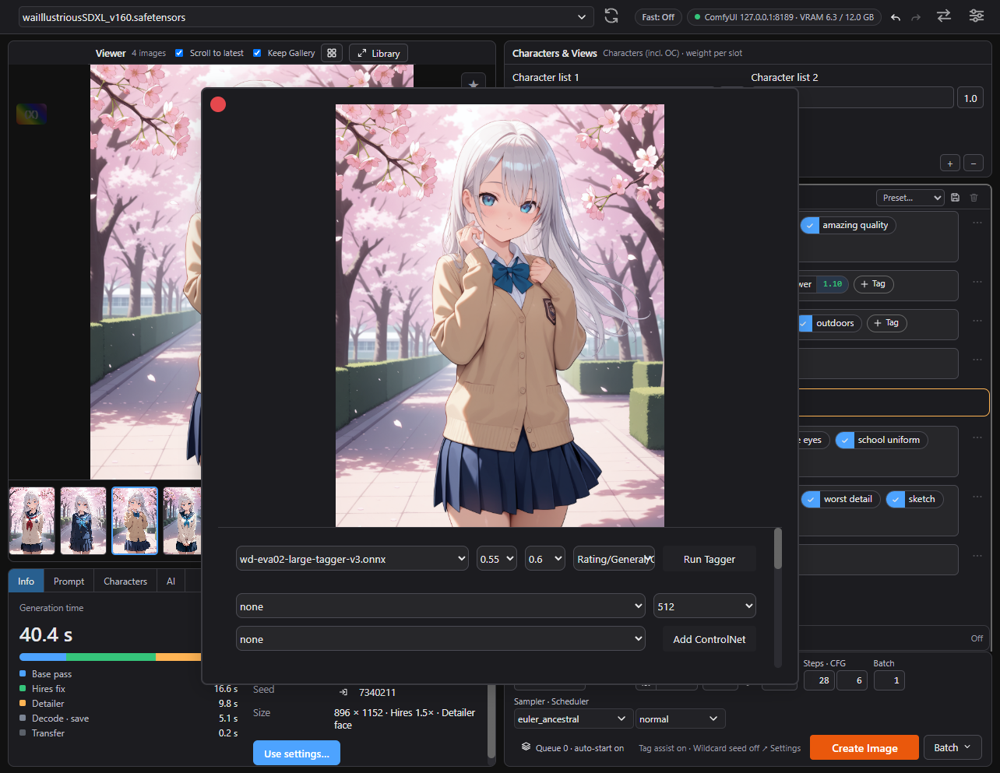
</details>

## 角色列表
### 收藏
角色、原创角色和标签的收藏在选择弹窗中管理：打开弹窗，切换条目上的星标，之后可在顶部的收藏分组中找到它们。收藏的标签在胶囊上会高亮。收藏随设置一起保存。

### 预览与搜索
角色列表支持英文、中文和日文关键字搜索。


## 顶部按钮与右键菜单
顶部栏从左到右：模型、重新加载模型列表、Fast 模式、后端状态（GPU 目标 Local / Pod）、撤销、重做、从右到左、设置。主题切换在 设置 → General，刷新页面在 设置 → Advanced；设置会自动保存。

<details>
<summary>右键菜单</summary>

菜单内容取决于右击的对象：标签块（编辑权重、启用 / 禁用、相关标签、复制、删除、移动 / 复制到其他字段）、提示词字段（复制 / 清空字段、启用 / 禁用全部标签、发送 LoRA 到槽位、移动 / 复制选中内容）、画廊图像（复制图像 / 元数据、移除当前图像、清空画廊）、AI 字段（测试 AI 生成）。

**拼写检查（英语）**
右击带拼写错误（波浪下划线）的单词可查看建议。
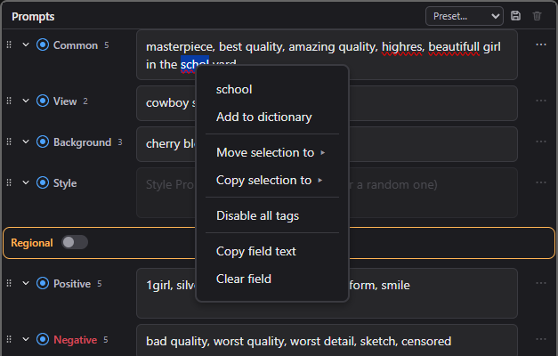

**AI 提示词生成测试**
右击 `AI prompt` 字段可在不生成图像的情况下获取 AI 提示词。结果以弹窗显示；把 AI 规则切换为 `Last` 可在后续生成中沿用该结果。
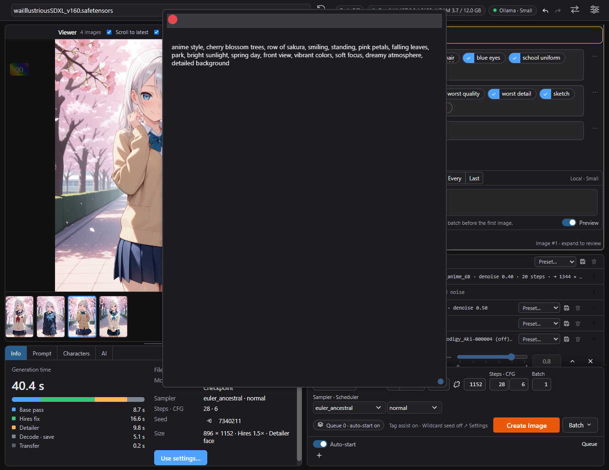

**复制图像 / 元数据**
右击 `Gallery` 可把当前图像或其元数据复制到剪贴板。
使用 Image Saver 节点的 ComfyUI 会输出类 a1111 格式的元数据。
复制图像基于把 base64 转回 PNG，但元数据会被 Chromium 内核裁掉；如需原图，请到 ComfyUI/WebUI 的输出文件夹查找。
SAAC：把图像从浏览器拖到本地文件夹，或使用浏览器右键的 `另存为`。
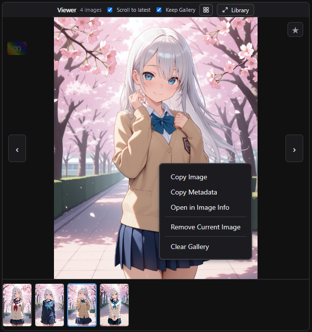

**发送 LoRA 到槽位**
右击 `Common` 或 `Positive` 可把文本形式的 LoRA 发送到 LoRA 槽位。
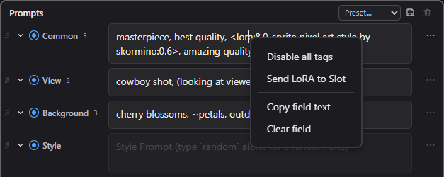
</details>

------
# AI 提示词
远程
1. 按设置向导配置 `Remote AI url`、`Remote AI model` 和 `API Key`。
2. 在 `AI Prompt` 中输入内容，例如 `make character furry, and I want a detailed portrait`。

本地
1. 自行编译 [Llama.cpp](https://github.com/ggml-org/llama.cpp)，或从[可信来源](https://github.com/ggml-org/llama.cpp/releases)下载。
2. 从 [HuggingFace](https://huggingface.co/) 下载模型，推荐 `oh-dcft-v3.1-claude-3-5-sonnet-20241022.Q8_0`（[这里](https://huggingface.co/mradermacher/oh-dcft-v3.1-claude-3-5-sonnet-20241022-GGUF)）之类的 GGUF。
3. 推荐服务器参数：`llama-server.exe -c 16384 --port <your local LLM port> -m "<your GGUF model here>"`
4. 把 `AI Prompt Generator` 设为 `Local`。
5. 把 `Local Llama.cpp server` 设为本地 AI 的地址和端口。
6. （可选）使用其他本地 AI 服务时请检查 API 设置。
7. 在 `AI Prompt` 中输入类似 `make character furry, and I want a detailed portrait` 的内容。

重写（Nishiki）
1. 安装 [Ollama](https://ollama.com/) 并拉取一个模型。
2. 把 AI 模式设为 `重写（Refine）`，填入 Ollama 地址和模型。
3. 照常编写提示词。每个批量的第一张图之前，重写会用一次结构化调用改写整段提示词并应用到编辑器；不满意可用 `Ctrl + Z` 撤销。
4. 若已注册 Runpod Pod，AI 主机可选择 `Pod`。

------
# Image API Interface
*ComfyUI*
> [!IMPORTANT]
> 若工作流无法正确加载，请改用 `2025-05-03-022732_1775747588.json`。

1. 在 ComfyUI 设置中启用 `DEV mode`，并把 `examples\2025-05-03-022732_1775747588.png` 载入 ComfyUI；确认已安装 [ComfyUI_Mira](https://github.com/mirabarukaso/ComfyUI_Mira) **v0.5.6.0 或以上**。
    1.1. 可能需要通过 ComfyUI → Manager → Install PIP packages → opencv-python 安装 `opencv-python`。
2. 把 `Image API Interface` 设为 `ComfyUI`。
3. 确认 `Image Interface IP Address:Port` 与你的 ComfyUI 页面一致。
4. 开始使用。

若 SAA 中预览有问题，在启动 BAT 中加入 `--preview-method latent2rgb`：
```
py ComfyUI\main.py --fast --use-sage-attention --cuda-malloc --windows-standalone-build --listen 0.0.0.0 --port 58188 --preview-method latent2rgb
```

*Forge Neo（WebUI）*
1. 在 `COMMANDLINE_ARGS`（webui-user.bat）中加入 ` --api` 启用 `API mode`。
2. 启动 WebUI。
3. 把 `Image API Interface` 设为 `WebUI`。
4. 确认 `Image Interface IP Address:Port` 与你的 WebUI 页面一致。
5. 开始使用。

## 第三方混合后端的自定义路径
> [!WARNING]
> 启用自定义路径会覆盖你的模型路径设置。
> 不建议在官方 WebUI（Forge Neo/A1111）和 ComfyUI 上使用。

编辑 `data/custom_path.yaml` 启用自定义路径：
1. 把 `use_custom_path` 设为 `true`。
2. 把 `enable` 设为 `false` 可禁用整个分类。
3. 注释掉不需要覆盖的单个自定义路径。
4. 路径列表支持单行字符串与多行字符串。
5. 支持绝对路径与相对路径（相对于 base_path）。

[#92 在 Stability Matrix 中使用 ComfyUI 时的自定义路径设置](https://github.com/mirabarukaso/character_select_stand_alone_app/issues/92)

## 远程使用时的文件夹路径问题
SAA 需要搜索 ComfyUI/WebUI 的 checkpoints 文件夹来获取模型、LoRA 等条目。若后端地址为远程（非 127.0.0.1），文件夹搜索会失败，SAA 会以 `Default` 模式运行。该模式下无法更换模型或通过槽位设置 LoRA。
两种解决办法：
1. `镜像文件夹` —— 把远程 `models` 文件夹复制到本地，然后让 SAA 使用本地文件夹。简单，但需要额外空间。
2. `符号链接或共享文件夹` —— 创建符号链接，或把远程 `models` 文件夹设为共享（建议只读），然后让 SAA 使用该文件夹。

## 高级安全设置（API 认证）
> [!WARNING]
> *不要把任何未加保护的本地端口转发到公网。*
> *仅限 WebUI（Forge Neo）。在 ComfyUI 提供正规且安全的方式之前，不要把 ComfyUI API 转发到公网。*

更多 WebUI（Forge Neo）命令行参数见 [Command-Line-Arguments-and-Settings](https://github.com/AUTOMATIC1111/stable-diffusion-webui/wiki/Command-Line-Arguments-and-Settings)。

把 `webui-user.bat` 复制为 `webui-user-api.bat`，然后按以下参数编辑。
把 `user:pass` 替换为你的 `用户名:密码`。
`--api` `--api-auth` 启用 API 与 API 认证。
`--nowebui` 表示不需要浏览器界面。
`--port 58189` 把 API 端口设为 `58189`。
```
set COMMANDLINE_ARGS= --xformers --no-half-vae --api --api-auth user:pass --nowebui --port 58189
```
用新的 `webui-user-api.bat` 启动 Forge Neo。
把 `用户名:密码` 粘贴到 SAA → Settings → `WebUI API Auth`，然后把 `Enable` 设为 `ON`。

------
# Hires Fix 与 Image Color Transfer
Image Color Transfer 详情见 [Image Color Transfer](https://github.com/mirabarukaso/ComfyUI_Mira#image-color-transfer)。
*由于缺少生成规则且没有 openCV，WebUI 不再支持 Color transfer。*

确保所有放大模型位于 `upscale_models` 文件夹。

ComfyUI 注意事项：
需自行下载放大模型：`Manager` → `Model Manager`，用 `upscale` 过滤。

WebUI（Forge Neo/A1111）放大器注意事项：
WebUI 使用基于名称的放大模型列表。`静态放大器列表` 可用，并会在首次生成后更新为 API 列表。

Forge 使用基于文件的放大模型列表，比较混乱：
  **重要：如果 upscale_models 文件夹不存在，SAA 会使用静态放大器列表。**
  **不确定的话，生成一次即可，HiFix 模型列表会正确更新。**
  解决办法：
  1. 在 `models` 中创建 `upscale_models` 文件夹，把所有放大模型放进去。
  2. 以放大模型文件夹名（例如 `ESRGAN`）创建指向 `upscale_models` 的符号链接。
  3. 重启 Forge。`Hires Fix` 模型现在应该可用，并在首次生成后更新为 API 列表。

------
# 中文翻译与角色验证
衷心感谢以下无私奉献、付出宝贵时间提供中文翻译与角色数据验证的朋友（排名不分先后）：
**Silence, 燦夜, 镜流の粉丝, 樱小路朝日, 满开之萤, 以及两位不愿具名的朋友。**

# 角色列表特别感谢
lanner0403 [WAI-NSFW-illustrious-character-select](https://github.com/lanner0403/WAI-NSFW-illustrious-character-select)
Cell1310  [Illustrious XL (v0.1) Recognized Characters List](https://civitai.com/articles/10242/illustrious-xl-v01-recognized-characters-list)
mobedoor [#23](https://github.com/mirabarukaso/character_select_stand_alone_app/issues/23)
UdinXProgrammer [#62](https://github.com/mirabarukaso/character_select_stand_alone_app/issues/62)
Nurimtod [#75](https://github.com/mirabarukaso/character_select_stand_alone_app/issues/75) [#83](https://github.com/mirabarukaso/character_select_stand_alone_app/issues/83)
atmogenic [#84](https://github.com/mirabarukaso/character_select_stand_alone_app/issues/84) [#85](https://github.com/mirabarukaso/character_select_stand_alone_app/issues/85)
funnygeeker [#87](https://github.com/mirabarukaso/character_select_stand_alone_app/issues/87)

------
# FAQ
双击 `saa.exe` 没有反应？
1. 可能是文件下载失败或文件缺失。
2. 在控制台中运行：在资源管理器地址栏输入 `cmd` 打开控制台。
3. 输入 `saa` 回车，查看后端日志。

设置向导搞砸了……
1. 关闭应用。
2. 删除 `settings`（打包版为 `resources/app/settings`）中的 `app.json`。
3. 再试一次。

ERR_CONNECTION_REFUSED
1. 多数情况下是（ComfyUI/WebUI）后端 API 地址填错了。

有浏览器版的 SAA 吗？
1. 有。
2. 详见 `高级安全设置（API 认证）`。

Error HTTP 400 ...... Cannot execute because node StepAndCfg does not exist ......
1. 安装 `ComfyUI_Mira`。
2. 重启 ComfyUI。

放大模型列表为 `None`（ComfyUI）
1. 是否修改过默认目录配置？
2. 是否为非官方版本？
3. 查看 [#58](https://github.com/mirabarukaso/character_select_stand_alone_app/issues/58)

ComfyUI/WebUI is busy, cannot run new generation, please try again later.
参见 [README_SAAC.md](README_SAAC.md) 中的第 5、6 条。

我的设置和预设在哪里？
1. `settings/app.json`、`settings/state.json`、`settings/presets/`、`settings/user_lists.json`，以及旁边的 Parts、LoRA 目录和 Library 文件。参见[设置存储](#设置存储)。
2. Nishiki 之前的 `settings/*.json` 会在首次启动时移到 `settings/legacy/`。
